# AgentSphere 4A 架构

> 4A = **业务架构（Business）/ 应用架构（Application）/ 技术架构（Technology）/ 数据架构（Data）**
>
> 代码基线：`main @ b22fbae`（2026-10-27）　｜　文档日期：2026-10-28
>
> 图表使用 Mermaid，GitHub / GitLab / VS Code(插件) / IntelliJ(Mermaid 插件) 均可直接渲染。

## 目录

- [0. 一句话定位](#0-一句话定位)
- [1. 业务架构](#1-业务架构)
  - [1.1 业务定位](#11-业务定位)
  - [1.2 参与者与角色](#12-参与者与角色)
  - [1.3 业务能力地图](#13-业务能力地图)
  - [1.4 核心业务流程](#14-核心业务流程)
  - [1.5 业务规则](#15-业务规则)
  - [1.6 业务边界（非目标）](#16-业务边界非目标)
- [2. 应用架构](#2-应用架构)
  - [2.1 应用全景](#21-应用全景)
  - [2.2 后端模块与依赖](#22-后端模块与依赖)
  - [2.3 应用服务清单](#23-应用服务清单)
  - [2.4 关键应用组件](#24-关键应用组件)
  - [2.5 调用图](#25-调用图)
  - [2.6 集成关系](#26-集成关系)
- [3. 技术架构](#3-技术架构)
  - [3.1 技术栈](#31-技术栈)
  - [3.2 部署拓扑](#32-部署拓扑)
  - [3.3 关键机制](#33-关键机制)
  - [3.4 关键技术决策](#34-关键技术决策)
  - [3.5 可观测性](#35-可观测性)
  - [3.6 交付流水线](#36-交付流水线)
  - [3.7 技术债与风险](#37-技术债与风险)
- [4. 数据架构](#4-数据架构)
  - [4.1 存储分工](#41-存储分工)
  - [4.2 数据分域](#42-数据分域)
  - [4.3 ER 图](#43-er-图)
  - [4.4 数据流](#44-数据流)
  - [4.5 数据治理](#45-数据治理)
- [5. 4A 对照矩阵](#5-4a-对照矩阵)

---

## 0. 一句话定位

> 把「LLM + 工具 + 浏览器 + 记忆 + 模型路由」封装成**可配置的 Agent 实例**，通过四个入口对外提供**会话式**（人机对话）与**任务式**（系统对系统）两种交付形态。

与其他 Agent 产品的关键差异：**不是一个 Agent，而是一个 Agent 托管平台**——实例是配置单元、能力是供给单元、模型是路由单元，三者互相解耦。

---

## 1. 业务架构

### 1.1 业务定位

| 维度 | 内容 |
|---|---|
| 服务对象 | 平台管理员 / 运营开发者 / 终端用户 / 外部业务系统 |
| 核心价值 | 让业务方**不写代码**就能获得一个能干活的 Agent：会查资料、会调接口、会操作网页、会产出结构化结果 |
| 交付形态 | ① 会话式（Web / 嵌入 Widget）② 任务式（OpenAPI 提交 + 回调）③ 能力式（单次 LLM 补全） |
| 差异化 | 实例级配置（提示词/模型路由/能力/记忆/入口开关）、浏览器实操、技能可安装可同步、多供应商故障转移 |

### 1.2 参与者与角色

| 角色 | 主要入口 | 关注点 |
|---|---|---|
| 平台管理员 | Web 控制台 `/admin/**` | 用户/角色/权限、身份源、审计、系统配置 |
| 运营 / 开发者 | Web 控制台 | 配实例、接 MCP、写技能、调模型路由 |
| 终端用户 | Web 控制台 `/chat`、嵌入 Widget | 提需求、回答澄清、看执行过程 |
| 外部业务系统 | `/api/v1/api/*` | 提交任务、拿结构化产物、单次补全 |
| 无头浏览器 | Chrome 扩展 | 被 Agent 驱动操作真实网页 |

### 1.3 业务能力地图

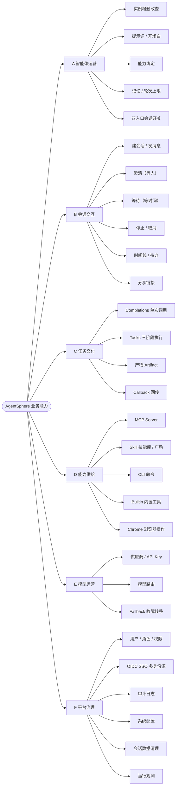

### 1.4 核心业务流程

#### ① 会话链路（人在环）

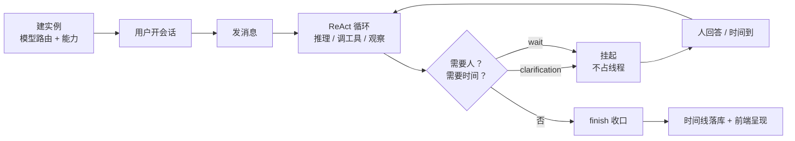

#### ② 任务链路（系统对系统，三阶段）

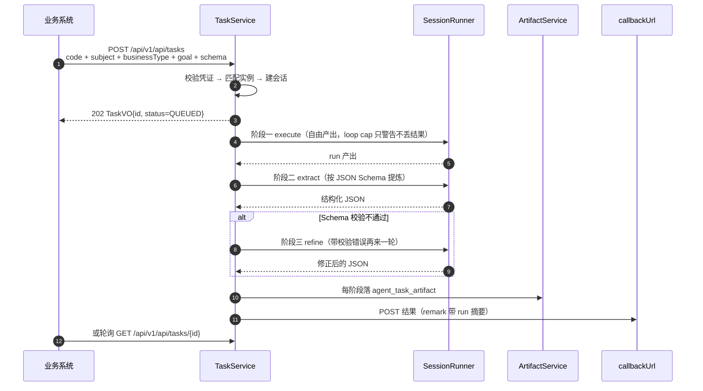

#### ③ 能力链路（供给 → 消费）

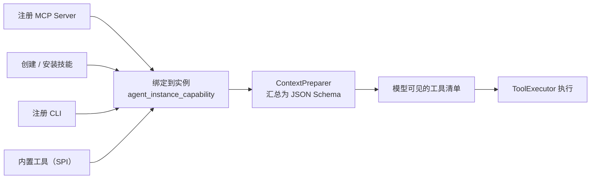

### 1.5 业务规则

| 规则 | 为什么是这样 |
|---|---|
| 实例按**入口**分别开关：`allow_console_session` / `allow_widget_session`（默认 false） | 主站与 Widget 调同一套接口、同一枚令牌，只能靠 `X-Client-Surface` 区分；第三态 `INTERNAL`（任务路径）必须放行 |
| 技能正文必须是 `# H1 + ## stepN + ### stepN.M` | 步骤编号是待办条目回查正文的锚点，格式一乱就无法按步骤取内容 |
| 技能广场只展示 `visibility=PUBLIC AND created_by IS NOT NULL` | 行级数据权限默认按 `created_by` 过滤，必须显式放开才是"广场" |
| 任务超时 = `max(调用方传值, 服务端下限)` | 线上 155/158 个任务硬编码 3600s，只有服务端兜底能真正抬高 |
| `finish` 是 agentic run 唯一合法收口，纯聊天实例不下发 | 否则模型用三句话冒充交付，静默失败 |
| 只有最后一轮才注入"禁止再调工具" | 提前几轮就禁会把活截成半成品 |

### 1.6 业务边界（非目标）

- **不做通用工作流编排器**：编排发生在单个 Agent 的 ReAct 循环内，不是可视化 DAG 设计器。
- **不做模型训练/微调**：只做推理侧的路由与适配。
- **不做多租户 SaaS 计费**：`tenant_id` 已预留，但无计费/配额模块。
- **定时任务**：`/periodic-tasks` 前端目前是占位页，能力未落地。

---

## 2. 应用架构

### 2.1 应用全景

四个可部署单元 + 两个中间件：

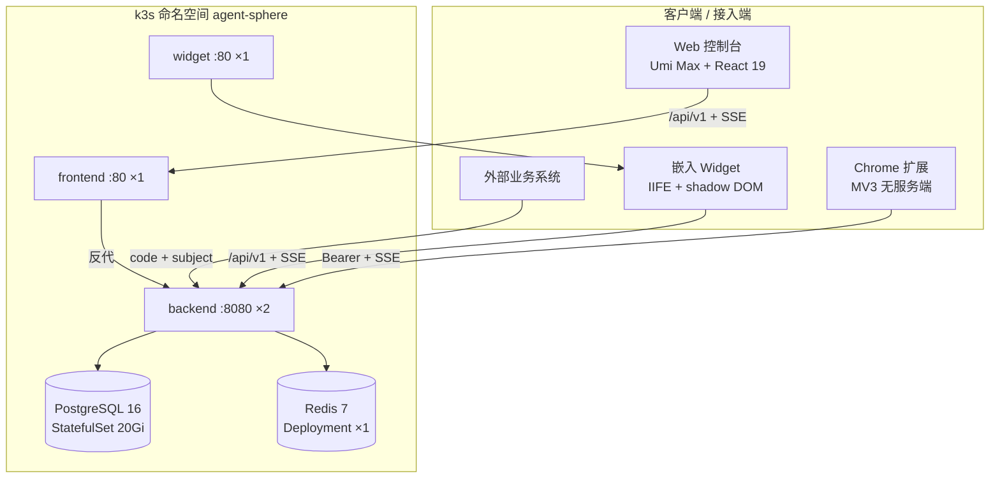

### 2.2 后端模块与依赖

13 个 Maven 模块。业务域统一按 **7 层子模块**切分：`domain → exception → dtvo → spi → repository → service → controller`。

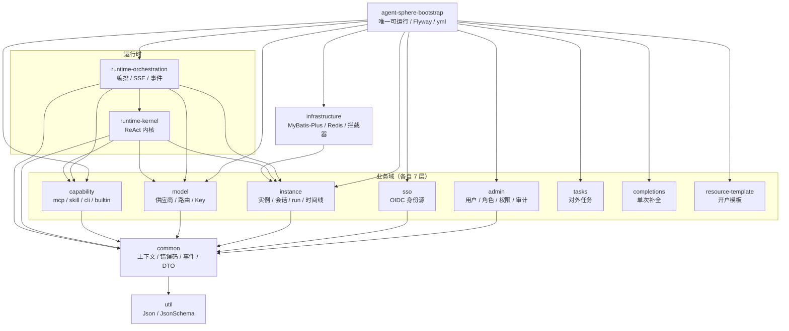

**依赖纪律（改代码必须守）**

- `controller → service → repository → spi → domain`，**Controller 只依赖 `*-spi` 契约**，不依赖实现。
- **kernel 不能反向依赖 orchestration**（否则成环）。kernel 需要触发编排动作时，只发 Spring 本地事件。
- `infrastructure` 已依赖 `instance-service`，所以 instance 不得反向依赖 infrastructure（清理 SQL 因此写成裸 mapper）。

### 2.3 应用服务清单

| 域 | REST 前缀 | 控制器 |
|---|---|---|
| 认证 | `/api/v1/auth`、`/api/v1/auth/sso` | `AuthController`、`SsoAuthController`、`SsoIdentityController` |
| 实例 | `/api/v1/instance/**` | `InstanceController`、`InstanceCapabilityController`、`SessionController`、`SessionTimelineController`、`SessionTodoController`、`RunController`、`RunActivityController`、`MemoryController`、`LlmInteractionController`、`SessionCleanupController`、`SubAgentRunController` |
| 运行时 | `/api/v1/runtime`、`/api/v1/chrome` | `ChatRuntimeController`、`SseRuntimeController`、`ChromeCallbackController` |
| 模型 | `/api/v1/model/**` | `ModelProviderController`、`RouteController`、`ApiKeyController` |
| 能力 | `/api/v1/capability/**` | `CapabilityMcpController`、`CapabilitySkillController`、`CapabilityCliController`、`BuiltinToolController` |
| 任务 | `/api/v1/api/tasks`、`/api/v1/admin/tasks` | `TaskController`、`AdminTasksController`、`AdminTaskArtifactController` |
| 补全 | `/api/v1/api/completions` | `CompletionsController`、`AdminCompletionsController` |
| 治理 | `/api/v1/admin/**`、`/api/v1/system/config` | `AdminUserController`、`RoleController`、`PermissionController`、`IdentityProviderAdminController`、`AuditLogController`、`SystemConfigController` |
| 内容 | `/api/v1/files`、`/api/v1/artifacts/documents`、`/api/v1/browser` | `FileController`、`DocumentController`、`BrowserScreenshotController` |

### 2.4 关键应用组件

| 分层 | 组件 | 一句话职责 |
|---|---|---|
| 编排 | `ChatRuntimeService` / `RuntimeOrchestrator` | 建 run、提交异步、驱动内核 |
| 编排 | `ContextPreparer` / `KernelContextAssembler` | 每次 run 前装配历史、记忆、工具、提示词 |
| 编排 | `SseManager` / `SseEventRelay` / `SseEventCache` | 按会话广播，支持 `afterSeq` 断线补拉 |
| 编排 | `TimelineRecorder` / `RuntimeEventListener` | 事件 → 时间线 / 终态的**唯一收口** |
| 编排 | `PendingWaitWakeScheduler` / `WaitingRunReconciler` | 挂起恢复的主路径与对账兜底 |
| 内核 | `SessionRunner` / `SessionRunCoordinator` | ReAct 主循环、取消、超时、轮次护栏 |
| 内核 | `KernelLlmService` + `ProviderStrategy` + `FallbackRouteExecutor` | 流式调用、厂商适配、故障转移 |
| 内核 | `ToolExecutor` + `FiberSet` | 工具统一分发、并发执行、超时盒子 |
| 内核 | `HistoryLoader` / `CompactionService` / `ToolResultCompressor` | 上下文水位控制 |
| 内核 | `DelegateService` / `SessionSubRunner` | 子 Agent 委派（DAG） |
| 能力 | `CapabilityMcpSpi` / `CapabilitySkillSpi` / `CapabilityCliSpi` / `CapabilityBuiltinToolSpi` | 四类能力的统一插槽 |

### 2.5 调用图

#### 2.5.1 组件调用关系（静态）

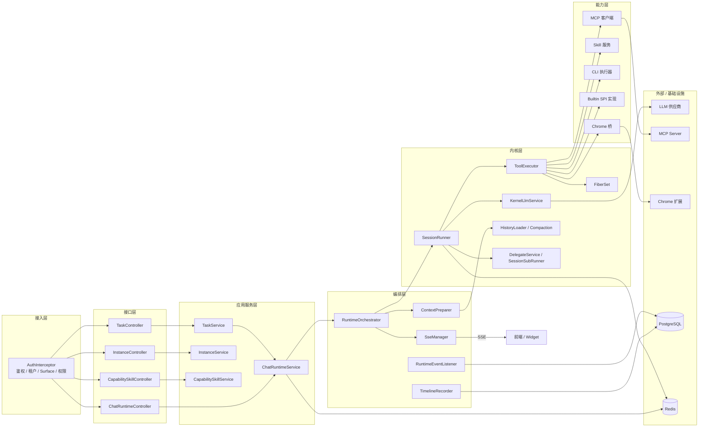

#### 2.5.2 一次 `chat` 的调用时序（动态）

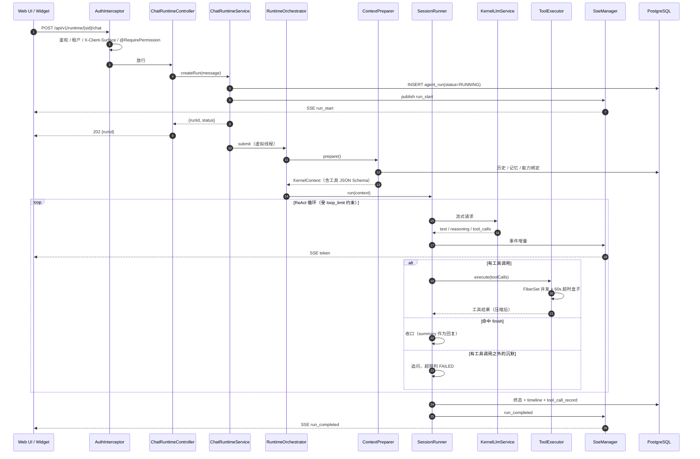

### 2.6 集成关系

| 方向 | 对象 | 协议 / 凭证 |
|---|---|---|
| 入站 | Web / Widget / 扩展 | REST + SSE（`/stream`），Bearer Token |
| 入站 | 外部业务系统 | `code + subject + businessType`，免 Bearer |
| 入站 | Chrome 扩展 | 扩展长连 `/runtime/user/task/stream` + `/api/v1/chrome` 回调 |
| 出站 | LLM 供应商 | OpenAI 兼容流式 + 厂商策略适配 |
| 出站 | MCP Server | Model Context Protocol（Streamable HTTP） |
| 出站 | 身份源 IdP | OIDC 授权码 + PKCE(S256) + nonce + JWKS 验签 |
| 出站 | 业务方回调 | `callbackUrl` POST |

---

## 3. 技术架构

### 3.1 技术栈

| 层次 | 选型 | 版本 |
|---|---|---|
| 语言 / 运行时 | Java + Spring Boot + 虚拟线程 | Java 21 / Boot 3.4.3 |
| 持久化 | PostgreSQL + MyBatis-Plus + Flyway | PG 16 / MP 3.5.9 / 91 个迁移 |
| 缓存与协调 | Redis + Redisson（**禁止** Spring Data Redis） | Redis 7 / Redisson 3.40.2 |
| 弹性与缓存 | Resilience4j、Caffeine | 2.3.0 / 3.2.0 |
| 工具与 Schema | MCP、victools、swagger-core、hutool | 4.38.0 / 2.2.28 / 5.8.34 |
| 实时通道 | SSE（按会话 emitter + 心跳 + 事件缓存补拉） | — |
| 前端 | React + UmiJS Max + Ant Design | React 19 / antd 6 |
| 前端工程 | Biome、Tailwind v4、Jest | — |
| Widget | Vite lib 模式 + IIFE + shadow DOM | Vite 6 |
| 扩展 | Manifest V3、原生 ESM、`chrome.debugger`（仅 `cdp-client.js`） | — |
| 部署 | k3s + Ingress + Fleet(GitOps) | — |

### 3.2 部署拓扑

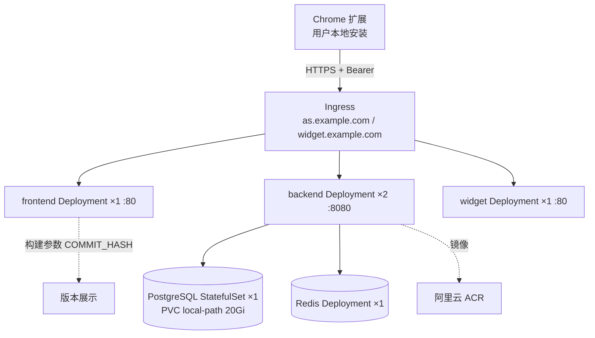

要点：

- **backend 2 副本、无会话粘性**，因此所有运行时状态必须落库；SSE 断线靠 `afterSeq` 从 `agent_timeline` 补拉。
- **中间件单点**：PG/Redis 都是单实例，`local-path` 存储不支持跨节点漂移。
- 中间件镜像已镜像化到 ACR（线上拉不到 Docker Hub）。

### 3.3 关键机制

| 机制 | 实现 | 解决什么 |
|---|---|---|
| 异步 run | 请求线程只建 run 后立即返回 `{runId}`，执行在虚拟线程 | 长任务不占 Tomcat 线程 |
| 单写者 | 一个 run 只由其创建副本的循环写 | 免分布式状态机 |
| 挂起 - 恢复 | `agent_pending_wait` + 内存定时器（主）+ cron 扫描（补偿）+ 单条 CAS UPDATE | 不占线程、重启不丢、并发只恢复一次 |
| 多副本协调 | Redisson 锁：`session-cleanup` / `skill-auto-update` / `pending-wait` | 2 副本不重复执行 |
| 租户上下文 | `InheritableThreadLocal`，后台线程入口强制 `stop()` + `AuthContext.clear()` | 防串租户（曾致 wait 卡 15 分钟） |
| 事件解耦 | Spring 本地事件（kernel 不能反向依赖 orchestration） | 破循环依赖 |
| 模型容错 | `ProviderStrategy` 适配 + 路由 Fallback + 指数退避重试 | 供应商突发抖动不整批挂 |
| 流式一致性 | SSE 增量 + timeline 落库 + `afterSeq` 补拉 | 断线 / 多端一致 |
| 上下文水位 | HistoryLoader + Compaction + 工具结果压缩 | 防爆窗 |

### 3.4 关键技术决策

| 问题 | 决策 | 代价 |
|---|---|---|
| 工具必须 60s 内返回，但业务要等几分钟 | `wait` 挂起而非 sleep，等待发生在超时盒子之外 | 两条唤醒路径 + 全链路状态机维护 |
| 「没调工具」= 完成还是放弃 | 三分支判据 + `finish` 工具 + `finish_reason` 透传 | 模型需学会调 `finish` |
| 轮次预算在 5 个重入入口会漂移 | `loop_count` 与 `loop_limit` 同时持久化，`PINNED` 优先级最高 | 多一列、多一次幂等写 |
| 上下文爆窗 | 分层压缩 + 历史重建 | 压缩本身消耗 token |
| 硬删 vs 逻辑删 | 清理任务唯一允许硬删，且按外键顺序 | 顺序写死在 mapper，不能重排 |
| 2 副本 + 无粘性 | 状态全落库，SSE 靠补拉 | 实时性略降 |
| 供应商参数宽容度不同 | 策略模式按 `company` 选，不做模型名兜底 | 每个厂商一份实现 |

### 3.5 可观测性

四层证据链，缺一不可：

| 层 | 载体 | 用途 |
|---|---|---|
| 请求级 | `TraceIdFilter` + `ControllerLogAspect` | 串联一次 HTTP 调用 |
| 用户级 | `agent_timeline` | 用户可见的执行轨迹，SSE 补拉数据源 |
| 模型级 | `agent_llm_interaction_record` | 原始请求/响应/推理；**排查要点**：`prompt_tokens IS NULL AND duration_ms < 1000` = 供应商秒回错误 |
| 审计级 | `sys_audit_log` + `*_run` 记录表 | 管理动作与后台任务留痕 |

日志分级：`com.buukle` = DEBUG；`*.repository` 与 `com.buukle.agent.capability` = WARN（因此能力模块的 info 日志需在 `logback-spring.xml` 中单独放开）。

### 3.6 交付流水线

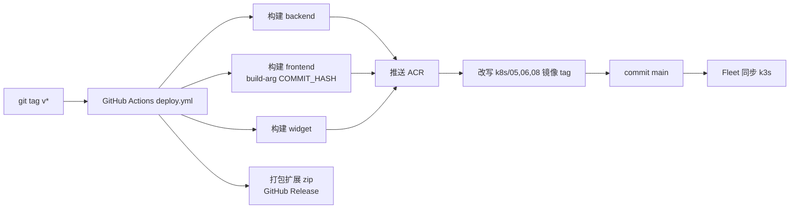

本地等价：`.local-workflow/deploy.sh`（buildx + `type=local` 缓存，支持 `--dry-run` / `--skip-existing` / `--only`）。

### 3.7 技术债与风险

| 项 | 影响 |
|---|---|
| **无测试 CI** | 只有本地 `mvn test` / `biome` / `jest`，回归靠自觉 |
| PG 单实例 20Gi `local-path` | 无高可用；数据量增长靠清理任务控盘 |
| SSE 事件缓存在进程内 | 跨副本补拉只能走 DB |
| `agent_llm_interaction_record` 体量最大 | 清理任务硬删 + 需手工 `VACUUM FULL` 才回落磁盘 |
| 文档与实现漂移 | `agent-sphere/AGENTS.md` 仍提 langgraph4j，pom 中已无该依赖 |
| 定时任务能力未落地 | `/periodic-tasks` 为占位页 |
| 扩展 / Widget 与后端版本无强绑定 | 发版顺序需人工保证 |

---

## 4. 数据架构

### 4.1 存储分工

| 存储 | 放什么 | 为什么 |
|---|---|---|
| PostgreSQL | 38 张业务表、时间线、原始 LLM 交互 | 强一致 + `jsonb` + 行级权限 |
| Redis（Redisson） | 缓存、分布式锁、限流、部分运行态 | 2 副本共享；**必须**走 Redisson |
| 文件存储 | `agent_file_store` / 文档 / 产物 / 截图 `fileKey` | 大对象不落库 |
| 浏览器 `sessionStorage` | Widget 令牌 | 跨站嵌入不共享 Cookie |

### 4.2 数据分域

| 域 | 张数 | 表 |
|---|---:|---|
| 智能体配置 | 2 | `agent_instance`、`agent_instance_capability` |
| 会话运行 | 9 | `agent_session`、`agent_run`、`agent_sub_agent_run`、`agent_timeline`、`agent_tool_call_record`、`agent_session_todo`、`agent_pending_clarification`、`agent_pending_wait`、`agent_user_in_loop_record` |
| 模型与记忆 | 6 | `agent_model_provider`、`agent_model_route`、`agent_api_key`、`agent_llm_interaction_record`、`agent_compact_record`、`agent_memory` |
| 能力供给 | 4 | `capability_mcp`、`capability_skill`、`capability_skill_sync_run`、`capability_cli` |
| 任务与补全 | 5 | `agent_task`、`agent_task_artifact`、`agent_completions`、`agent_completions_call`、`agent_completions_prompt` |
| 平台治理 | 10 | `agent_user`、`agent_sso_identity`、`agent_identity_provider`、`sys_role`、`sys_permission`、`sys_role_permission`、`sys_user_role`、`sys_audit_log`、`agent_system_config`、`agent_session_cleanup_run` |
| 内容 | 2 | `agent_file_store`、`agent_document` |

### 4.3 ER 图

> 说明：库中**只有两条物理外键**（`agent_run.session_id → agent_session`、`agent_task_artifact.task_id → agent_task`）。
> 其余连线都是**逻辑关联**（靠 `*_id` 列 + 应用层保证），因此删除顺序必须由代码控制。

#### 4.3.1 会话运行域（核心）

#### 4.3.2 模型与任务域

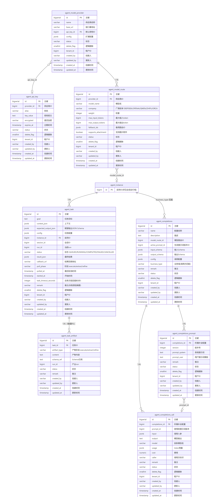

#### 4.3.3 身份与能力域

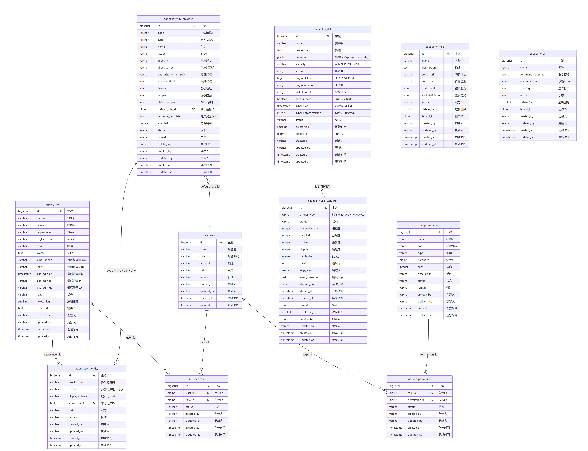

#### 4.3.4 治理与内容域

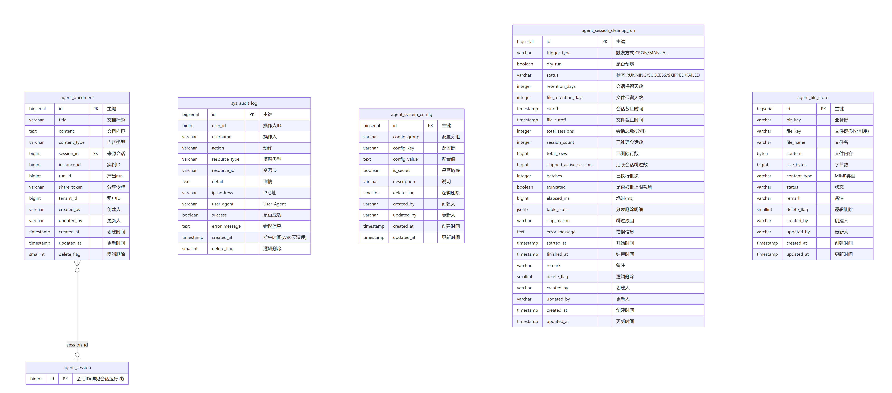

**图例说明**

- 图上每列是 `类型 字段名 PK/FK 中文注释`，与 Flyway 迁移**逐列对应**，四张图合计覆盖全部 **38 张表**。
- `||--o{` 一对多；`}o--o|` 多对零或一；连线上的文字是关联条件。
- `capability_mcp` / `capability_cli` 通过 `agent_instance_capability(capability_type, capability_id)` **多态绑定**，没有外键，所以不连线。
- `sys_*` 是平台治理表，与业务表仅靠 `created_by`（字符串）弱关联。
- 4.3.2 / 4.3.4 里的 `agent_instance`、`agent_session` 是**占位节点**（只画 `id`），完整字段见 4.3.1。

> 图源是仓库里的 Mermaid 文件，改字段后重新出图即可（`erDiagram`，边标签均为纯文本，可直接在 GitHub 渲染）：
> [er-1-session-run.mmd](agent-sphere-readme/er-1-session-run.mmd) · [er-2-model-task.mmd](agent-sphere-readme/er-2-model-task.mmd) · [er-3-identity-capability.mmd](agent-sphere-readme/er-3-identity-capability.mmd) · [er-4-governance.mmd](agent-sphere-readme/er-4-governance.mmd)

### 4.4 数据流

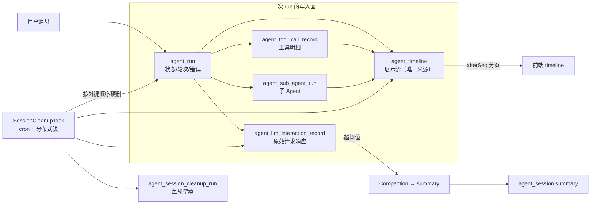

**关键特征**

1. **一次 run 写多张表**：`run`（状态）、`timeline`（展示）、`tool_call_record`（明细）、`llm_interaction_record`（原始）。
2. **时间线双源合并**：SSE 增量 + `beforeSeq/afterSeq` 分页拉取，前端按 `seq` 去重（子 Agent 占位行 `seq < 0`）。
3. **压缩链**：历史超阈值 → `agent_compact_record` → 重写 `agent_session.summary` → 后续 run 用摘要重建上下文。
4. **清理链**：`agent_session_cleanup_run` 记录每轮（含 `dryRun`），保留天数与开关走 `agent_system_config`，改配置不用重新发版。

### 4.5 数据治理

| 规则 | 说明 |
|---|---|
| 逻辑删除 | 全表 `delete_flag`，唯一例外是会话清理的**硬删**（原始交互记录不硬删等于没清） |
| 通用字段 | `status / remark / created_by / updated_by / created_at / updated_at` |
| 多租户 | `tenant_id` + `created_by` 双重口径；行级权限拦截器给 SELECT 追加 `created_by = 当前用户` |
| 迁移 | Flyway 91 个版本，**已应用不可改写**，只能新增 |
| 大表 | `agent_llm_interaction_record`、`agent_timeline` 是增长主因 |
| 磁盘回收 | 硬删只还 PG 内部空间，需手工 `VACUUM FULL` 才回落文件系统 |
| 索引 | 清理任务依赖 `agent_session(delete_flag, created_at)`、`agent_task(session_id)` 等，缺失会退化为全表扫 |

---

## 5. 4A 对照矩阵

| 业务能力 | 应用落点 | 数据落点 | 技术手段 |
|---|---|---|---|
| 配一个 Agent | `InstanceController → InstanceService` | `agent_instance`、`agent_instance_capability` | MyBatis-Plus + 行级权限 |
| 聊一次天 | `ChatRuntimeController → ChatRuntimeService → SessionRunner` | `session / run / timeline / tool_call_record` | 虚拟线程 + SSE |
| 等一个人回答 | `SessionRunner` 挂起 → `ChatRuntimeService.resume` | `agent_pending_clarification` | CAS claim + 双唤醒路径 |
| 等一段时间 | `wait` 工具 → `PendingWaitWakeScheduler` | `agent_pending_wait` | 内存定时器 + cron 兜底 |
| 让 Agent 用工具 | `ContextPreparer.resolveTools → ToolExecutor → SPI` | `capability_*`、`agent_tool_call_record` | Java SPI + MCP + FiberSet |
| 让 Agent 看/点网页 | 扩展 ← `/api/v1/chrome` 指令 | `agent_file_store`（截图）、`agent_timeline` | CDP + content script |
| 业务方要结构化结果 | `TaskController` → execute/extract/refine | `agent_task`、`agent_task_artifact` | 异步轮询 + JSON Schema 校验 |
| 换模型 / 降级 | `RouteController → ModelProviderService` | `agent_model_provider / route / api_key` | ProviderStrategy + Fallback |
| 谁能用什么 | `@RequirePermission` + `AuthInterceptor` | `sys_user / role / permission` | RBAC + `created_by` 行级 |
| 单点登录 | `SsoAuthController` | `agent_identity_provider`、`agent_sso_identity` | OIDC + PKCE + JWKS |
| 事后追责 | `AuditLogController`、`TimelineRecorder` | `sys_audit_log`、`agent_timeline` | AOP + 事件收口 |

---

## 附：阅读路径建议

| 目的 | 入口文件 |
|---|---|
| 看配置全貌 | `agent-sphere/agent-sphere-bootstrap/src/main/resources/application.yml` |
| 看编排主干 | `ChatRuntimeController` → `ChatRuntimeService` → `RuntimeOrchestrator` |
| 看内核心脏 | `SessionRunner#run` / `#runTurn` |
| 看工具怎么装进来 | `ContextPreparer#resolveTools` → `ToolExecutor` |
| 看数据怎么落 | `TimelineRecorder` → `agent_timeline`；`SessionCleanupTask` → 删除顺序 |
| 看怎么加一个工具 | `agent-sphere/AGENTS.md`「新增内置工具」章节 |
