# AgentSphere 4A Architecture

> 4A = **Business Architecture / Application Architecture / Technology Architecture / Data Architecture**
>
> Code baseline: `main @ b22fbae` (2026-10-27) ｜ Doc date: 2026-10-28 ｜ English edition of [`ARCHITECTURE-4A-cn.md`](ARCHITECTURE-4A-cn.md)
>
> All diagrams are Mermaid; GitHub / GitLab / VS Code / IntelliJ render them directly.

## Contents

- [0. One-Line Positioning](#0-one-line-positioning)
- [1. Business Architecture](#1-business-architecture)
  - [1.1 Positioning](#11-positioning)
  - [1.2 Actors and Roles](#12-actors-and-roles)
  - [1.3 Business Capability Map](#13-business-capability-map)
  - [1.4 Core Business Flows](#14-core-business-flows)
  - [1.5 Business Rules](#15-business-rules)
  - [1.6 Scope Boundaries (Non-Goals)](#16-scope-boundaries-non-goals)
- [2. Application Architecture](#2-application-architecture)
  - [2.1 Application Landscape](#21-application-landscape)
  - [2.2 Backend Modules and Dependencies](#22-backend-modules-and-dependencies)
  - [2.3 Application Service Inventory](#23-application-service-inventory)
  - [2.4 Key Application Components](#24-key-application-components)
  - [2.5 Call Graphs](#25-call-graphs)
  - [2.6 Integration Matrix](#26-integration-matrix)
- [3. Technology Architecture](#3-technology-architecture)
  - [3.1 Technology Stack](#31-technology-stack)
  - [3.2 Deployment Topology](#32-deployment-topology)
  - [3.3 Key Mechanisms](#33-key-mechanisms)
  - [3.4 Key Technical Decisions](#34-key-technical-decisions)
  - [3.5 Observability](#35-observability)
  - [3.6 Delivery Pipeline](#36-delivery-pipeline)
  - [3.7 Technical Debt and Risks](#37-technical-debt-and-risks)
- [4. Data Architecture](#4-data-architecture)
  - [4.1 Storage Split](#41-storage-split)
  - [4.2 Data Domains](#42-data-domains)
  - [4.3 ER Diagrams](#43-er-diagrams)
  - [4.4 Data Flow](#44-data-flow)
  - [4.5 Data Governance](#45-data-governance)
- [5. 4A Traceability Matrix](#5-4a-traceability-matrix)

---

## 0. One-Line Positioning

> Package "LLM + tools + browser + memory + model routing" into a **configurable Agent instance**, and expose it through four entry points in two delivery shapes: **conversational** (human ↔ agent) and **task-oriented** (system ↔ system).

The key difference from other agent products: **it is not an agent, it is an agent hosting platform** — the instance is the configuration unit, capabilities are the supply unit, models are the routing unit, and all three are decoupled from each other.

---

## 1. Business Architecture

### 1.1 Positioning

| Dimension | Content |
|---|---|
| Served parties | Platform admins / operator-developers / end users / external business systems |
| Core value | Let business teams get a working agent **without writing code**: it looks things up, calls APIs, drives web pages, and returns structured results |
| Delivery shapes | ① Conversational (web console / embedded widget) ② Task-based (OpenAPI submit + callback) ③ Capability-based (single LLM completion) |
| Differentiation | Instance-level configuration (prompt / model route / capabilities / memory / entry switches), real browser operation, installable and syncable skills, multi-provider failover |

### 1.2 Actors and Roles

| Role | Primary entry | Focus |
|---|---|---|
| Platform admin | Web console `/admin/**` | Users / roles / permissions, identity providers, audit, system config |
| Operator / developer | Web console | Configure instances, wire up MCP, author skills, tune model routes |
| End user | Web console `/chat`, embedded widget | Ask, answer clarifications, watch execution |
| External business system | `/api/v1/api/*` | Submit tasks, fetch structured artifacts, one-shot completions |
| Headless browser | Chrome extension | Driven by the agent to operate real web pages |

### 1.3 Business Capability Map

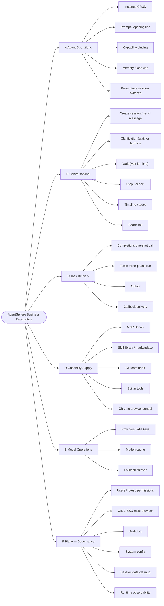

### 1.4 Core Business Flows

#### ① Conversational path (human in the loop)

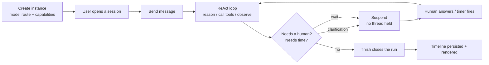

#### ② Task path (system to system, three phases)

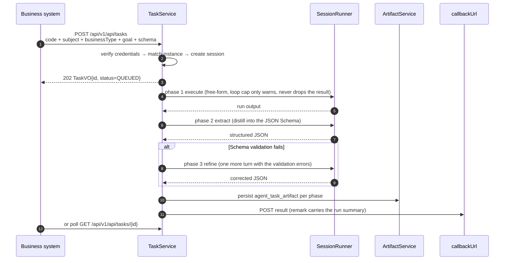

#### ③ Capability path (supply → consumption)

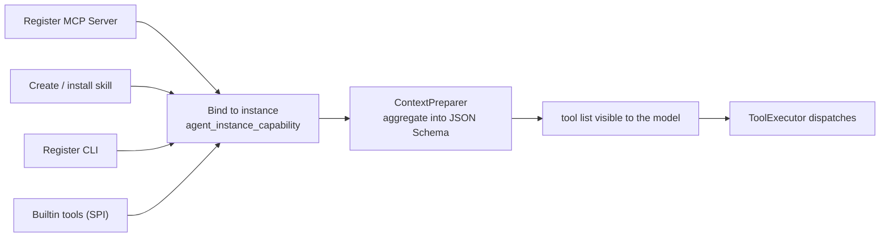

### 1.5 Business Rules

| Rule | Why it is this way |
|---|---|
| Instances gate sessions **per entry point**: `allow_console_session` / `allow_widget_session` (default false) | The console and the widget share one API surface and one token, so only `X-Client-Surface` distinguishes them; the third value `INTERNAL` (task path) must stay allowed |
| Skill body must follow `# H1 + ## stepN + ### stepN.M` | Step numbers are the anchor that lets todo items look their body back up; a broken format makes per-step retrieval impossible |
| The skill marketplace only shows `visibility=PUBLIC AND created_by IS NOT NULL` | Row-level data permission filters by `created_by` by default, so the marketplace must be opened up explicitly |
| Task timeout = `max(caller value, server floor)` | 155/158 tasks in production hard-code 3600s; only a server-side floor can actually raise it |
| `finish` is the only legal close-out for an agentic run, and is not exposed to pure-chat instances | Otherwise the model fakes delivery in three sentences and fails silently |
| The "do not call any more tools" hint is injected only on the final turn | Banning tools a few turns early truncates the work into a half-finished product |

### 1.6 Scope Boundaries (Non-Goals)

- **Not a general workflow orchestrator**: orchestration happens inside a single agent's ReAct loop, not in a visual DAG designer.
- **No model training / fine-tuning**: only inference-side routing and adaptation.
- **No multi-tenant SaaS billing**: `tenant_id` is reserved, but there is no billing or quota module.
- **Scheduled tasks**: the `/periodic-tasks` page is still a placeholder; the capability is not shipped.

---

## 2. Application Architecture

### 2.1 Application Landscape

Four deployable units plus two middleware services:

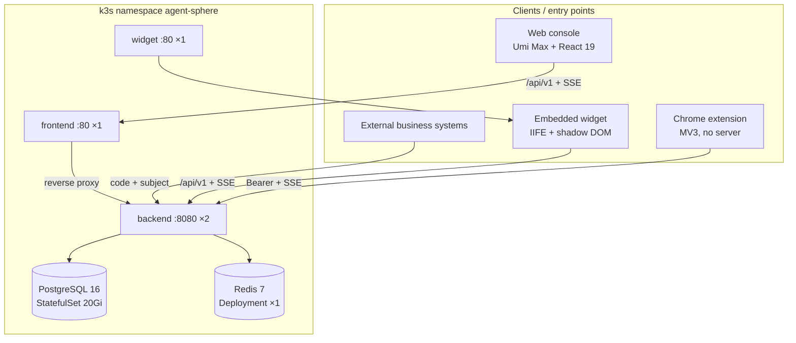

### 2.2 Backend Modules and Dependencies

13 Maven modules. Every business domain is split into the same **7 sub-modules**: `domain → exception → dtvo → spi → repository → service → controller`.

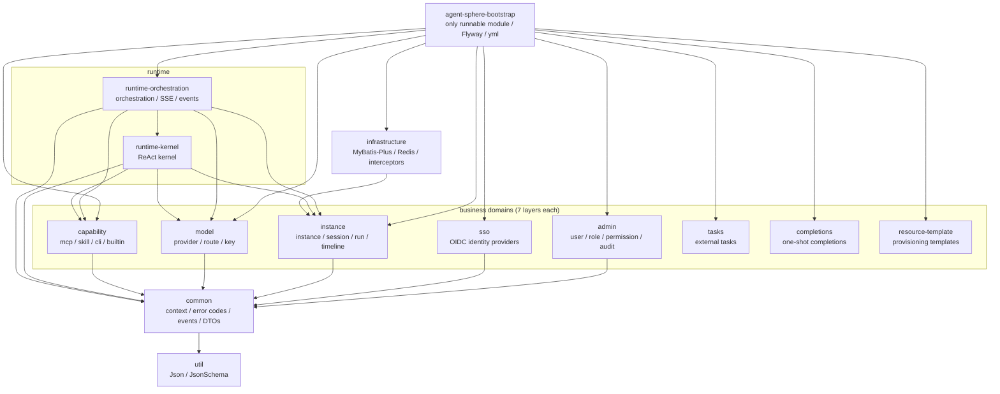

**Dependency discipline (mandatory when changing code)**

- `controller → service → repository → spi → domain`; **controllers depend only on the `*-spi` contract**, never on an implementation.
- **The kernel must not depend back on orchestration** (that would create a cycle). When the kernel needs an orchestration action, it publishes a Spring local event.
- `infrastructure` already depends on `instance-service`, so instance must not depend back on infrastructure (which is why the cleanup SQL is written as a raw mapper).

### 2.3 Application Service Inventory

| Domain | REST prefix | Controllers |
|---|---|---|
| Auth | `/api/v1/auth`, `/api/v1/auth/sso` | `AuthController`, `SsoAuthController`, `SsoIdentityController` |
| Instance | `/api/v1/instance/**` | `InstanceController`, `InstanceCapabilityController`, `SessionController`, `SessionTimelineController`, `SessionTodoController`, `RunController`, `RunActivityController`, `MemoryController`, `LlmInteractionController`, `SessionCleanupController`, `SubAgentRunController` |
| Runtime | `/api/v1/runtime`, `/api/v1/chrome` | `ChatRuntimeController`, `SseRuntimeController`, `ChromeCallbackController` |
| Model | `/api/v1/model/**` | `ModelProviderController`, `RouteController`, `ApiKeyController` |
| Capability | `/api/v1/capability/**` | `CapabilityMcpController`, `CapabilitySkillController`, `CapabilityCliController`, `BuiltinToolController` |
| Tasks | `/api/v1/api/tasks`, `/api/v1/admin/tasks` | `TaskController`, `AdminTasksController`, `AdminTaskArtifactController` |
| Completions | `/api/v1/api/completions` | `CompletionsController`, `AdminCompletionsController` |
| Governance | `/api/v1/admin/**`, `/api/v1/system/config` | `AdminUserController`, `RoleController`, `PermissionController`, `IdentityProviderAdminController`, `AuditLogController`, `SystemConfigController` |
| Content | `/api/v1/files`, `/api/v1/artifacts/documents`, `/api/v1/browser` | `FileController`, `DocumentController`, `BrowserScreenshotController` |

### 2.4 Key Application Components

| Layer | Component | One-line responsibility |
|---|---|---|
| Orchestration | `ChatRuntimeService` / `RuntimeOrchestrator` | Create the run, submit asynchronously, drive the kernel |
| Orchestration | `ContextPreparer` / `KernelContextAssembler` | Assemble history, memory, tools and prompts before every run |
| Orchestration | `SseManager` / `SseEventRelay` / `SseEventCache` | Broadcast per session; support `afterSeq` catch-up after a drop |
| Orchestration | `TimelineRecorder` / `RuntimeEventListener` | The **single funnel** from events to timeline / terminal state |
| Orchestration | `PendingWaitWakeScheduler` / `WaitingRunReconciler` | Primary resume path plus reconciliation fallback |
| Kernel | `SessionRunner` / `SessionRunCoordinator` | ReAct main loop, cancellation, timeouts, turn guardrails |
| Kernel | `KernelLlmService` + `ProviderStrategy` + `FallbackRouteExecutor` | Streaming calls, vendor adaptation, failover |
| Kernel | `ToolExecutor` + `FiberSet` | Unified tool dispatch, concurrent execution, timeout box |
| Kernel | `HistoryLoader` / `CompactionService` / `ToolResultCompressor` | Context watermark control |
| Kernel | `DelegateService` / `SessionSubRunner` | Sub-agent delegation (DAG) |
| Capability | `CapabilityMcpSpi` / `CapabilitySkillSpi` / `CapabilityCliSpi` / `CapabilityBuiltinToolSpi` | The four uniform capability slots |

### 2.5 Call Graphs

#### 2.5.1 Component call relationships (static)

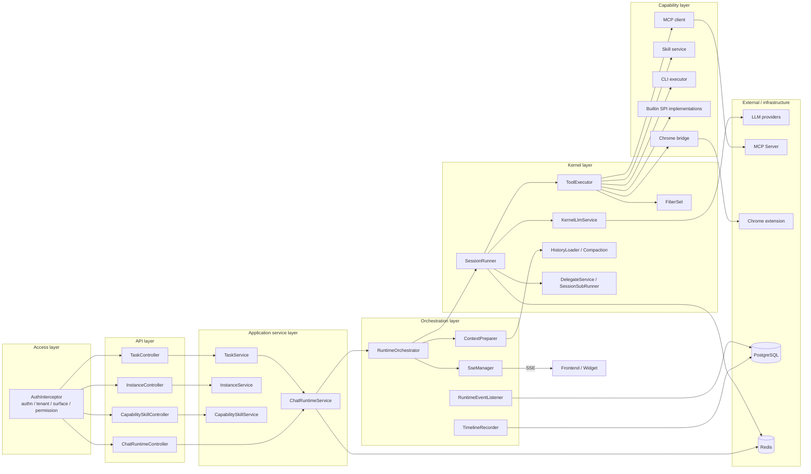

#### 2.5.2 Call sequence of one `chat` (dynamic)

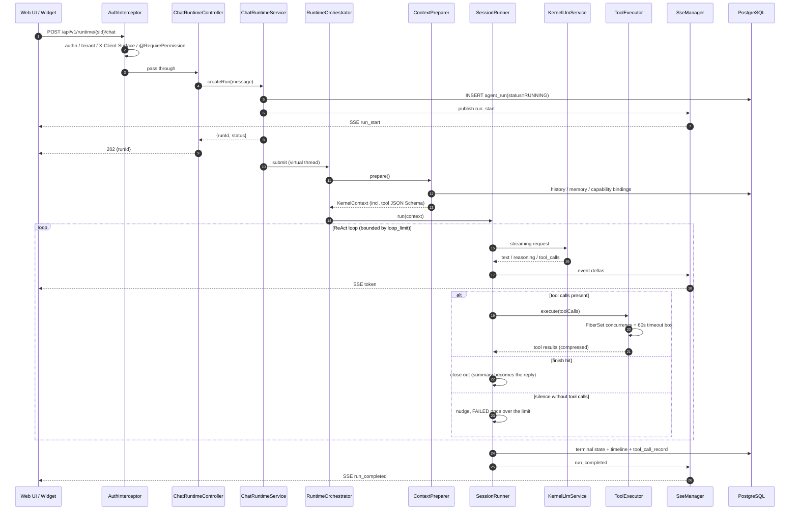

### 2.6 Integration Matrix

| Direction | Counterparty | Protocol / credentials |
|---|---|---|
| Inbound | Web console / widget / extension | REST + SSE (`/stream`), Bearer token |
| Inbound | External business systems | `code + subject + businessType`, no Bearer |
| Inbound | Chrome extension | Long-lived `/runtime/user/task/stream` + `/api/v1/chrome` callbacks |
| Outbound | LLM providers | OpenAI-compatible streaming + vendor strategy adaptation |
| Outbound | MCP Server | Model Context Protocol (Streamable HTTP) |
| Outbound | Identity provider (IdP) | OIDC authorization code + PKCE(S256) + nonce + JWKS verification |
| Outbound | Business callback | `callbackUrl` POST |

---

## 3. Technology Architecture

### 3.1 Technology Stack

| Layer | Choice | Version |
|---|---|---|
| Language / runtime | Java + Spring Boot + virtual threads | Java 21 / Boot 3.4.3 |
| Persistence | PostgreSQL + MyBatis-Plus + Flyway | PG 16 / MP 3.5.9 / 91 migrations |
| Cache & coordination | Redis + Redisson (**Spring Data Redis is forbidden**) | Redis 7 / Redisson 3.40.2 |
| Resilience & caching | Resilience4j, Caffeine | 2.3.0 / 3.2.0 |
| Tools & schema | MCP, victools, swagger-core, hutool | 4.38.0 / 2.2.28 / 5.8.34 |
| Realtime channel | SSE (per-session emitters + heartbeat + event-cache catch-up) | — |
| Frontend | React + UmiJS Max + Ant Design | React 19 / antd 6 |
| Frontend tooling | Biome, Tailwind v4, Jest | — |
| Widget | Vite lib mode + IIFE + shadow DOM | Vite 6 |
| Extension | Manifest V3, native ESM, `chrome.debugger` (only in `cdp-client.js`) | — |
| Deployment | k3s + Ingress + Fleet (GitOps) | — |

### 3.2 Deployment Topology

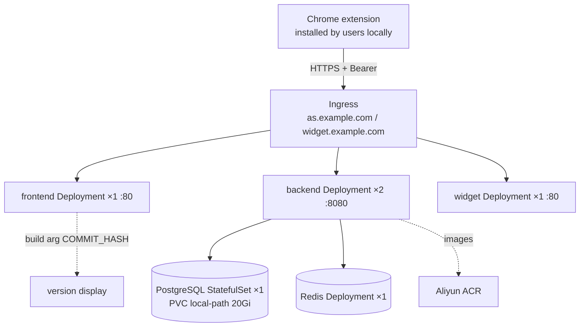

Key points:

- **Two backend replicas with no session affinity**, so all runtime state must be persisted; after an SSE drop the client catches up from `agent_timeline` via `afterSeq`.
- **Single-point middleware**: PG and Redis are single instances, and `local-path` storage cannot drift across nodes.
- Middleware images are mirrored into ACR (nodes cannot pull from Docker Hub).

### 3.3 Key Mechanisms

| Mechanism | Implementation | Problem it solves |
|---|---|---|
| Async run | The request thread only creates the run and returns `{runId}`; execution happens on a virtual thread | Long tasks never pin Tomcat threads |
| Single writer | A run is written only by the replica's loop that created it | No distributed state machine needed |
| Suspend / resume | `agent_pending_wait` + in-memory timer (primary) + cron scan (compensation) + single CAS UPDATE | No thread held, survives restarts, resumes exactly once under concurrency |
| Multi-replica coordination | Redisson locks: `session-cleanup` / `skill-auto-update` / `pending-wait` | Two replicas never run the same job twice |
| Tenant context | `InheritableThreadLocal`; background threads must `stop()` + `AuthContext.clear()` on entry | Prevents tenant bleed (once made waits stall for 15 minutes) |
| Event decoupling | Spring local events (the kernel must not depend on orchestration) | Breaks the dependency cycle |
| Model fault tolerance | `ProviderStrategy` adaptation + route fallback + exponential backoff | A provider hiccup does not fail a whole batch |
| Streaming consistency | SSE deltas + persisted timeline + `afterSeq` catch-up | Drop-outs and multi-device consistency |
| Context watermark | HistoryLoader + Compaction + tool-result compression | Prevents context blow-up |

### 3.4 Key Technical Decisions

| Problem | Decision | Cost |
|---|---|---|
| Tools must return within 60s, but business waits take minutes | `wait` suspends instead of sleeping; the wait happens outside the timeout box | Two wake-up paths + a full state machine to maintain |
| "No tool called" — done or gave up? | Three-branch criterion + `finish` tool + `finish_reason` passthrough | The model must learn to call `finish` |
| Turn budget drifts across five re-entry points | Persist both `loop_count` and `loop_limit`; `PINNED` has the highest priority | One extra column, one extra idempotent write |
| Context blow-up | Layered compaction + history rebuild | Compaction itself costs tokens |
| Hard delete vs logical delete | The cleanup job is the only hard delete, and follows FK order | The order is hard-coded in the mapper and cannot be reordered |
| 2 replicas, no affinity | All state persisted; SSE recovers by catch-up | Slightly less real-time |
| Providers tolerate parameters differently | Strategy pattern selected by `company`, no model-name guessing | One implementation per vendor |

### 3.5 Observability

Four layers of evidence, none optional:

| Layer | Carrier | Purpose |
|---|---|---|
| Request | `TraceIdFilter` + `ControllerLogAspect` | Stitch one HTTP call together |
| User | `agent_timeline` | The user-visible execution trace, and the SSE catch-up source |
| Model | `agent_llm_interaction_record` | Raw request / response / reasoning; **triage hint**: `prompt_tokens IS NULL AND duration_ms < 1000` = the provider errored instantly |
| Audit | `sys_audit_log` + `*_run` tables | Trails for admin actions and background jobs |

Log levels: `com.buukle` = DEBUG; `*.repository` and `com.buukle.agent.capability` = WARN (so info logs from the capability module must be re-enabled explicitly in `logback-spring.xml`).

### 3.6 Delivery Pipeline

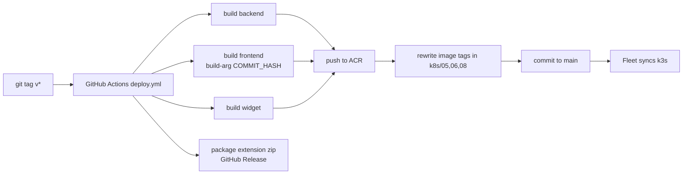

Local equivalent: `.local-workflow/deploy.sh` (buildx + `type=local` cache; supports `--dry-run` / `--skip-existing` / `--only`).

### 3.7 Technical Debt and Risks

| Item | Impact |
|---|---|
| **No test CI** | Only local `mvn test` / `biome` / `jest`; regressions rely on discipline |
| Single PG instance, 20Gi `local-path` | No high availability; growth is contained by the cleanup job |
| SSE event cache lives in-process | Cross-replica catch-up can only hit the DB |
| `agent_llm_interaction_record` is the largest table | The cleanup job hard-deletes, and disks only shrink after a manual `VACUUM FULL` |
| Docs drift from implementation | `agent-sphere/AGENTS.md` still mentions langgraph4j; the pom no longer has it |
| Scheduled tasks not shipped | `/periodic-tasks` is a placeholder page |
| Extension / widget are not version-locked to the backend | Release ordering is a manual responsibility |

---

## 4. Data Architecture

### 4.1 Storage Split

| Store | Holds | Why |
|---|---|---|
| PostgreSQL | 38 business tables, timeline, raw LLM interactions | Strong consistency + `jsonb` + row-level permission |
| Redis (Redisson) | Cache, distributed locks, rate limiting, part of the runtime state | Shared by 2 replicas; **must** go through Redisson |
| File store | `agent_file_store` / documents / artifacts / screenshot `fileKey` | Large objects stay out of the database |
| Browser `sessionStorage` | Widget token | Cross-site embedding does not share cookies |

### 4.2 Data Domains

| Domain | Tables | Names |
|---|---:|---|
| Agent configuration | 2 | `agent_instance`, `agent_instance_capability` |
| Session runtime | 9 | `agent_session`, `agent_run`, `agent_sub_agent_run`, `agent_timeline`, `agent_tool_call_record`, `agent_session_todo`, `agent_pending_clarification`, `agent_pending_wait`, `agent_user_in_loop_record` |
| Models & memory | 6 | `agent_model_provider`, `agent_model_route`, `agent_api_key`, `agent_llm_interaction_record`, `agent_compact_record`, `agent_memory` |
| Capability supply | 4 | `capability_mcp`, `capability_skill`, `capability_skill_sync_run`, `capability_cli` |
| Tasks & completions | 5 | `agent_task`, `agent_task_artifact`, `agent_completions`, `agent_completions_call`, `agent_completions_prompt` |
| Platform governance | 10 | `agent_user`, `agent_sso_identity`, `agent_identity_provider`, `sys_role`, `sys_permission`, `sys_role_permission`, `sys_user_role`, `sys_audit_log`, `agent_system_config`, `agent_session_cleanup_run` |
| Content | 2 | `agent_file_store`, `agent_document` |

### 4.3 ER Diagrams

> Note: the schema has **only two physical foreign keys** (`agent_run.session_id → agent_session`, `agent_task_artifact.task_id → agent_task`).
> Every other line is a **logical association** (a `*_id` column enforced by the application), which is why delete ordering must be controlled by code.

#### 4.3.1 Session runtime (core)

#### 4.3.2 Models and tasks

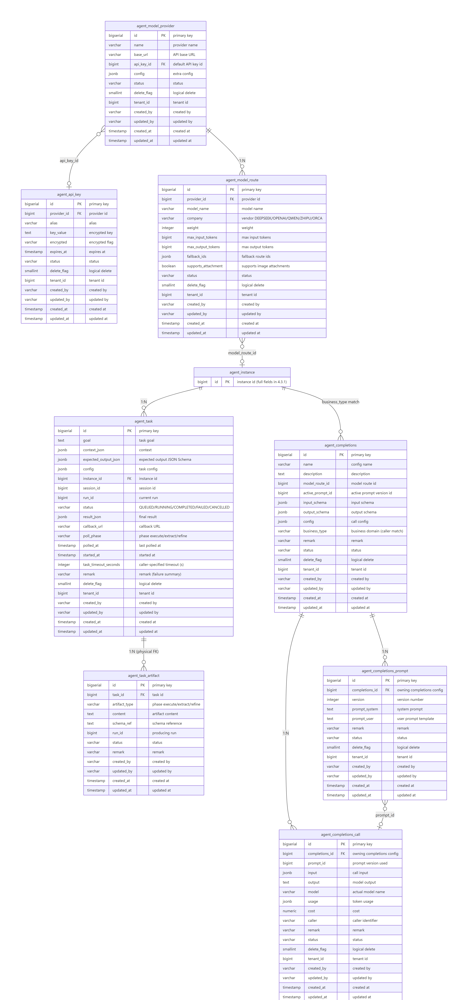

#### 4.3.3 Identity and capabilities

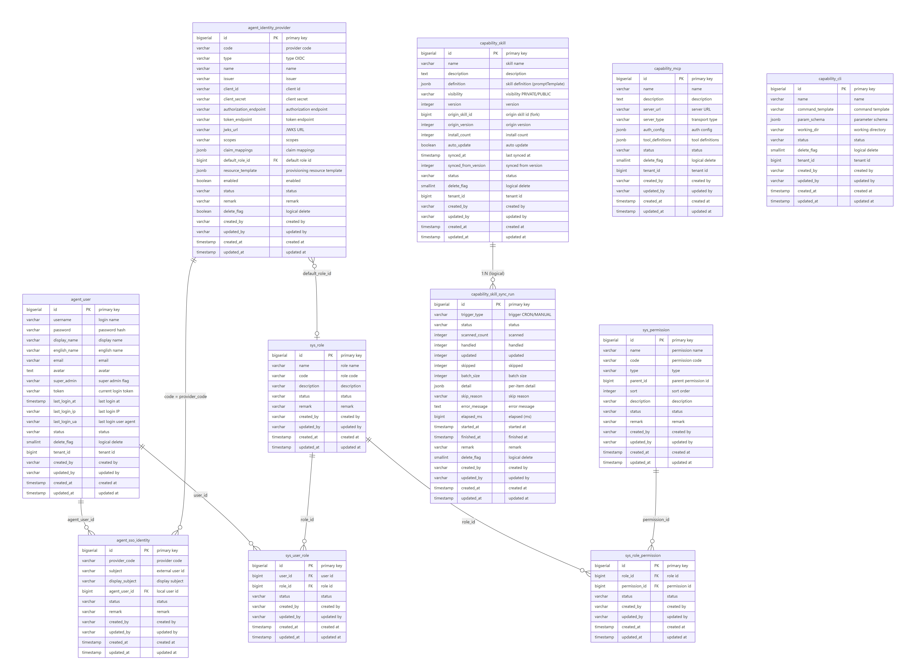

#### 4.3.4 Governance and content

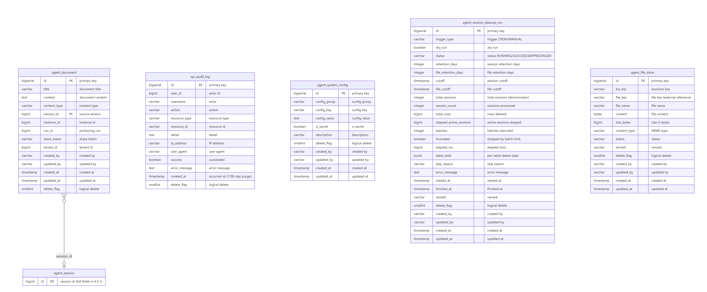

**Legend**

- Each column is `type field PK/FK comment`, matching the Flyway migrations **column by column**; the four diagrams together cover all **38 tables**.
- `||--o{` one-to-many; `}o--o|` many-to-zero-or-one; the text on a line is the join condition.
- `capability_mcp` / `capability_cli` are **polymorphically bound** through `agent_instance_capability(capability_type, capability_id)` and have no foreign key, so they are not connected.
- `sys_*` are platform governance tables, only loosely tied to business tables through `created_by` (a string).
- `agent_instance` / `agent_session` in 4.3.2 and 4.3.4 are **placeholder nodes** (only `id`); full fields are in 4.3.1.

> The sources are Mermaid files in this repository — re-render after changing a column (`erDiagram`, all edge labels are plain text, so GitHub renders them directly):
> [er-1-session-run-en.mmd](agent-sphere-readme/er-1-session-run-en.mmd) · [er-2-model-task-en.mmd](agent-sphere-readme/er-2-model-task-en.mmd) · [er-3-identity-capability-en.mmd](agent-sphere-readme/er-3-identity-capability-en.mmd) · [er-4-governance-en.mmd](agent-sphere-readme/er-4-governance-en.mmd)

### 4.4 Data Flow

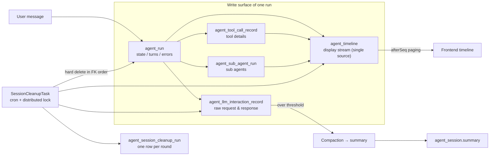

**Key characteristics**

1. **One run writes several tables**: `run` (state), `timeline` (display), `tool_call_record` (details), `llm_interaction_record` (raw).
2. **Timeline merges two sources**: SSE deltas + `beforeSeq/afterSeq` paging; the frontend dedupes by `seq` (sub-agent placeholder rows use `seq < 0`).
3. **Compaction chain**: history over threshold → `agent_compact_record` → rewrite `agent_session.summary` → later runs rebuild context from the summary.
4. **Cleanup chain**: `agent_session_cleanup_run` records every round (including `dryRun`); retention days and the on/off switch live in `agent_system_config`, so config changes need no redeploy.

### 4.5 Data Governance

| Rule | Description |
|---|---|
| Logical delete | Every table has `delete_flag`; the only exception is the session-cleanup **hard delete** (keeping raw interactions would mean nothing was cleaned) |
| Common columns | `status / remark / created_by / updated_by / created_at / updated_at` |
| Multi-tenancy | `tenant_id` + `created_by` dual criteria; the row-level interceptor appends `created_by = current user` to SELECTs |
| Migrations | 91 Flyway versions, **applied ones are immutable**, only additive changes |
| Large tables | `agent_llm_interaction_record` and `agent_timeline` drive growth |
| Disk reclaim | A hard delete only frees space inside PG; the filesystem shrinks only after a manual `VACUUM FULL` |
| Indexes | The cleanup job relies on `agent_session(delete_flag, created_at)`, `agent_task(session_id)` etc.; without them it degrades to a full scan |

---

## 5. 4A Traceability Matrix

| Business capability | Application landing point | Data landing point | Technical means |
|---|---|---|---|
| Configure an agent | `InstanceController → InstanceService` | `agent_instance`, `agent_instance_capability` | MyBatis-Plus + row-level permission |
| Have one conversation | `ChatRuntimeController → ChatRuntimeService → SessionRunner` | `session / run / timeline / tool_call_record` | Virtual threads + SSE |
| Wait for a human answer | `SessionRunner` suspends → `ChatRuntimeService.resume` | `agent_pending_clarification` | CAS claim + two wake-up paths |
| Wait for a period of time | `wait` tool → `PendingWaitWakeScheduler` | `agent_pending_wait` | In-memory timer + cron fallback |
| Let the agent use tools | `ContextPreparer.resolveTools → ToolExecutor → SPI` | `capability_*`, `agent_tool_call_record` | Java SPI + MCP + FiberSet |
| Let the agent see / click a page | Extension ← `/api/v1/chrome` commands | `agent_file_store` (screenshots), `agent_timeline` | CDP + content script |
| Business wants a structured result | `TaskController` → execute/extract/refine | `agent_task`, `agent_task_artifact` | Async polling + JSON Schema validation |
| Swap a model / degrade | `RouteController → ModelProviderService` | `agent_model_provider / route / api_key` | ProviderStrategy + fallback |
| Who may use what | `@RequirePermission` + `AuthInterceptor` | `sys_user / role / permission` | RBAC + `created_by` row-level |
| Single sign-on | `SsoAuthController` | `agent_identity_provider`, `agent_sso_identity` | OIDC + PKCE + JWKS |
| Post-hoc accountability | `AuditLogController`, `TimelineRecorder` | `sys_audit_log`, `agent_timeline` | AOP + event funnel |

---

## Appendix: Suggested Reading Path

| Goal | Entry file |
|---|---|
| See the full configuration | `agent-sphere/agent-sphere-bootstrap/src/main/resources/application.yml` |
| See the orchestration trunk | `ChatRuntimeController` → `ChatRuntimeService` → `RuntimeOrchestrator` |
| See the kernel's heart | `SessionRunner#run` / `#runTurn` |
| See how tools get wired in | `ContextPreparer#resolveTools` → `ToolExecutor` |
| See how data is persisted | `TimelineRecorder` → `agent_timeline`; `SessionCleanupTask` → delete order |
| See how to add a tool | `agent-sphere/AGENTS.md`, "adding a builtin tool" section |
