# AgentSphere

**English** | [Chinese](README.zh-CN.md)

> 4A = **Business Architecture / Application Architecture / Technology Architecture / Data Architecture**

## Contents

- [0. One-Line Positioning](#0-one-line-positioning)
- [Product Preview](#product-preview)
- [1. Business Architecture](#1-business-architecture)
- [2. Application Architecture](#2-application-architecture)
- [3. Technology Architecture](#3-technology-architecture)
- [4. Data Architecture](#4-data-architecture)
- [5. 4A Traceability Matrix](#5-4a-traceability-matrix)
- [6. Quick Start](#6-quick-start)
- [7. Repository Map](#7-repository-map)
- [8. Development & Verification](#8-development--verification)

---

## 0. One-Line Positioning

> Package LLM + tools + browser + memory + model routing into a **configurable Agent instance**, and expose it through conversational, task-oriented and capability-based entry points.

AgentSphere is **an agent hosting platform**, not a single agent. The instance is the configuration unit, capabilities are the supply unit, and models are the routing unit. All three are decoupled.

---

## Product Preview

Live screenshots from the deployed product. The Chinese versions of the same screens are used by [README.zh-CN.md](README.zh-CN.md).

| Agent operations | System administration | Super Agent workspace |
|---|---|---|
| 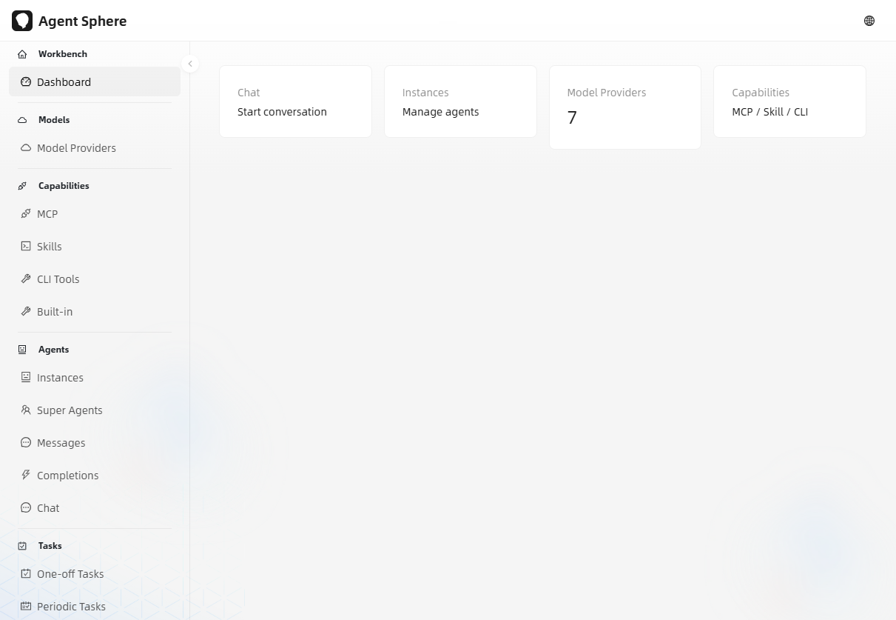 | 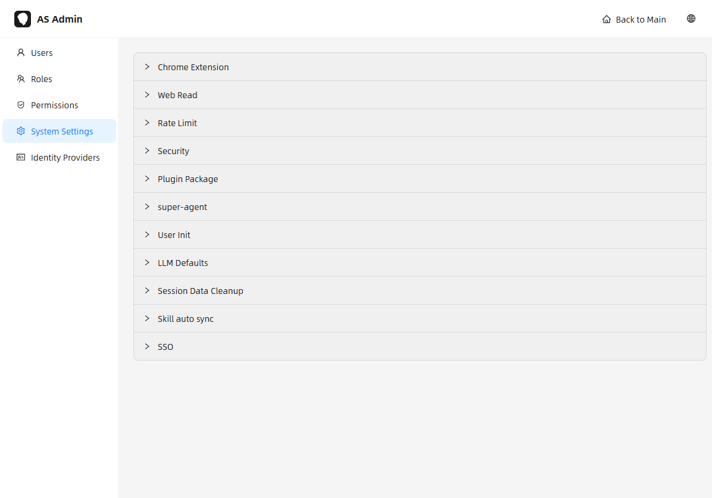 | 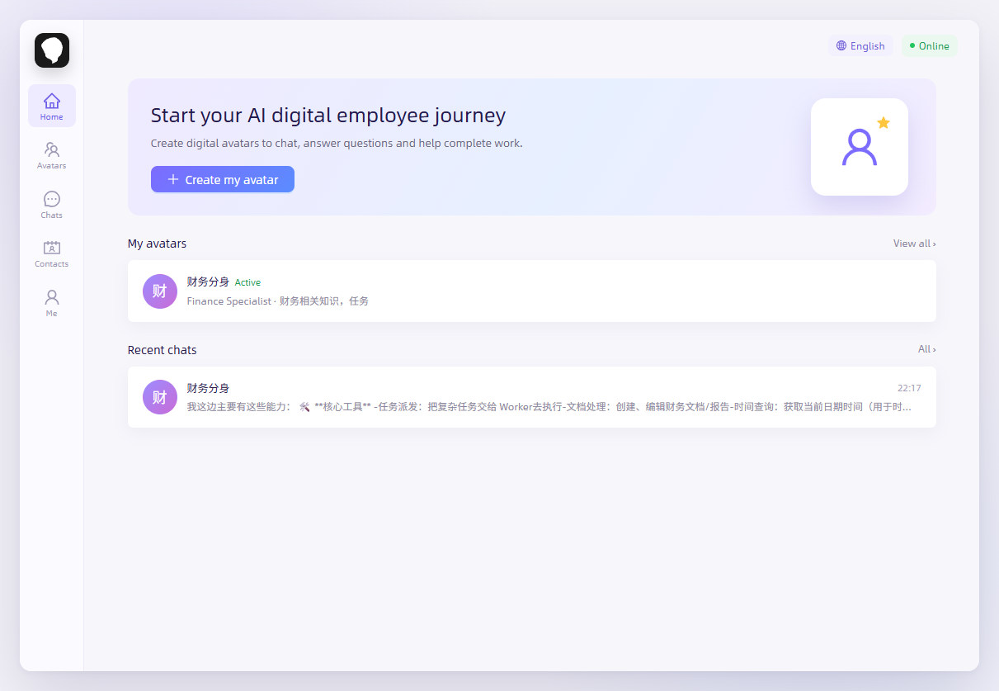 |

### Agent configuration and conversation

| Instances | Chat |
|---|---|
| 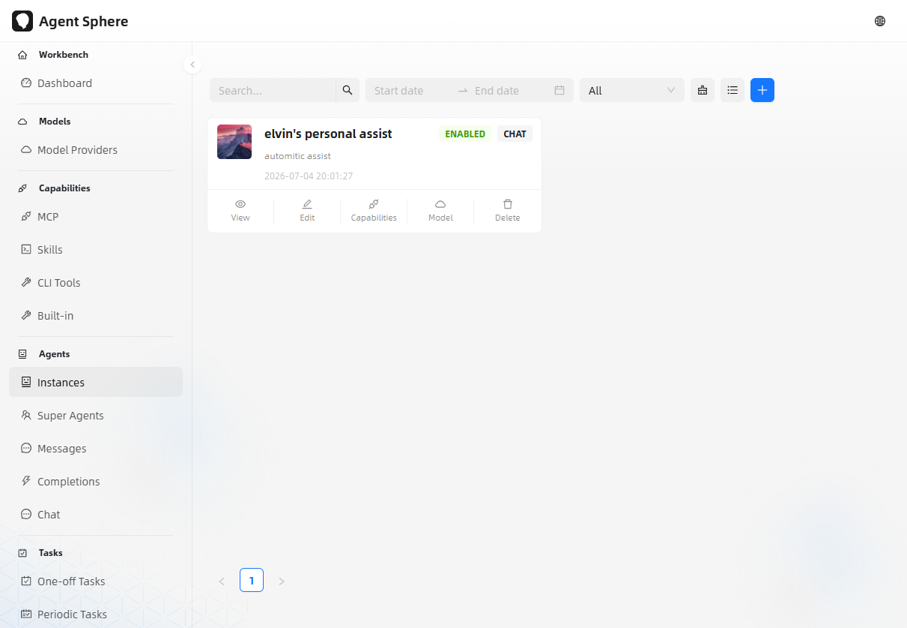 | 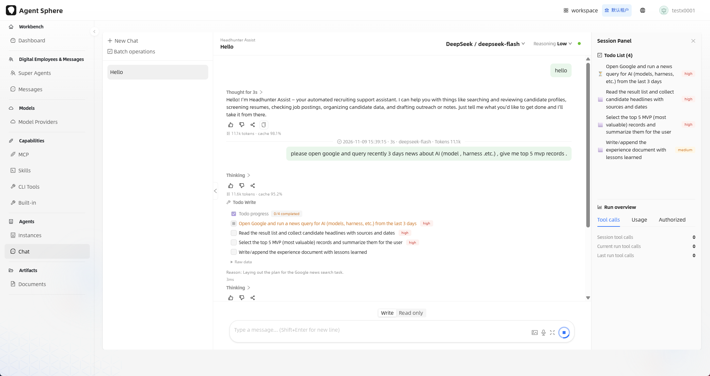 |

### Digital employees and IM

Screenshots from the Super Agent product at `/workspace`.

| Digital employees | Digital employee chats |
|---|---|
| 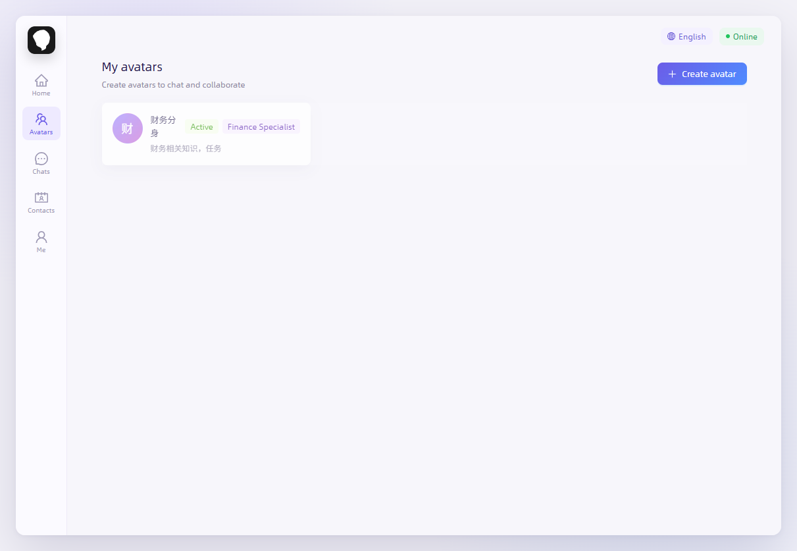 | 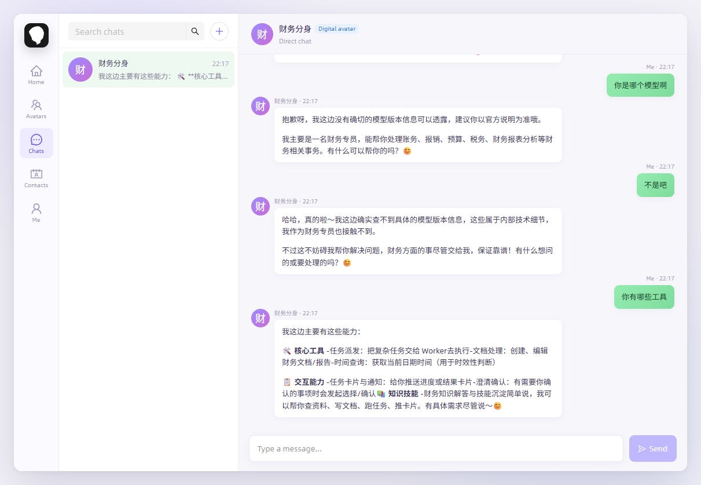 |

---

## 1. Business Architecture

### 1.1 Positioning

| Dimension | Content |
|---|---|
| Served parties | Platform admins / operator-developers / end users / external business systems / digital-employee users |
| Core value | Let business teams get a working agent without writing code: it looks things up, calls APIs, drives web pages and returns structured results |
| Delivery shapes | Conversational (console / widget) · Task-based (submit + callback) · Capability-based (one-shot completion) · Digital employee (`/workspace`) |
| Differentiation | Instance-level configuration, real browser operation, installable skills, multi-provider failover, Super Agent routing and IM channels |

#### Product surfaces

| Entry | Product | Main capabilities |
|---|---|---|
| `http://127.0.0.1:8000/**` | Agent operations platform (excluding `/admin/**` and `/workspace`) | Agent instances, capability center, model routes, chat, tasks, artifacts, IM operations, Super Agent configuration |
| `http://127.0.0.1:8000/admin/**` | System administration | Users, roles, permissions, identity providers, dictionaries, system config, audit logs |
| `http://127.0.0.1:8000/workspace` | Super Agent product | Digital-employee list, conversations, contacts, task collaboration, replies |

- `/**` is the admin/operator view.
- `/admin/**` is platform governance.
- `/workspace` is the end-user product for digital employees.

### 1.2 Actors and Roles

| Role | Primary entry | Focus |
|---|---|---|
| Platform admin | `/admin/**` | Users, roles, permissions, identity providers, audit, system config |
| Operator / developer | Web console | Configure instances, wire MCP, author skills, tune model routes |
| End user | `/chat`, embedded widget | Ask, answer clarifications, watch execution |
| Digital-employee user | `/workspace` | Talk to Super Agents, follow work items, receive replies |
| External business system | `/api/v1/api/*` | Submit tasks, fetch artifacts, run one-shot completions |
| IM / channel user | IM, webhook, embedded channel | Send messages to a digital employee; receive routed replies |
| Headless browser | Chrome extension | Operate real web pages under agent control |

### 1.3 Business Capability Map

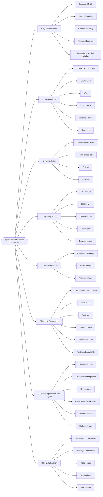

### 1.4 Core Business Flows

#### Conversational path (human in the loop)

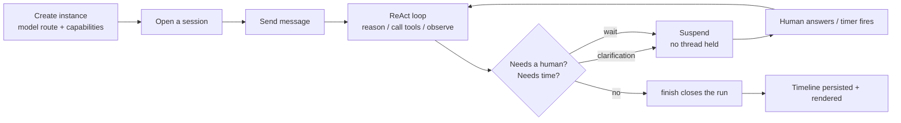

#### Task path (system to system, three phases)

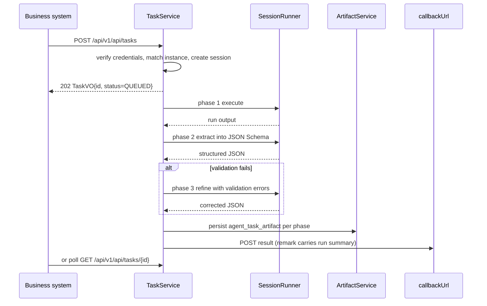

#### Capability path (supply → consumption)

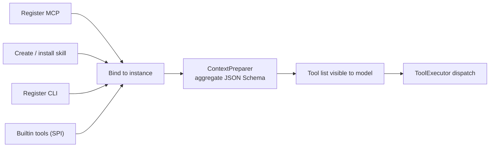

#### Super Agent path (digital employee)

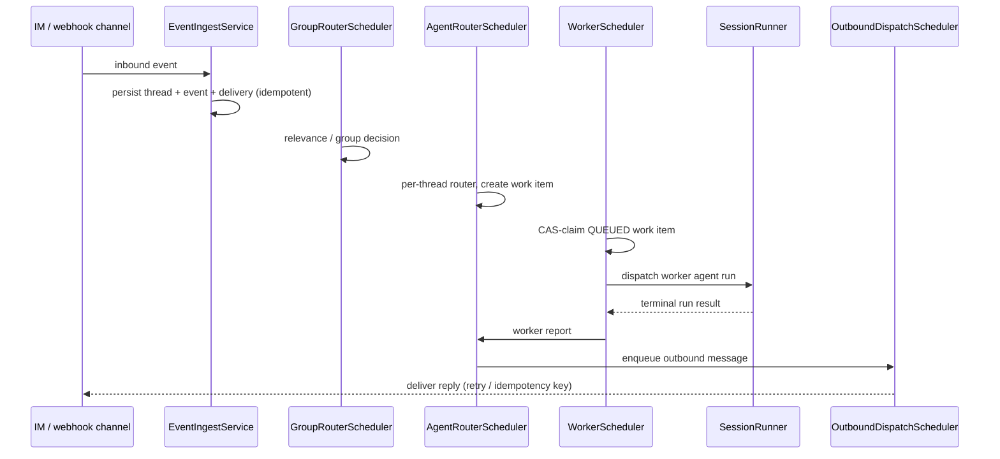

A Super Agent is a digital employee composed of a **Router instance + Worker instance + channel bindings**. Inbound events become threads/work items; worker runs produce reports; outbound messages are delivered back to the originating channel.

#### IM collaboration path

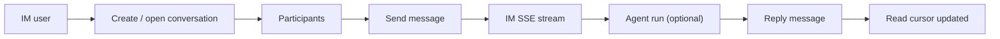

IM is a channel for both human-to-human and human-to-agent collaboration. Conversations, participants, messages, attachments and read cursors are independent from Agent timelines; a message can trigger an Agent run and the reply is written back as an IM message.

### 1.5 Business Rules

| Rule | Why |
|---|---|
| Sessions are gated per entry point: `allow_console_session` / `allow_widget_session` (widget default false) | Console and widget share one API and token; only `X-Client-Surface` distinguishes them. `INTERNAL` must stay allowed for tasks |
| Skill body must follow `# H1 + ## stepN + ### stepN.M` | Step numbers anchor todo-to-skill lookup; broken format breaks per-step retrieval |
| Skill marketplace only shows `visibility=PUBLIC AND created_by IS NOT NULL` | Row-level permission filters by `created_by`; the marketplace opens up explicitly |
| Task timeout = `max(caller value, server floor)` | Most production tasks hard-code 3600s; only a server floor can raise them |
| `finish` is the only legal close-out for agentic runs and is not exposed to pure-chat instances | Otherwise a few sentences can fake delivery and fail silently |
| The “no more tools” hint is injected only near the final turn | Banning tools early truncates work into a half-finished product |
| A Super Agent always owns exactly one Router instance and one Worker instance, plus channel bindings | The router decides relevance/ownership; the worker executes. Keeping the roles separate prevents one prompt from doing both |
| Inbound channel events are persisted before routing; deliveries and outbound messages are idempotent | Webhook retries and reconnect bursts must not create duplicate work items or duplicate replies |
| Worker work items are claimed with a CAS status transition; only the worker report writes terminal state | Two replicas must never dispatch the same item, and scheduler retries must not overwrite a finished result |
| Outbound replies use persist-then-send with retry and an idempotency key | Channel delivery can fail; the outbox is the source of truth |
| IM messages and Agent sessions are linked by conversation/session ids, not by a shared timeline table | IM history and Agent execution history have different retention and read patterns |

### 1.6 Scope Boundaries (Non-Goals)

- **Not a general workflow orchestrator**: orchestration lives inside a single agent’s ReAct loop, not a visual DAG designer.
- **No model training / fine-tuning**: inference-side routing and adaptation only.
- **No SaaS billing/quota**: `tenant_id` is reserved, but no billing module exists.
- **Scheduled tasks not shipped**: `/periodic-tasks` remains a placeholder.

---

## 2. Application Architecture

### 2.1 Application Landscape

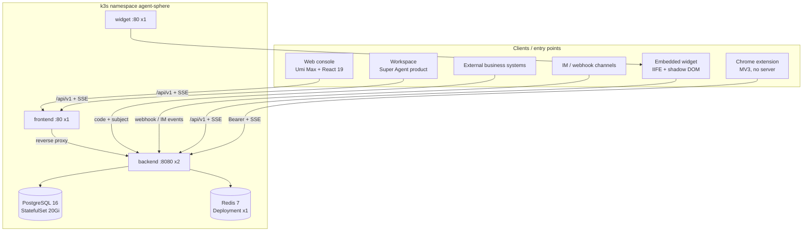

### 2.2 Backend Modules and Dependencies

Business domains use the same layered split:

```text
-domain → -exception → -dtvo → -spi → -repository → -service → -controller
```

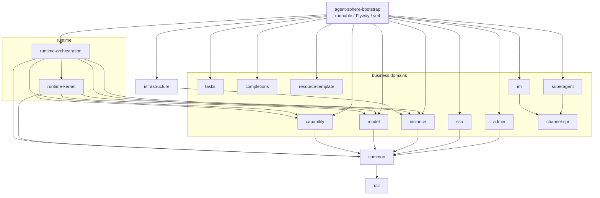

Dependency discipline:

- `controller → service → repository → spi → domain`; controllers depend on `*-spi`, never implementations.
- The kernel must not depend back on orchestration; use Spring local events for cross-layer actions.
- `infrastructure` depends on `instance-service`, so instance must not depend back on infrastructure.

### 2.3 Call Graphs

#### Static component relationships

`mermaid
graph LR
    UI["Web / Widget / Workspace"] --> API["Controllers"]
    API --> SVC["Application services"]
    SVC --> ORCH["Runtime orchestrator"]
    ORCH --> KERNEL["SessionRunner"]
    KERNEL --> LLM["KernelLlmService"]
    KERNEL --> TOOLS["ToolExecutor"]
    TOOLS --> CAPS["MCP / Skill / CLI / Builtin"]
    LLM --> PROVIDERS["LLM providers"]
    ORCH --> SSE["SseManager"]
    SSE --> UI
    SVC --> DB[("PostgreSQL")]
    KERNEL --> REDIS[("Redis")]
`
#### One `chat` call sequence

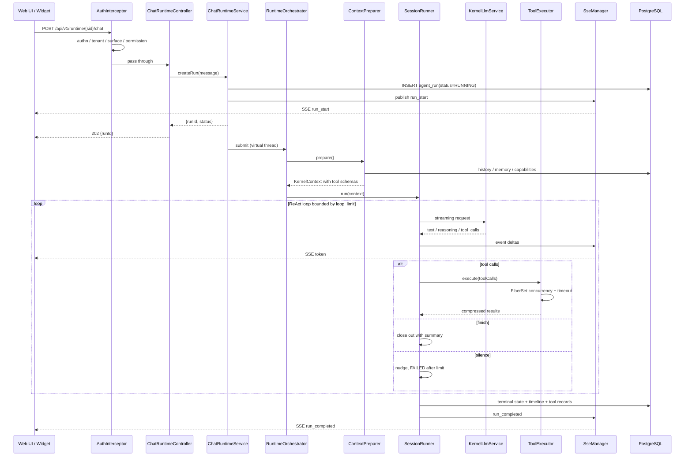

#### Super Agent digital-employee sequence

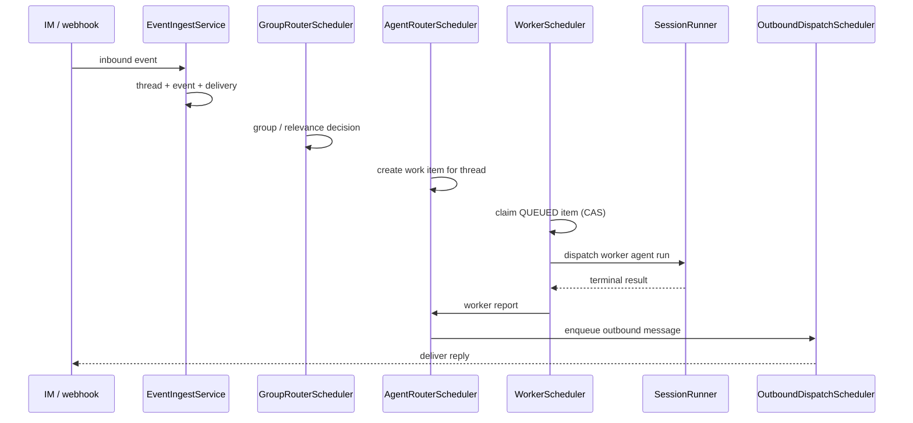

#### IM message sequence

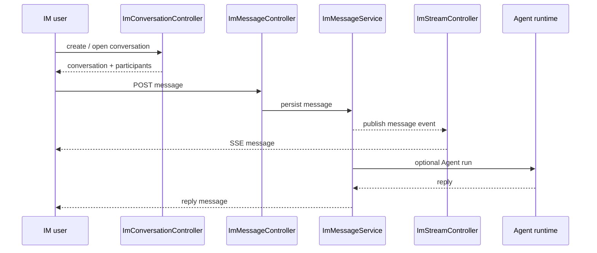

### 2.4 Integration Matrix

| Direction | Counterparty | Protocol / credentials |
|---|---|---|
| Inbound | Web console / widget / workspace / extension | REST + SSE (`/stream`), Bearer token |
| Inbound | External business systems | `code + subject + businessType`, no Bearer |
| Inbound | Chrome extension | Long-lived `/runtime/user/task/stream` + `/api/v1/chrome` callbacks |
| Inbound | IM / webhook channels | Normalized events through `EventIngestPort`; channel bindings |
| Outbound | Channel adapter | IM / webhook replies from the outbound outbox |
| Outbound | LLM providers | OpenAI-compatible streaming + vendor strategy |
| Outbound | MCP server | Model Context Protocol (Streamable HTTP) |
| Outbound | Identity provider | OIDC authorization code + PKCE + nonce + JWKS |
| Outbound | Business callback | `callbackUrl` POST |

---

## 3. Technology Architecture

### 3.1 Technology Stack

| Layer | Choice |
|---|---|
| Language / runtime | Java 21, Spring Boot 3.4.3, virtual threads |
| Persistence | PostgreSQL 16, MyBatis-Plus 3.5.9, Flyway (149 migrations) |
| Coordination | Redis 7 + Redisson 3.40.2; Spring Data Redis forbidden |
| Resilience / cache | Resilience4j, Caffeine |
| Tools / schema | MCP, victools, swagger-core, Hutool |
| Super Agent / channels | Channel SPI adapters, event/outbox schedulers, Redisson locks |
| Realtime | SSE with per-session emitters, heartbeat and event-cache catch-up |
| Frontend | React 19, UmiJS Max, Ant Design 6, Biome |
| Widget | Vite library mode, IIFE, shadow DOM |
| Extension | Manifest V3, native ESM, `chrome.debugger` only in `cdp-client.js` |
| Deployment | k3s, Ingress, Fleet GitOps |

### 3.2 Deployment Topology

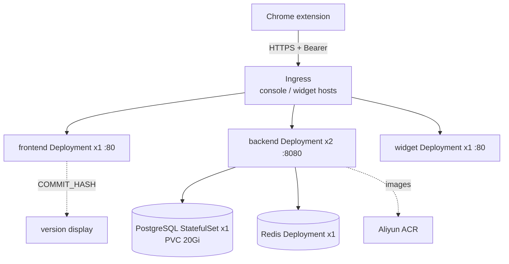

Key points:

- Two backend replicas with no session affinity: all runtime state must be persisted.
- SSE drops recover from `agent_timeline` via `afterSeq`.
- PG and Redis are single instances; `local-path` storage cannot drift across nodes.
- Middleware images are mirrored into ACR.

### 3.3 Key Mechanisms

| Mechanism | Implementation | Problem solved |
|---|---|---|
| Async run | Request thread creates run and returns `{runId}`; execution on a virtual thread | Long tasks never pin Tomcat threads |
| Single writer | A run is written only by the replica running it | No distributed state machine |
| Suspend / resume | Pending record + in-memory timer + cron fallback + CAS claim | No thread held; survives restart; resumes once |
| Multi-replica coordination | Redisson locks for cleanup, skill sync, pending wait, routers | Jobs never run twice |
| Tenant context | `InheritableThreadLocal`; background threads clear tenant/auth | Prevents tenant bleed |
| Event decoupling | Spring local events | Breaks kernel → orchestration cycle |
| Model fault tolerance | ProviderStrategy + route fallback + backoff | Provider hiccups do not fail a batch |
| Streaming consistency | SSE deltas + persisted timeline + `afterSeq` | Reconnect and multi-device consistency |
| Context watermark | HistoryLoader + compaction + tool-result compression | Prevents context blow-up |
| Channel event pipeline | Persist thread/event/delivery first; group router + agent router + worker scheduler | Webhook retries are idempotent; routing and execution are separately scalable |
| Outbound outbox | Persist-then-send, retry with backoff, idempotency key | Channel failures do not lose replies |
| IM streaming | Dedicated IM SSE stream and per-conversation read cursors | Message delivery is independent from Agent timelines |

### 3.4 Key Technical Decisions

| Problem | Decision | Cost |
|---|---|---|
| Tools must return quickly, but waits take minutes | `wait` suspends instead of sleeping | Two wake paths + a state machine |
| “No tool called” is ambiguous | Three-branch criterion + `finish` + `finish_reason` | Model must learn `finish` |
| Turn budget drifts across re-entry points | Persist `loop_count` and `loop_limit`; `PINNED` wins | Extra columns and idempotent writes |
| Context blow-up | Tiered compaction + history rebuild | Compaction costs tokens |
| Logical vs hard delete | Cleanup is the only hard delete, in FK order | Delete order is hard-coded |
| Two replicas, no affinity | Persist all state; SSE catch-up | Slightly less real-time |
| Provider parameter differences | Strategy by `company`, no model-name guessing | One implementation per vendor |
| Digital employee needs routing + execution | One Router instance + one Worker instance per Super Agent | Two prompts and two runtimes to maintain |
| Channel events can retry | Persist-before-route + delivery idempotency + CAS work-item claim | More scheduler tables and states |
| IM and Agent history differ | Separate IM tables and Agent timeline; link by ids | Two retention models |

### 3.5 Observability

| Layer | Carrier | Purpose |
|---|---|---|
| Request | `TraceIdFilter` + `ControllerLogAspect` | Stitch one HTTP call together |
| User | `agent_timeline` | User-visible execution trace; SSE catch-up source |
| Model | `agent_llm_interaction_record` | Raw request/response/reasoning; `prompt_tokens IS NULL AND duration_ms < 1000` = provider instant error |
| Audit | `sys_audit_log` + `*_run` tables | Admin actions and background job trails |
| Super Agent | `agent_work_item`, `agent_outbound_message`, `agent_watchdog_run` | Routing, dispatch and delivery visibility |
| IM | `im_message`, `im_read_cursor` | Conversation delivery and read state |

Log levels: `com.buukle` DEBUG; `*.repository` and `com.buukle.agent.capability` WARN.

### 3.6 Delivery Pipeline

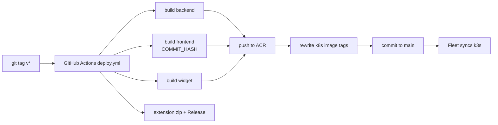

Local equivalent: `.local-workflow/deploy.sh` (`--dry-run` / `--skip-existing` / `--only`).

### 3.7 Technical Debt and Risks

| Item | Impact |
|---|---|
| No test CI | Regressions rely on local `mvn test` / `biome` / `jest` |
| Single PG instance, 20Gi local-path | No HA; growth contained by cleanup |
| SSE event cache is in-process | Cross-replica catch-up can only hit the DB |
| `agent_llm_interaction_record` is large | Cleanup hard-deletes; disk shrinks only after `VACUUM FULL` |
| Scheduled tasks not shipped | `/periodic-tasks` is a placeholder |
| Extension/widget not version-locked to backend | Release ordering is manual |
| Super Agent depends on several schedulers | Router / worker / outbound / watchdog must all be healthy for end-to-end delivery |
| Channel delivery is at-least-once | Consumers must tolerate duplicate replies; idempotency keys reduce but do not eliminate retries |

---

## 4. Data Architecture

### 4.1 Storage Split

| Store | Holds | Why |
|---|---|---|
| PostgreSQL | Business tables, timeline, raw LLM interactions, IM messages | Strong consistency, `jsonb`, row-level permission |
| Redis (Redisson) | Cache, locks, rate limiting, part of runtime state | Shared by replicas; must go through Redisson |
| File store | `agent_file_store`, documents, artifacts, screenshot `fileKey` | Large objects stay out of the DB |
| Browser `sessionStorage` | Widget token | Cross-site embedding does not share cookies |

### 4.2 Data Domains

| Domain | Core tables |
|---|---|
| Agent configuration | `agent_instance`, `agent_instance_capability` |
| Session runtime | `agent_session`, `agent_run`, `agent_sub_agent_run`, `agent_timeline`, `agent_tool_call_record`, `agent_session_todo`, `agent_pending_clarification`, `agent_pending_wait`, `agent_user_in_loop_record` |
| Models & memory | `agent_model_provider`, `agent_model_route`, `agent_api_key`, `agent_llm_interaction_record`, `agent_compact_record`, `agent_memory` |
| Capability supply | `capability_mcp`, `capability_skill`, `capability_skill_sync_run`, `capability_cli` |
| Tasks & completions | `agent_task`, `agent_task_artifact`, `agent_completions`, `agent_completions_call`, `agent_completions_prompt` |
| Super Agent / channels | `agent_super_agent`, `agent_channel_binding`, `agent_thread`, `agent_event`, `agent_event_delivery`, `agent_thread_subscription`, `agent_work_item`, `agent_outbound_message`, `agent_watchdog_run` |
| IM | `im_conversation`, `im_conversation_setting`, `im_message`, `im_participant`, `im_read_cursor` |
| Platform governance | `agent_user`, `agent_sso_identity`, `agent_identity_provider`, `sys_role`, `sys_permission`, `sys_role_permission`, `sys_user_role`, `sys_audit_log`, `agent_system_config`, `agent_session_cleanup_run` |
| Content | `agent_file_store`, `agent_document` |

### 4.3 ER Model

> The schema has only **two physical foreign keys**: `agent_run.session_id → agent_session` and `agent_task_artifact.task_id → agent_task`. Other relations are logical `*_id` associations enforced by application code.

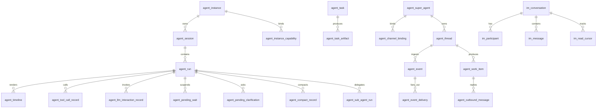

`capability_mcp` / `capability_cli` are polymorphically bound through `agent_instance_capability(capability_type, capability_id)` and have no foreign key.

### 4.4 Data Flow

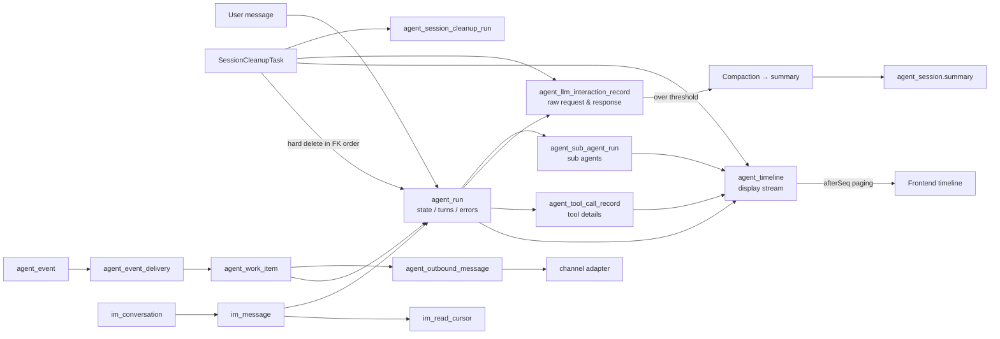

Key characteristics:

1. One run writes several tables: state, display, tool details, raw LLM interaction.
2. Timeline merges SSE deltas with page queries; frontend dedupes by `seq` (sub-agent rows use `seq < 0`).
3. Compaction chain: history over threshold → compact record → session summary → later runs rebuild context.
4. Cleanup records every round, including dry runs.
5. Channel events flow through delivery → work item → run → outbound; IM messages are separate but can trigger a run.

### 4.5 Data Governance

| Rule | Description |
|---|---|
| Logical delete | Every table has `delete_flag`; session cleanup is the only hard delete |
| Common columns | `status`, `remark`, `created_by`, `updated_by`, `created_at`, `updated_at` |
| Multi-tenancy | `tenant_id` + `created_by`; row-level interceptor appends `created_by` to SELECTs |
| Migrations | 149 Flyway versions; applied ones immutable, additive only |
| Large tables | `agent_llm_interaction_record` and `agent_timeline` drive growth |
| Disk reclaim | Hard delete only frees space inside PG; filesystem shrinks after `VACUUM FULL` |
| Indexes | Cleanup relies on `agent_session(delete_flag, created_at)`, `agent_task(session_id)` |
| Event idempotency | Inbound events/deliveries dedupe by source keys; work items are claimed by CAS |
| Outbox | Outbound messages persist before send; retries keep the same idempotency key |
| Retention | Super Agent threads/events/work items/outbound rows follow the retention task |

---

## 5. 4A Traceability Matrix

| Business capability | Application landing point | Data landing point | Technical means |
|---|---|---|---|
| Configure an agent | `InstanceController → InstanceService` | `agent_instance`, `agent_instance_capability` | MyBatis-Plus + row-level permission |
| Have one conversation | `ChatRuntimeController → ChatRuntimeService → SessionRunner` | `session / run / timeline / tool_call_record` | Virtual threads + SSE |
| Wait for a human answer | `SessionRunner` suspends → `ChatRuntimeService.resume` | `agent_pending_clarification` | CAS claim + two wake paths |
| Wait for a period of time | `wait` tool → `PendingWaitWakeScheduler` | `agent_pending_wait` | In-memory timer + cron fallback |
| Let the agent use tools | `ContextPreparer.resolveTools → ToolExecutor → SPI` | `capability_*`, `agent_tool_call_record` | Java SPI + MCP + FiberSet |
| Let the agent see/click a page | Extension → `/api/v1/chrome` | `agent_file_store`, `agent_timeline` | CDP + content script |
| Business wants structured result | `TaskController` → execute/extract/refine | `agent_task`, `agent_task_artifact` | Async polling + JSON Schema |
| Swap a model / degrade | `RouteController → ModelProviderService` | `agent_model_provider / route / api_key` | ProviderStrategy + fallback |
| Who may use what | `@RequirePermission` + `AuthInterceptor` | `sys_user / role / permission` | RBAC + `created_by` |
| Single sign-on | `SsoAuthController` | `agent_identity_provider`, `agent_sso_identity` | OIDC + PKCE + JWKS |
| Post-hoc accountability | `AuditLogController`, `TimelineRecorder` | `sys_audit_log`, `agent_timeline` | AOP + event funnel |
| Run a digital employee | `SuperAgentController → SuperAgentService` | `agent_super_agent` + router/worker instances | Router + Worker split |
| Ingest a channel message | `ChannelWebhookController → EventIngestService` | `agent_thread`, `agent_event`, `agent_event_delivery` | Idempotent ingest + channel SPI |
| Route work to a worker | `GroupRouterScheduler → AgentRouterScheduler` | `agent_work_item` | Relevance routing + CAS dispatch |
| Reply to a channel / IM | `OutboundDispatchScheduler` / `ImMessageService` | `agent_outbound_message`, `im_message` | Outbox + SSE |

---

## 6. Quick Start

Prerequisites: JDK 21, Maven, Node.js >= 20, PostgreSQL, Redis.

```bash
# Backend
mvn install -DskipTests
mvn -pl agent-sphere-bootstrap spring-boot:run -am

# Admin UI (:8000; proxies /api to :8080)
cd agent-sphere-ui
npm run dev

# Widget (:5173)
cd agent-sphere-copilot-widget
npm run dev
```

Product URLs:

- `http://127.0.0.1:8000/**` — Agent operations platform (excluding `/admin/**` and `/workspace`)
- `http://127.0.0.1:8000/admin/**` — System administration
- `http://127.0.0.1:8000/workspace` — Super Agent product

Extension: open `chrome://extensions`, enable Developer mode, load `agent-sphere-chrome-extension/` unpacked.

Backend tests need no DB/Redis:

```bash
mvn test
```

---

## 7. Repository Map

```text
agent-sphere/                  Backend (Java/Maven)
agent-sphere-ui/               Admin UI (React/Umi)
agent-sphere-copilot-widget/   Embeddable widget
agent-sphere-chrome-extension/ Chrome MV3 extension
k8s/                           k3s manifests
.github/workflows/             CI/CD
.local-workflow/               Local build/deploy scripts
examples/                      Integration examples
```

Project rules:

- `AGENTS.md`
- `agent-sphere/AGENTS.md`
- `agent-sphere-ui/AGENTS.md`
- `agent-sphere-copilot-widget/AGENTS.md`
- `agent-sphere-chrome-extension/AGENTS.md`

---

## 8. Development & Verification

| Project | Verification |
|---|---|
| Backend | `mvn test` |
| Admin UI | `npm run biome` → `npm run lint` → `npm test` |
| Widget | `npm run typecheck` → `npm test` |
| Extension | `vm.Script` syntax check + manual smoke test |

Read the matching `AGENTS.md` before changing a project. It contains the mandatory rules for
magic values, enums, method size, layering, tests and runtime invariants.

---

## License

See [LICENSE](LICENSE).
