<p align="center">
  
  
  
  
  
  
  
  
  
  
</p>

<p align="center"><b><a href="https://as.buukle.top" target="_blank">🔗 线上预览 / Live Demo → as.buukle.top</a></b></p>
<p align="center"><b>👤 演示账户 / Demo Account: <code>demo001</code> / <code>demo001</code></b></p>

This project is an AI  Agent orchestration platform. Driven by an LLM-based decision engine and combined with capabilities (built-in tools, MCP protocol, CLI execution, browser automation, etc.), it implements a primary closed loop of **Perception → Planning → Execution → Feedback**.

It supports configuring different model providers: OpenAI, DeepSeek, QuickRouter (relay station), BigModel (Zhipu AI), LiteLLM, OrcaRouter.
---

Screenshots

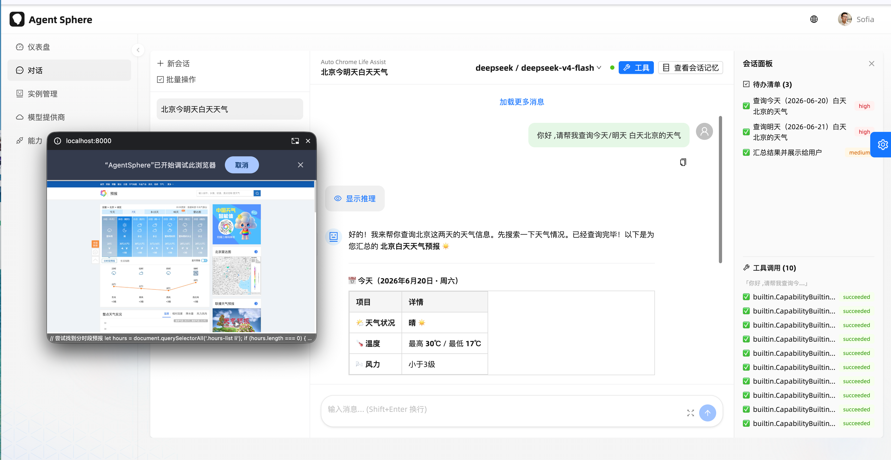

Multi-agent orchestration — the main chat renders sub-agent cards inline (live per-sub-agent steps, auto-scroll):

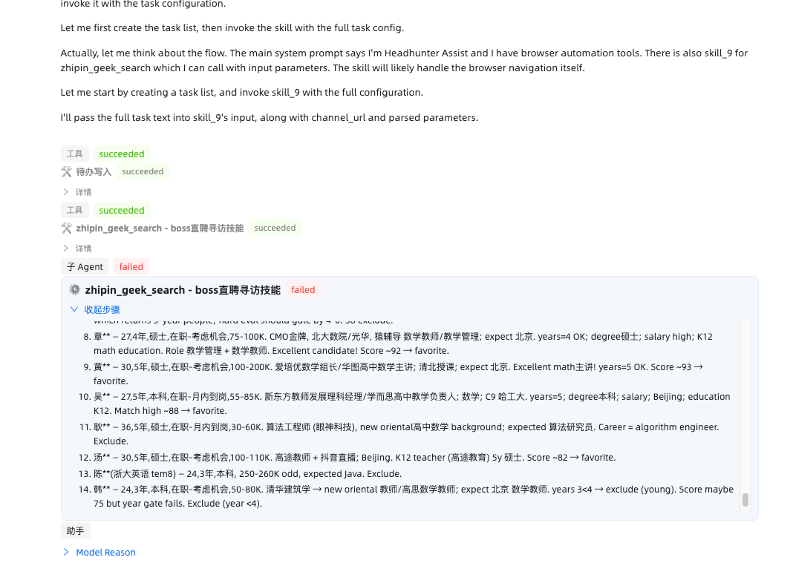

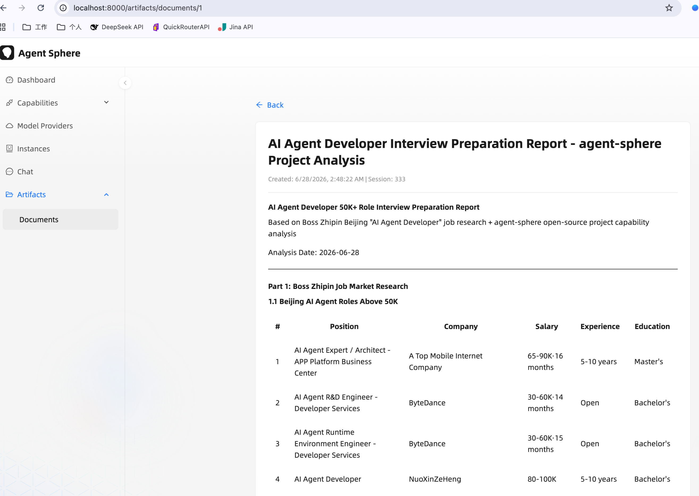

Embeddable chat widget (shadow DOM, OIDC SSO, REST + SSE timeline chat):

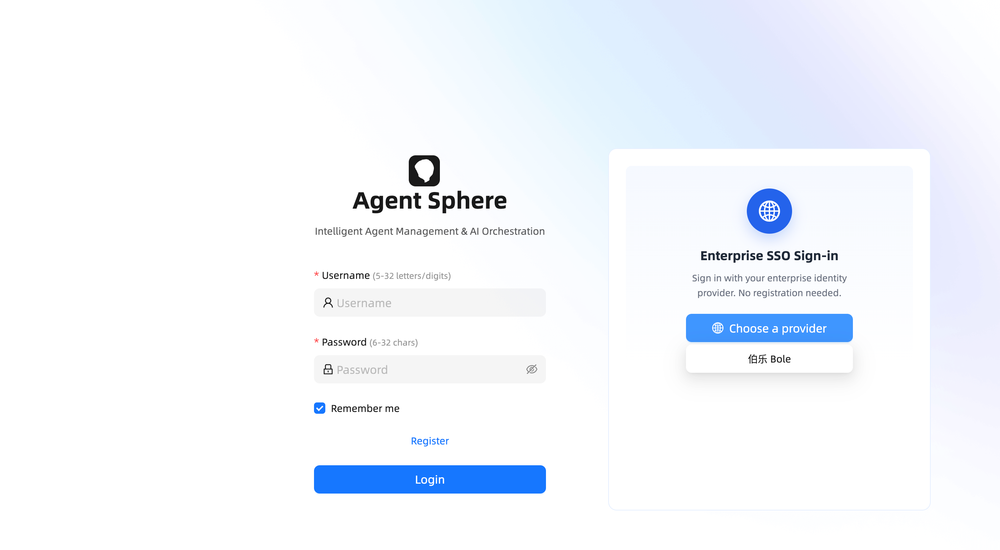

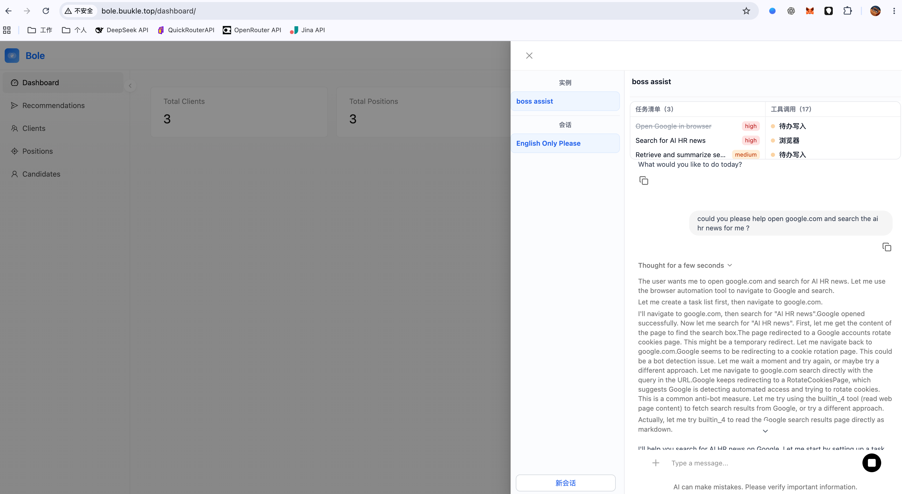

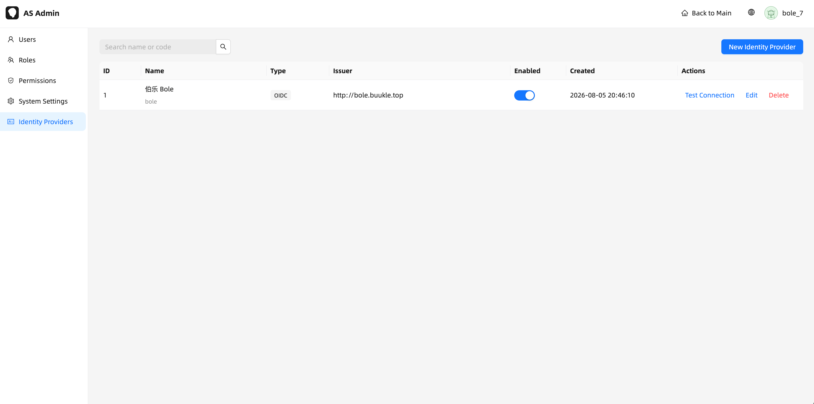

▶ [Click to watch the video demo](https://www.bilibili.com/video/BV1WqTT62Efq/)

[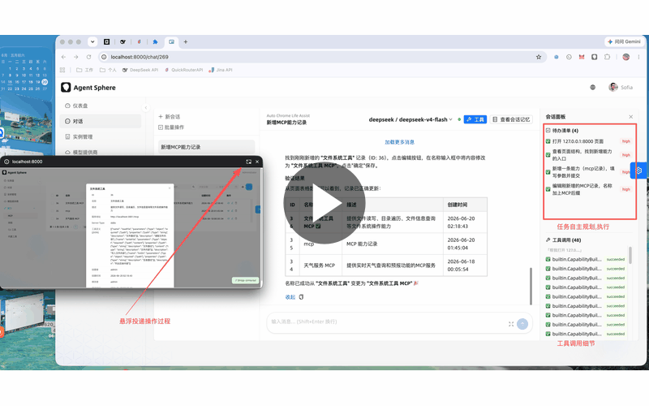](https://www.bilibili.com/video/BV1WqTT62Efq/)

## Features

- **LLM ReAct orchestration** — `SessionRunner` runs a `Plan → Act → Observe → Learn` loop with per-turn timeout, cancellation, and automatic context compaction.
- **Multi-agent sub-runs** — a parent run can delegate sub-tasks to **sub-agents** via the unified **`delegate` tool** (`SessionSubRunner`); it also drives **DAG orchestration** (`tasks[]`): Kahn-layered parallel lanes, per-task `args`/`dependsOn` data injection through `ContactEnvelope`, a `delegate-lane/v1` output contract with per-key reconciliation, and bounded retries.
- **Multi-provider model routing** — OpenAI / DeepSeek / BigModel (Zhipu) / relay stations / OrcaRouter, with primary + fallback route chains and graceful degradation.
- **Unified capability layer** — MCP servers, built-in SPI tools, CLI execution, browser automation, and composite skills, dispatched through a single `ToolExecutor`.
- **Real browser automation** — a Manifest V3 Chrome Extension bridge performs DOM operations (navigate / click / type / executeJS) with real-time execution feedback.
- **Vision-based browser operation** — the extension captures page screenshots (viewport + full-page) and feeds them back into the model as a **visual observation** (main agent, sub-agents and embeddable widget all render them inline); `clickAt(x, y)` performs pixel-targeted trusted clicks at screenshot coordinates.
- **Image recognition (chat images)** — upload images with a chat message (`/api/v1/files/upload` → `fileKey`), rendered inline in the conversation as thumbnails with a click-to-zoom preview (main UI + widget); routes gate image support via `supports-attachment` and degrade to plain text when unavailable.
- **Multi-level memory** — persistent runs, tool-call records with write-time JSON compression, and token-budget based context compaction.
- **Human-in-the-loop clarification** — the LLM pauses with a `ask_clarification` tool and resumes via AG-UI interrupt/resume (`confirm` / `choice` / `input`).
- **Suspend–resume `wait` tool** — a non-blocking `wait` (`builtin_10`) parks the run in a `WAITING` state instead of sleeping, so the wait happens *outside* the 60s tool-timeout box without holding a virtual thread or a parallelism slot; a memory timer wakes it, with a cron fallback, a stuck-run reconciler and bounded resume retries (§3.8a).
- **Model-owned todo plan linked to skills** — `todowrite` is the single carrier of the plan; todo items point back at their source skill via structured `skillId` / `stepId` (§3.8b).
- **Loop budget** — a per-run turn budget that survives park/resume, reported to the model every turn, with a hard-close nudge near the cap and a `loopCapped` flag that distinguishes a truncated run from one that legitimately finished (§3.1a).
- **OIDC multi-provider SSO** — PKCE + JWKS-verified logins from any IdP, JIT user provisioning, plus full RBAC and audit logging.
- **Per-user private resource copies** — each identity provider declares a `resource_template` JSON; on a user's first login the platform asynchronously provisions a **private copy** (model provider / api key / model route / completions / instance / mcp / skill / document) owned by that user, with row-level `created_by` isolation.
- **Capability Open API** — external systems call `completions` and `tasks` over `/api/v1/api/*` with `code + subject + businessType` identity, plus `businessType`-scoped ownership checks and task callback URLs.
- **Task artifacts** — tasks persist two-phase structured outputs as `agent_task_artifact` rows, reviewable from the **产出 → 任务产物** page (list / detail / JSON view / copy).
- **Completions management** — 提示工程 admin page with input/output JSON Schema, runtime config (`temperature` / `max_tokens` / `top_p` / penalties / `stop` / `thinking`), prompt versioning, and call records.
- **Single user-level browser connection** — the Chrome extension keeps one per-user task SSE stream (no per-session following), `<all_urls>` host permission, and shows the user as `provider@subject`.
- **Embeddable chat widget** — a single IIFE script that mounts into a shadow DOM and talks a typed **REST + SSE timeline** with self-managed Bearer auth (no CopilotKit / AG-UI runtime), embeddable in any third-party page.
- **Skill Hub (composite-skill marketplace)** — every skill has a `PRIVATE`/`PUBLIC` visibility: publish it from **My Skills** to make it appear in the **Skill Hub**, which lists **all users' PUBLIC skills (including your own)** with keyword search and install-count ordering. Installing **forks** a copy into your own skills (PRIVATE by default, auto-suffixed on name collision) and increments the source's `install_count`; your own published skills do not show an **Install** button. Gated by `capability:skill:publish` / `capability:skill:install`.

## 1. Quick Start for Development

See: [QUICK_START.md](QUICK_START.md)

## 2. Architecture

### 2.1 Overall Structure

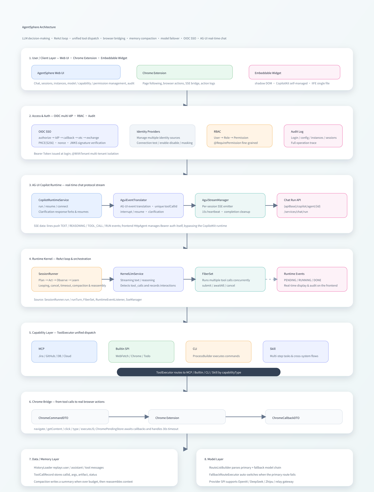

> Full **4A architecture** (Business / Application / Technology / Data, with ER and call-sequence diagrams): [ARCHITECTURE-4A-cn.md](ARCHITECTURE-4A-cn.md) (Chinese).

### 2.2 Core Components

#### 2.2.1 SessionRunner (ReAct Engine)

Manages the complete execution lifecycle of an AI session, implementing the **Plan → Act → Observe → Learn** loop:

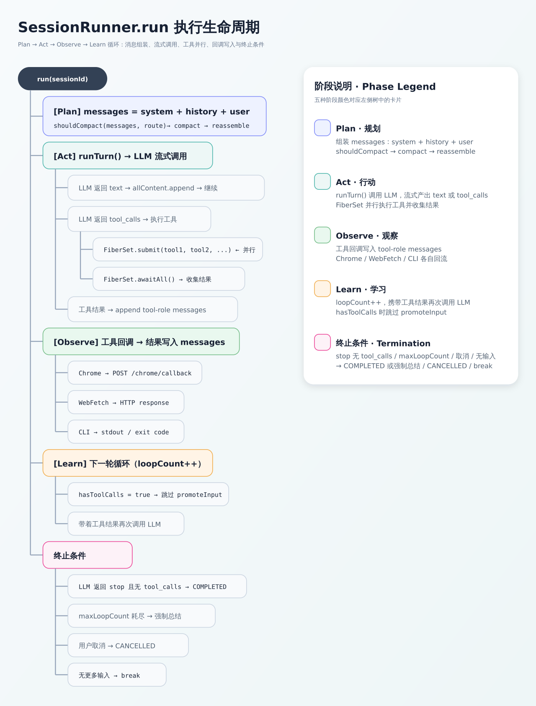

**Alignment with the ReAct pattern:**

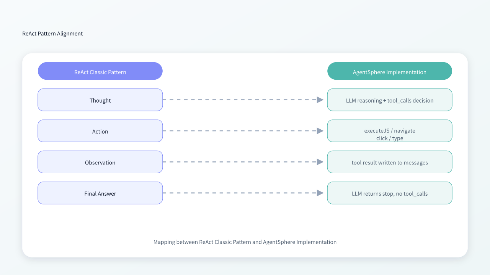

#### 2.2.2 Capability Layer

| Capability Type | Implementation | Description | Examples |
|-----------------|----------------|-------------|----------|
| **MCP (Model Context Protocol)** | MCP Server client | Standard protocol, connects to any MCP Server | Jira, GitHub, Slack, databases |
| **Builtin (built-in tools)** | SPI: `CapabilityBuiltinToolSpi` | Java SPI extension | WebFetch, WebRead, Chrome, Todowrite, DocWrite, SkillManage, TextContains |
| **Chrome Browser** | Chrome Extension bridge | DOM operations + real-time execution feedback | Navigate, click, fill forms, executeJS, **screenshot, clickAt** |
| **CLI (command line)** | `ProcessBuilder` execution | Local or remote shell | Git operations, build/deploy, system administration |
| **Skill (composite skills)** | Multi-step task orchestration | LLM-driven task decomposition | Cross-system workflows |

#### 2.2.2a Skill Hub (Publish & Install)

Each skill carries a `visibility`: `PRIVATE` (author only, default) or `PUBLIC` (published to the Hub — publishing is immediate, **no review gate**). The **My Skills** tab toggles visibility (`PUT /api/v1/capability/skill/{id}/visibility`); the **Skill Hub** tab (`GET /api/v1/capability/skill/hub`, keyword + paging) lists **all users' PUBLIC skills, including your own**, ordered by `install_count` then `created_at`.

Backend filter: `visibility='PUBLIC' AND created_by IS NOT NULL`. The explicit `created_by` reference makes `DataPermissionInterceptor` skip its ownership rewrite, so the Hub is a true cross-user listing (ordinary users are otherwise row-scoped to `created_by = <username>`). Installing (`POST /api/v1/capability/skill/{id}/install`) **forks** the source into your own skills — a PRIVATE copy with `origin_skill_id` back-linking the source, name auto-suffixed on collision (e.g. `skill (1)`), and the source's `install_count` incremented. Your own published skills do **not** show an Install button; unpublishing never affects already-installed copies.

**Skill body structure is validated** — a skill's `promptTemplate` must follow a fixed heading schema, because `## stepN` headings are what the todo/skill linkage (§3.8b) keys against:

- exactly **one** `# <skill name>` H1, and it must come first;
- at least one `## stepN <step name>`;
- `### stepN.M <sub-step name>` must sit under the `## stepN` with the **same number**;
- no heading level may be skipped (H1 → H3 without an H2 is rejected).

Legacy definitions that carry a bare `{"prompt": ...}` with no heading structure are rejected too — they must be normalised before they can be updated or appended to. That is intentional.

There is exactly **one** implementation of this rule: `SkillTemplateValidator` in the `common` module, returning either `null` (pass) or a violation list plus the canonical template. The **only** enforcement point is the service layer (`CapabilitySkillServiceImpl#validateDefinition`, called by both create and update), which throws `BizException(PARAM_INVALID)` — so both entry points (the UI form via `CapabilitySkillController`, and the agent's own `skill_manage` tool) are covered without duplicating the check. Because legacy definitions are rejected, the **default resource template's sample skill must itself be compliant**, since `SkillInitializer` reads it to seed a new account.

The canonical template is kept in sync across three places: `SkillTemplateValidator.SKILL_TEMPLATE` (backend), the tool description that references it, and `SKILL_TEMPLATE` / `SAMPLE_DEFINITION` in `agent-sphere-ui/src/pages/capabilities/skill/index.tsx`.

**Versioning & auto-update** — every skill carries a `version` (int, starts at 1; each content edit via `PUT /api/v1/capability/skill/{id}` bumps it). Installed copies record the source version at fork time (`origin_version`). On the **My Skills** tab you can flip **Auto update** on for any installed copy (`PUT /api/v1/capability/skill/{id}/auto-update`); a scheduler (`SkillSyncRunner`, default every 5 min via `buukle.agent.skill.auto-update-interval`) scans those copies and — when `source.version > copy.origin_version` — fully syncs `name`/`description`/`definition` from the source (a true fork-track, so local renames are overwritten). The sync uses a conditional `UPDATE ... WHERE id=? AND origin_version=?`, so multiple replicas never double-apply.

> The scan predicate is deliberately **`auto_update = true AND origin_skill_id IS NOT NULL`** with **no time window**. The earlier `SkillAutoUpdateSweeper` filtered on `created_at >= now() - 7 days` — but a copy's `created_at` is its **install** time, so any copy installed more than 7 days ago was **never scanned again**. That is why auto-update appeared to "do nothing". `SkillSyncRunnerTest#sweep_queryHasNoTimeWindow` locks the fix in; do not add a window back.

**Sync execution records** — the task's logger is suppressed by logback's `com.buukle.agent.capability = WARN` rule, so "did it run / how many did it sync" was unanswerable from logs. Every sweep therefore writes one `capability_skill_sync_run` row (V80) with `trigger_type`, `scanned_count`, `updated`, `skipped`, a per-copy skip detail, `skip_reason` and `elapsed_ms`. Skip reasons are enumerated in `SkillSyncOutcome` — notably `SOURCE_GONE` (source deleted or unpublished; the copy is left untouched) vs `VERSION_NOT_AHEAD` (nothing to do), which is exactly the distinction you need when nothing synced. **Trigger it on demand** with `POST /api/v1/capability/skill/sync-now` and poll `GET /api/v1/capability/skill/sync-runs` / `GET /sync-runs/{id}` — the same mirror of the session-cleanup endpoints, and the frontend reuses `useRecordedTask`. A kill switch (`buukle.agent.skill.auto-update-enabled`) and a sync-log retention window (`skill.sync-log-retention-days`) live in `agent_system_config` so they can change without a redeploy.

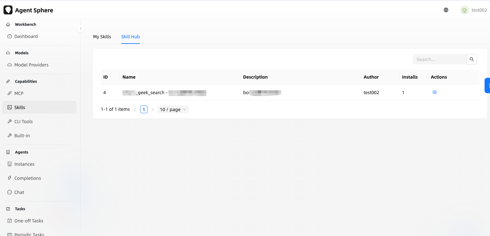


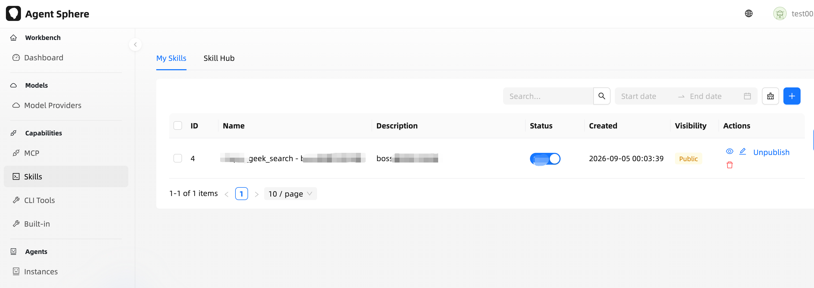

#### 2.2.3 Chrome Extension (Browser Bridge)

The extension bridges the backend with the user's browser for automated operations. It keeps a **single user-level task SSE connection** (`/api/v1/runtime/user/task/stream`) that delivers `browser_operation` commands for any of the user's sessions/runs — no per-session following. It declares `<all_urls>` host permission (granted at install) so it can inject a content script into any page the agent operates on.

Recent architecture notes:
- **Screenshots for vision operation** — the extension captures page screenshots (`Page.captureScreenshot`, viewport via `screenshot(scope=viewport)`, full-page via `scope=full`) with `cdp-client.js` (the only place allowed to touch `chrome.debugger`). The base64 is stored via `POST /api/v1/browser/screenshot` and only the `fileKey` travels on the callback, then the runtime injects a USER observation message (`text + image_url`) into the model context so vision-equipped models can plan from the real page (main and sub-agent loops share the same injection support, capped by `runner.max-screenshots-per-run`). `clickAt(x, y)` clicks at the device pixels of the last **viewport** screenshot (converted to CSS px via `devicePixelRatio`); non-interactive points click through with a warning. Screenshots are echoed back in the chat timeline as tool-card thumbnails (click-to-zoom), persisted from the tool artifact — live refresh and session reload both show them.
- **SSE lives in an offscreen document** (`offscreen.html/js`) — immune to MV3 service-worker suspension; the background alarm re-creates it if the browser closes it.
- **Native ES modules** — the background service worker (`background.js`, `"type": "module"`) imports `lib/cdp-client.js`, `lib/tab-manager.js`, `lib/result.js`, `lib/offscreen-bridge.js`; the execution layer is `content.js` + `content-locator.js` (injected in order into the isolated world).
- **Tab grouping** — every tab the plugin navigates/opens is auto-grouped under the `AgentSphere` tab group (`tabGroups` permission), recreated if closed.
- **`executeJS` is tiered** (debugger only as last resort): `chrome.scripting` into the page **MAIN world** → `chrome.debugger` `Runtime.evaluate` (bypasses CSP entirely; strict-CSP sites land here). MV3's extension CSP forbids `eval()` in an isolated world, so no isolated-world tier exists.

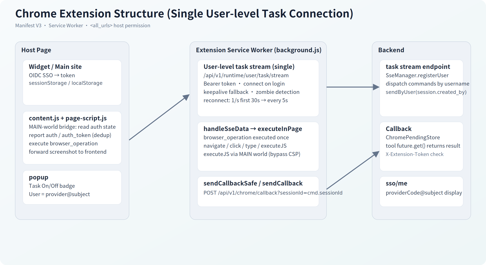

---

## 3. Algorithm — Core Algorithms

### 3.1 ReAct Execution Loop

The core loop of AgentSphere follows the **ReAct (Reasoning + Acting)** pattern, combining the LLM's reasoning ability with tool execution ability:

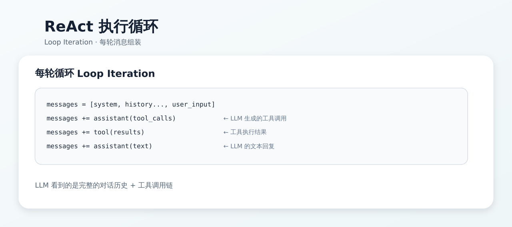

**Message structure:**

```
[
  {role: "system",    content: "You are a browser assistant..."},
  {role: "user",      content: "Help me check the weather in Guangzhou"},
  {role: "assistant", tool_calls: [{id: "call_1", name: "navigate", args: "..."}}]},
  {role: "tool",      tool_call_id: "call_1", content: '{"tabId": 42, "url": "..."}'},
  {role: "assistant", content: "The weather in Guangzhou tomorrow is..."},
  {role: "user",      content: "What should I prepare for going out tomorrow"},
  ...
]
```

**Multi-turn tool call example:**

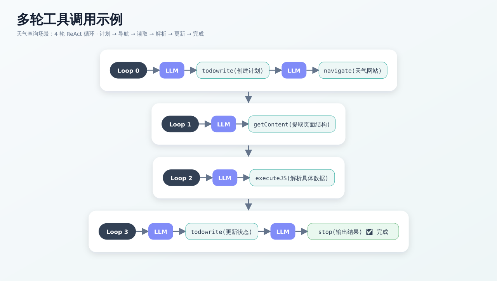

#### 3.1a Loop Budget — count, cap, and what the model is told

The loop count is a **per-run budget**, not a per-call allowance. A run that suspends on `wait` or clarification and later resumes continues from where it left off, so a model cannot buy unlimited turns by parking repeatedly.

**Resolution order** — `LoopLimitResolver`, highest priority first:

| Priority | Source | Configured at | Default |
|---|---|---|---|
| 0 | `PINNED` | the run's own `loop_limit` column (V88) | — |
| 1 | `INSTANCE` | `agent_instance.max_loop_count` | unset |
| 2 | `TASK` | `runner.task-max-loop-count` (task-triggered runs) | 2000 |
| 3 | `CHAT` | `runner.max-loop-count` | 128 |

**Why the budget is pinned.** A run re-enters the loop from five places — first `startRun`, `wait` resume, clarification resume (×2) and the stuck-`WAITING` reconciler. Only the first runs on the task request thread, which is where the `TaskLoopLimitHolder` ThreadLocal that carries the `TASK` allowance lives; the other four run on scheduler threads where it is null and the budget silently fell back to the much smaller `CHAT` value mid-run. V82 pinned the *counter* (`loop_count`); V88 pins the *denominator* (`loop_limit`) as well, so the budget cannot drift because of a lost ThreadLocal, an instance `max_loop_count` edited mid-run, or a config change. The two are written by the same `updateRun` — no extra write. Sub-agent loops are deliberately **not** pinned: `SessionSubRunner` is a single synchronous `for` loop with no park/resume, so its limit cannot drift within one call.

**What the model is told.** Every turn appends a tail system segment reporting `Loop n/total` and the remaining count (both 1-based, so "0 turns remaining" can never appear); within 5 turns of the cap it adds a nudge to converge. From **3 turns** before the cap it also appends a hard-close instruction to stop calling tools and deliver the answer. Both are **advisory** — the `while (loopCount < maxLoopCount)` condition is the only thing that actually enforces the cap.

Two subtleties worth knowing:

- The tail block is **rebuilt every turn, not edited in place**. Tool turns append assistant/tool/observation messages after it, so an in-place update would leave a stale copy stranded mid-history — contradicting itself on "turns remaining" and burning context.
- The hard-close wording deliberately says *"approaching the hard loop limit"* rather than *"this is your final turn"*. Injected 3 turns early, the latter would be false, and a model told it has one turn left may keep calling tools.

**`loopCapped` means "truncated", not "ran long".** It is set only when the model was still calling tools on the final turn and got cut off. A run that simply *finished* on the last allowed turn is a normal completion and is **not** marked. This distinction matters: the task guard (§5.2) fails loop-capped tasks instead of running the structured-extraction phase, and conflating the two used to discard complete results — a run that finished with `status=empty, stopReason=POOL_EXHAUSTED` had its entire structured conclusion replaced by `{"error": "run loop limit reached"}`.

#### 3.1b Per-turn LLM retry

A turn that errors with **no output and no tool calls** this attempt is retried in place, up to `runner.llm-turn-max-retries` attempts (default 3) with **exponential backoff** (1s → 2s → 4s, capped at 8s). Once a turn has produced partial text or emitted a tool call it is not retried, to avoid duplicating side effects.

The previous fixed `sleep(1s)` with a single retry was actively harmful against a provider that fails in bursts: fixed backoff re-hits the same instant and turns one blip into consecutive failures, and 2 attempts were not enough — production runs were killed by three failures inside 9 seconds while a run that happened to hit only two survived. Note there is no retryable/non-retryable classification yet, so a permanent error (context-length 400, auth failure) is retried too; now that the provider error is persisted (§4.2.2) this can be made precise later.

### 3.2 Multi-level Memory System

AgentSphere implements a multi-level memory system covering the full chain from persistence to runtime caching:

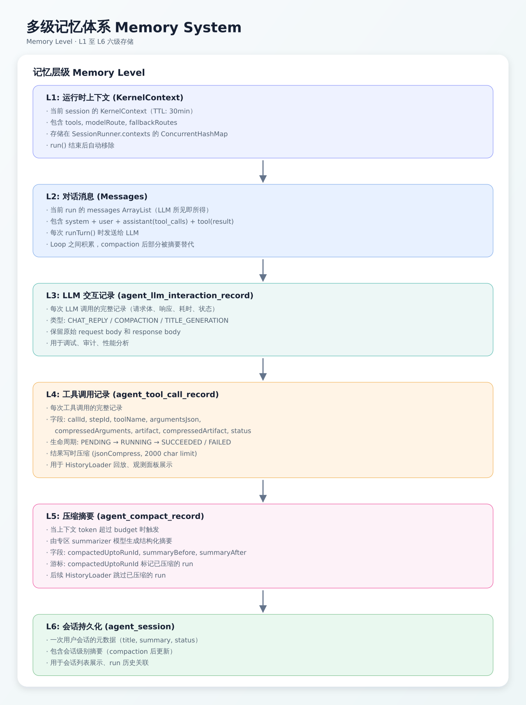

#### Memory Level Details

| Level | Storage | Lifecycle | Capacity | Purpose |
|-------|---------|-----------|----------|---------|
| L1: KernelContext | ConcurrentHashMap | During run (TTL 30min) | 1 per session | Tool list, model route |
| L2: Messages | ArrayList | During run | Dozens of turns | LLM input/output |
| L3: LLM Interaction | PostgreSQL | Permanent | Configurable | Debugging & audit |
| L4: Tool Call | PostgreSQL | Permanent | Unlimited | Replay, observation |
| L5: Compact Record | PostgreSQL | Permanent | Cumulative | Context compression |
| L6: Session | PostgreSQL | Permanent | 1 per session | Metadata |

#### 3.2.1 Context Assembly

`HistoryLoader` is responsible for loading historical messages from persistent storage and assembling them into the LLM context:

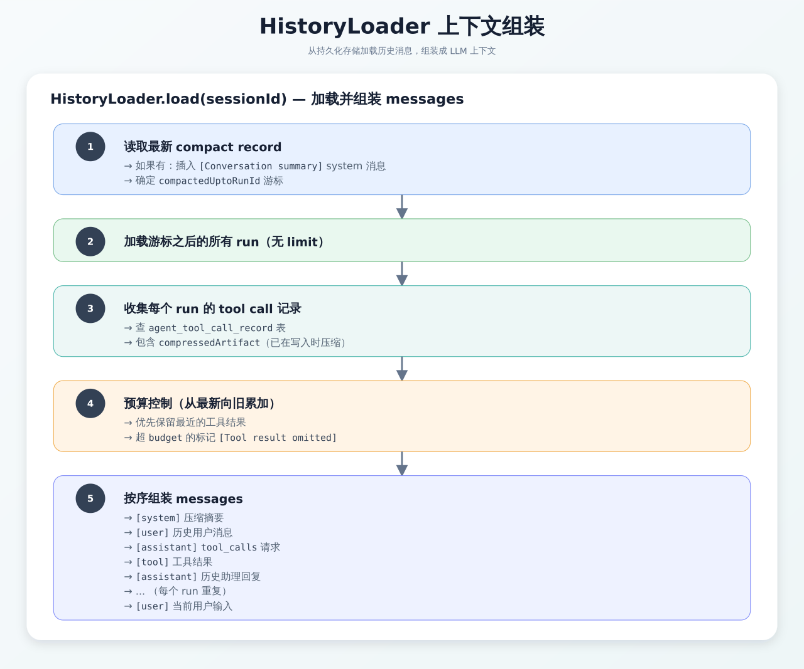

**Tool result compression flow:**

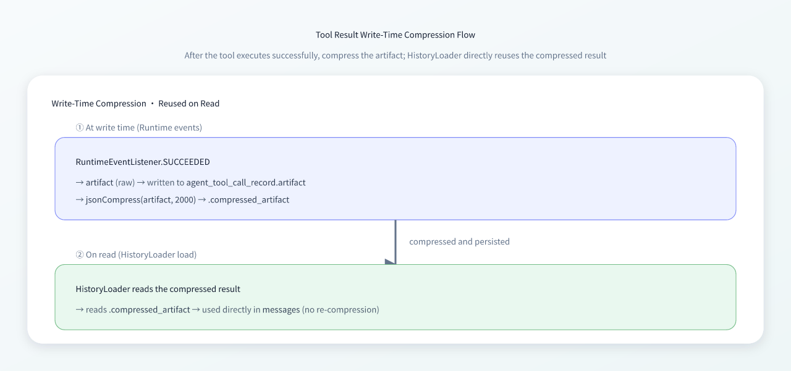

#### 3.2.2 Context Compaction

Triggered when the estimated tokens of messages exceed `maxInputTokens × budget-ratio`:

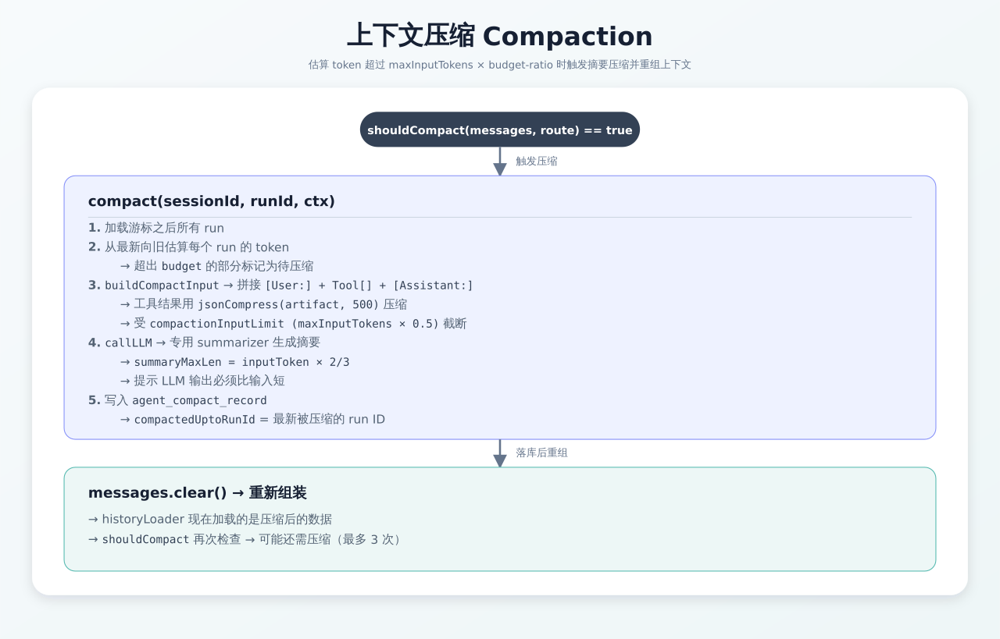

**Full compression chain flow:**

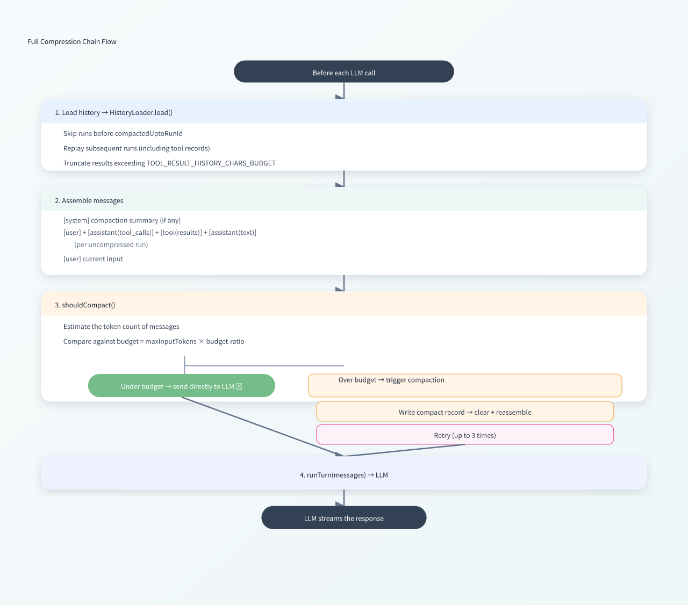

#### 3.2.3 Tool Call Record State Machine

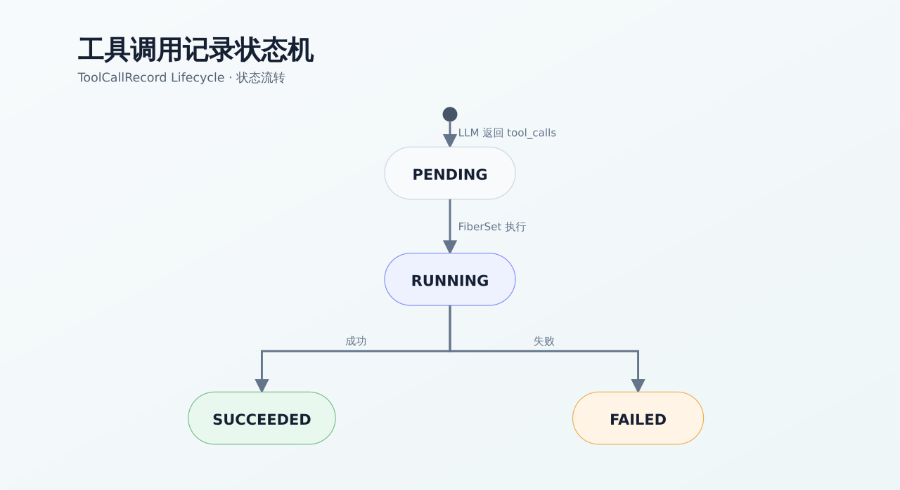

Each record contains:
- `callId` — Tool call ID generated by the LLM (e.g., `call_abc123`)
- `argumentsJson` — Original input arguments
- `compressedArguments` — Compressed version of input JSON (write-time compression)
- `artifact` — Original return result
- `compressedArtifact` — Compressed version of result JSON (write-time compression)
- Used by HistoryLoader for replay, observation panel display, and auditing

#### 3.2.4 Tool Result Compression Strategy

```java
jsonCompress(node, depth, maxValueChars) {
  if (depth > 5) return "[deep nested]";

  if (node instanceof Map) {
    // Recursively compress each value
    return map.mapValues(v -> jsonCompress(v, depth+1, maxValueChars))
  }

  if (node instanceof List) {
    if (list.size() <= 5) return list.map(v -> jsonCompress(v, depth+1))
    // Large array: keep first 3 + total count
    return { _count: 13, _showing: 3, items: [...] }
  }

  if (node instanceof String) {
    if (text.length() <= maxValueChars) return text
    // Long string: first 100 + ellipsis + last 50
    return text[0..100] + "...[+ N chars]...\n" + text[-50..-1]
  }

  return node // Number, Boolean pass-through
}
```

### 3.3 Model Routing and Fallback

AgentSphere provides a multi-level model fault-tolerance mechanism to ensure high availability of LLM calls.

#### Routing Configuration

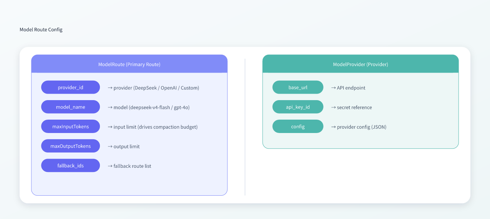

#### Fallback Execution Flow

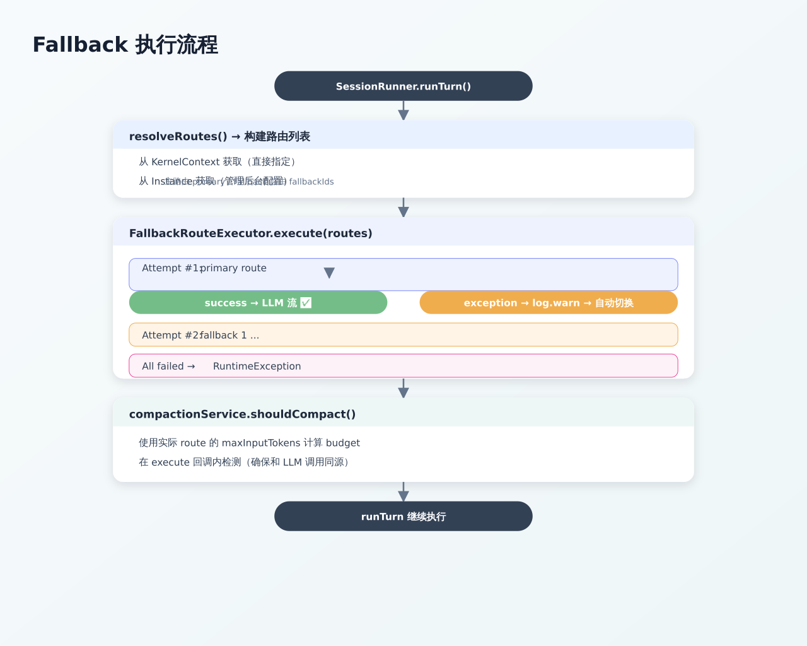

> Note: The compression budget calculation is based on the actual route's maxInputTokens, detected within the execute callback. See the formula below for details.

#### Compression Budget Calculation

```
budget = maxInputTokens × budget-ratio (default 0.7)

Example:
  Route: GLM-4.1V-Thinking-Flash, maxInputTokens=1_000_000
  → budget = 1_000_000 × 0.7 = 700_000 tokens
  → When messages exceed 700K tokens → trigger compaction

Dynamic adjustment:
  budget-ratio: 0.5  → Triggers earlier (preserves more context quality)
  budget-ratio: 0.8  → Triggers later (saves compression overhead)
```

#### Timeout Parameters

| Parameter | Default | Description |
|-----------|---------|-------------|
| `llm.connect-timeout` | 30s | Timeout for connecting to LLM API |
| `llm.read-timeout` | 60s | Timeout for reading response |
| `llm.stream-read-timeout` | 120s | Stream read timeout |
| `llm.stream-timeout` | 120s | Total timeout for streaming calls |
| `runner.turn-timeout` | 180s | Total timeout for a single LLM turn |

### 3.4 Browser Operation Flow

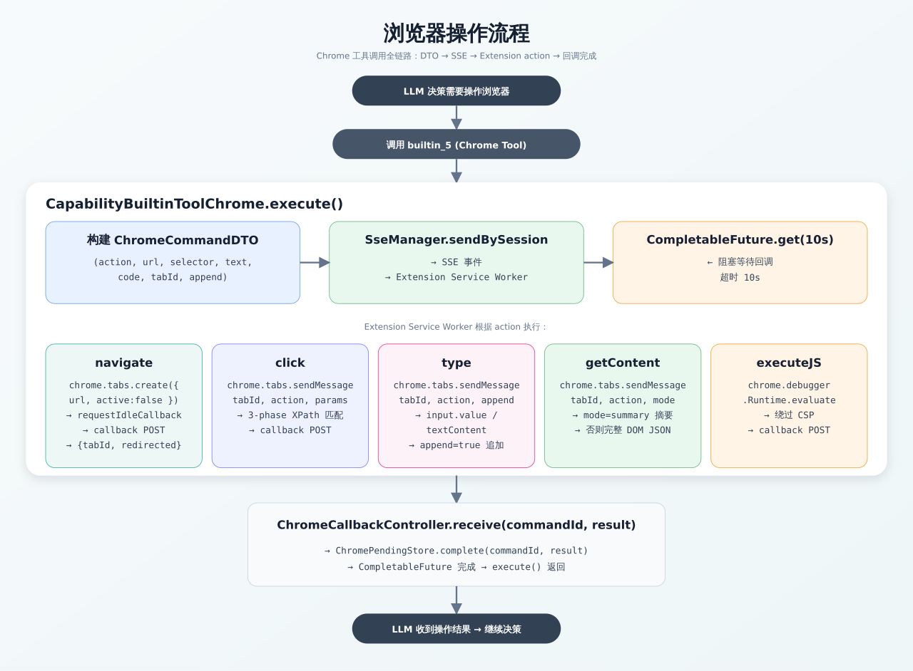

> Delivery note: `browser_operation` commands are pushed **once** on the user-level task stream (keyed by the session owner), never duplicated on a per-session stream — the extension executes each `commandId` exactly once and reports back via `/api/v1/chrome/callback?sessionId=<cmd.sessionId>`.

### 3.4a Image Recognition & Vision

Two vision paths share the same image part (`text + image_url` with a base64 data URL) understood by OpenAI-compatible providers:

- **Chat image attachments** — `POST /api/v1/files/upload` stores the file (`chat-attachment` bucket) and returns a `fileKey`; the send payload carries it, the run persists the reference (`agent_run.attachments`), and the timeline echoes `content.images` so the main UI and widget render thumbnails with a click-to-zoom preview. Routes gate image support: only `supports-attachment=true` routes carry image parts; when no capable route exists the message degrades to plain text (with a `REASONING_TOKEN` notice) instead of failing.
- **Browser screenshots** — after `screenshot` the tool result stores the image under the `browser-screenshot` bucket and its `fileKey` is injected as a USER observation message into the model's content, letting vision-equipped models plan the next action; the same `fileKey` is parsed back from the tool artifact into the timeline tool card. `GET /api/v1/files/{fileKey}` resolves either bucket for the frontends.

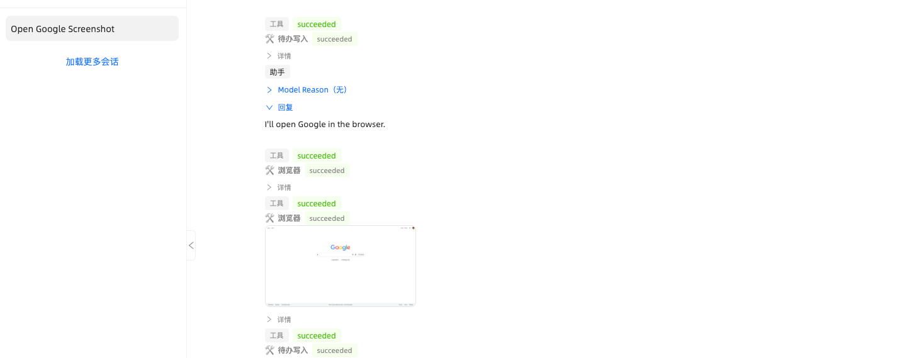

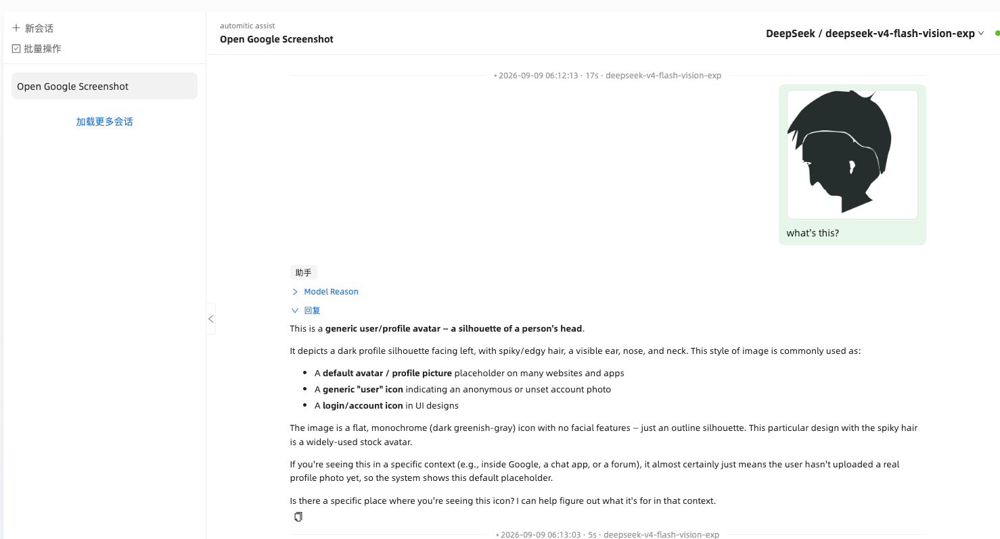

### 3.5 Multi-tab Management

Every tab the plugin navigates, opens, or follows (target=_blank / window.open) is aggregated into a single **`AgentSphere` tab group** (created once, recreated if the group is closed), so the browser stays organized during automation. Multi-tab following still auto-switches control to newly opened tabs.

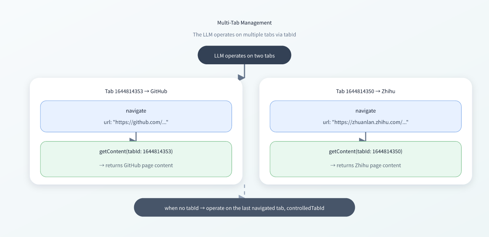

### 3.6 Timeout and Cancellation Chain

Stop/cancel is **session-level**: `POST /api/v1/runtime/{sessionId}/stop` stops the current run of the session regardless of which backend replica handled the request — no `runId` required. The cancel flag lives in Redis (`runtime:cancel-session:{sessionId}`) and the `SessionRunner` loop checks it at every cancellation point (loop top, after each turn, before/during/after tool fibers, and the LLM turn), terminating the run and publishing the cancel terminal event. The same endpoint also cancels a **parked** run — both `AWAITING_USER` (dismissing pending clarifications) and `WAITING` (cancelling the pending wait row). A parked run has already left the loop, so stopping it must write the terminal state directly rather than only setting the cancel flag: nothing would be left to consume that flag.

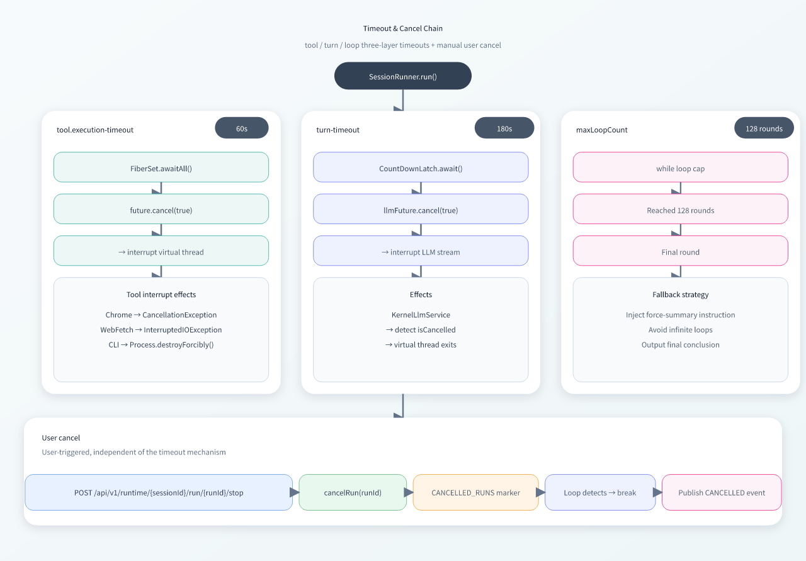

### 3.7 User-level Task Connection (Browser Plugin)

The extension no longer follows sessions. Instead it maintains a **single per-user task SSE stream** (`/api/v1/runtime/user/task/stream`) that receives every `browser_operation` command for the logged-in user (the backend fans out by the session owner, `session.created_by`).

- **When it connects**: on login (`auth` / `auth_token` reported by the content script), on extension/service-worker startup, and after a failed/closed connection. The connection is held by an **offscreen document** (immune to MV3 service-worker suspension); the background alarm re-creates the offscreen document if the browser closed it, and the keepalive loop pulls credentials and reconnects.
- **Reconnect**: the first 30 s retries once per second, then falls back to every 5 s; the count resets on success or a fresh login.
- **Auth**: `Authorization: Bearer <token>`; the stream is registered under `AuthContext.getUsername()`, so a task's session must be owned by the same user to receive its commands.
- **Callbacks**: command results are posted to `/api/v1/chrome/callback?sessionId=<cmd.sessionId>` (the command DTO carries its own session id). Multi-replica: callbacks are broadcast over the Redis event bus so the executing replica's pending future always completes.

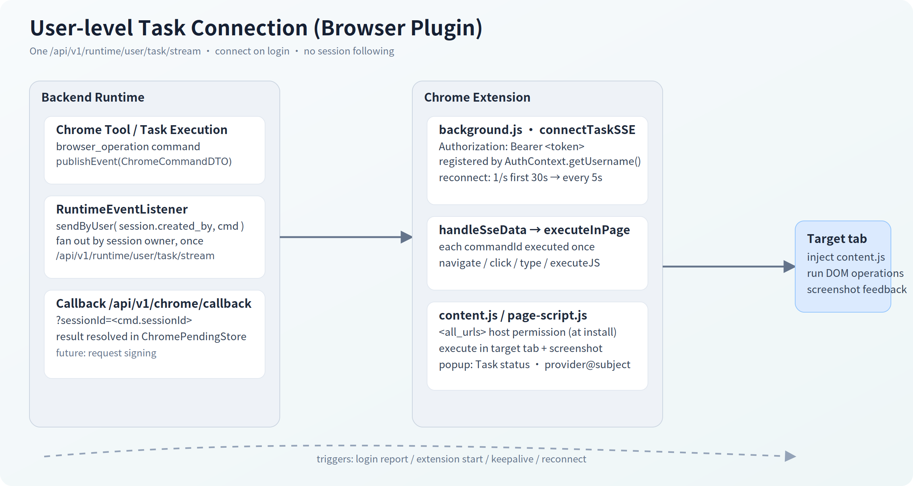

### 3.8 User Clarification (Human-in-the-Loop)

AgentSphere supports a **User Clarification** mechanism that enables the LLM to pause and explicitly ask the user for input when encountering ambiguous or decision-dependent situations, implementing a Human-in-the-Loop pattern.

#### Workflow

1. **LLM invocation**: During execution, when the LLM needs user input (e.g., choosing between options, confirming actions, filling in missing info), it calls the built-in tool `ask_clarification`.
2. **Pause and notify**: The run pauses and enters `AWAITING_USER` status. A `clarification_pending` SSE event is pushed to the frontend along with the clarification card (type, title, options).
3. **User response**: The user can respond through the clarification card in the chat UI:
   - **confirm** — Confirm/Cancel binary choice
   - **choice** — Multiple choice selection
   - **input** — Free-form text input
4. **Resume execution**: The system receives the response and resumes the run, delivering `"[User Response to Clarification]: ..."` to the LLM context. If the original run has ended, a new run is forked to continue.

#### Clarification Card (UI)

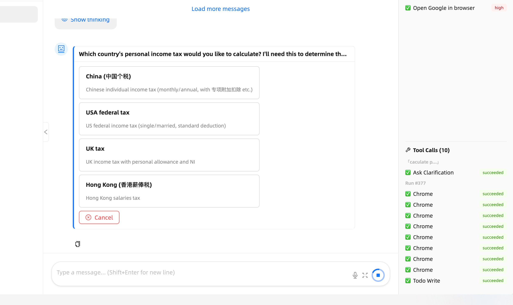

#### Cancellation

Users can cancel a pending clarification at any time:
- **Cancel via card**: Each clarification card has a Cancel button that sends a cancel signal and stops the run.
- **Cancel via sender**: The chat input shows a stop button while a run is active; clicking it issues a **session-level stop** (`POST /api/v1/runtime/{sessionId}/stop` — no runId required), cancelling the current run and any pending clarifications. Both the main UI and the embeddable widget use this endpoint.
- **Auto-cancel on new message**: Sending a new message while clarifications are pending automatically cancels them first.

#### SSE Events

| Event | Trigger | Effect |
|-------|---------|--------|
| `clarification_pending` | LLM calls `ask_clarification` tool | Clarification card appears |
| `clarification_responded` | User submits response | Card shows ✓, run resumes |
| `clarification_expired` | 30-minute TTL reached | Card grays out |
| `clarification_dismissed` | Run cancelled while awaiting | Card shows dismissed |

### 3.8a Wait Tool (Suspend–Resume)

`wait` (`builtin_10`) is a **built-in that does not block**. The tool body only writes one `agent_pending_wait` row and returns `{"status":"waiting"}` immediately; `SessionRunner` then breaks out of the loop and the run sits in the parked state `WAITING` until the timer fires, at which point the original run is resumed.

**Why park instead of sleep.** A regular tool must finish inside one `tool.execution-timeout` (60s) box, so "wait longer than 60s" is simply unsatisfiable. Parking puts the wait *outside* that box: it holds no virtual thread, no `maxParallel` semaphore slot, and no tool/step timeout. `FiberSet` needs no change at all — the suspension decision lives entirely outside the loop, exactly as `ask_clarification` proved.

**How the model is told.** Waking is not guaranteed, so the description forces the model to re-read the result with `getContent` first and forbids repeating the same wait — the same "re-verify after waiting" discipline `getContent(mode=ready)` uses.

| Property | Value |
|---|---|
| Row status lifecycle | `PENDING` → `RESUMED` (claimed) / `CANCELLED` / `FAILED` |
| Bounds | clamped to `MIN_WAIT_MS = 100` … `MAX_WAIT_MS = 600000` (10 min) |
| Wake path 1 | `PendingWaitWakeScheduler` — one in-memory timer per row |
| Wake path 2 | `WaitWakeTask` — cron every 10s, Redisson lock `scheduler:pending-wait` (a replica restart loses the in-memory timers) |
| Rescue | `WaitingRunReconciler` — sweeps `WAITING` runs older than `wait.reconcile-stale-minutes` |
| Resume retries | up to `MAX_RESUME_ATTEMPTS = 5` |

**Both wake paths claim with a single conditional `UPDATE ... WHERE status='PENDING'`**, never "select then update" — without the CAS, a timer and the cron firing at the same moment would resume the same run twice. The CAS is also what forces a failure path: once a row is `RESUMED`, `listDue` and `claimForResume` will never pick it up again, so a resume that throws would strand the run in `WAITING` forever. `resumeFromWait` therefore returns a `ResumeOutcome` (`RESUMED` / `SKIPPED` / `ERROR`) instead of swallowing the exception, and the caller decides: `ERROR` requeues the row to `PENDING` with `attempts+1` plus a `last_error`, and once the retry budget is exhausted the row is marked `FAILED` and the run receives a terminal event so the UI does not hang on "running".

Two boundaries that are easy to get wrong:

- **Once `asyncHandleUserMessage` returns, the resume is committed** — nothing may roll the run back to `WAITING` afterwards. Rolling back would put the row back in `PENDING`, let the cron claim it again, and **submit a second concurrent loop for the same run**. Failures *before* the submit must roll back, or the run is left `RUNNING` with no loop driving it and every later retry is misjudged as `SKIPPED`.
- The tool-success bookkeeping event is best-effort: it swallows its own exceptions and can never fail the resume.

`WAITING` is a real run state, so it is wired through the whole state machine — the run row, the `run_waiting` SSE event, the UI, the stop button and the session-cleanup guard. Two deliberate asymmetries: `WAITING` is in the frontend's pull-trigger set (so the panel refreshes to "waiting") but **not** in the terminal set (so the composer stays locked), and the stop button must set the terminal state directly rather than only setting a cancel flag, because the parked loop has already exited and nothing would consume that flag. Sub-agents must have `wait` stripped from their toolset — the suspension decision exists only in the main loop, so leaving it enabled creates a pending row that nobody ever claims.

### 3.8b Todo Plan & Skill Linkage

The **todo list is the single source of the plan**, maintained by the model through the `todowrite` tool and persisted in `agent_session_todo`. Reading a skill is a pure read: it never mutates the plan. (An earlier implementation seeded todos from a skill on `get`; it was removed because it replaced the model's own plan as an invisible side effect.)

`todowrite` is a **full replacement** — the model must resend the complete list every time, since a delete-then-insert implementation would otherwise silently drop items the model omitted.

| Scenario | Behaviour |
|---|---|
| No skill | The model builds its own plan. |
| The skill *is* the whole plan | Todos are laid out as `N. <title>` / `N.M <title>` from `## stepN` / `### stepN.M`. |
| The skill covers *some* steps | The existing plan is **kept**; only the source fields are back-filled. |

Each todo item carries a **structured** source pointer rather than a text link: `skillId` + `stepId` (V84, `agent_session_todo.skill_id` / `step_id`, with `stepId` holding the raw identifier as it appears in the heading). When the model works an item it looks the body back up with `skill_library(action=get, skillId=…, sectionHeading=stepId)` — heading matching is a case-insensitive substring match, and requesting an H2 section returns its H3 children with it. A sub-agent inherits the full toolset and the parent model route, with an optional `agentRef=instance:<id>` prefixing its system prompt.

No aggregation is needed when several skills are involved: every item carries its own source pointer, so there is no longer a "current skill" to keep in sync.

### 3.9 Delegate: Multi-Agent Delegation & DAG Orchestration

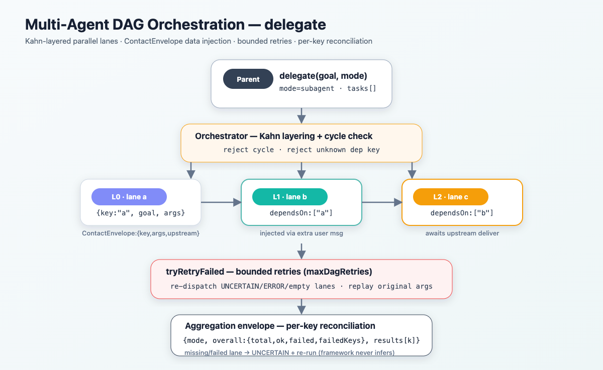

`delegate` is the **single pseudo-tool execution entry** for delegated work, always wired to the main agent (whenever `delegate.enabled`) and to skill execution. Skills are **not** direct tools: the agent first discovers/inspects a skill via `skill_library` (builtin_8), then executes it through `delegate` — the two-stage *discover → execute* flow (see `DELEGATE WORKFLOW` in the system prompt).

#### Execution modes
- `mode=main` — run **inline** in the current loop: no sub-agent, no depth increase. Default unless isolation is warranted.
- `mode=subagent` — isolate into a **`SessionSubRunner`** sub-agent: a restricted child LLM loop with its own reasoning/reply and tool calls. It **inherits the full toolset and the parent model route**; an optional `agentRef=instance:<id>` prefixes its system prompt. Rendered as inline sub-agent cards in the chat and the widget.

Isolation is reserved for noisy intermediate context, long-running work, or independent parallel lanes; simple work should be finished inline.

#### Task DAG (`tasks[]`, requires `mode=subagent`)
- Each task has `key` / `goal` (required), optional per-task `args`, `agentRef`, and `dependsOn` (upstream task keys).
- The orchestrator runs a **Kahn topological layering**: lanes in the same layer run in parallel (up to `maxParallel`); a lane is dispatched only once all its `dependsOn` lanes delivered OK (`DELIVERED_OK`). Cycles and unknown dependency keys are rejected up front.
- **Data injection** — each lane receives a `ContactEnvelope` (`v1-delegate-contact`): `{laneKey, args, upstream, upstream_visible, upstream_raw, truncated}`. Task-private `args` and the resolved upstream results are injected as deterministic JSON (rendered as an extra user message, with a recursive inline fallback in `SubAgentPolicy`); oversized upstream is truncated per-key, but the envelope itself always stays complete and parseable.

#### Lane output contract (`delegate-lane/v1`)
Business fields stay at the **top level**; all framework fields live under a top-level `_meta` object:
```json
{"<business fields>": "...",
 "_meta": {"contract":"delegate-lane/v1",
           "status":"OK|ERROR|UNCERTAIN",
           "verdict":"COMPUTED|UPSTREAM_MISSING|CLAIM_UNVERIFIABLE",
           "errorCategory":"...", "upstream_visible":true,
           "upstream_raw":"...", "retryCount":0, "reason":"..."}}
```
Delivery is gated **only** on `_meta.status=="OK"`; a lane without `_meta` is treated as `UNCERTAIN` (strict mode — bare business JSON never counts as delivered). The framework never reads or writes top-level business keys.

#### Orchestration pipeline
1. Cycle detection and dependency-key validation.
2. `runDagLayers` — first pass with **unbounded** dependency layering; a lane already dispatched (whatever its outcome) is never re-dispatched here.
3. `tryRetryFailed` — bounded retries (`maxDagRetries`): only re-dispatches lanes that returned UNCERTAIN/ERROR/empty, each with a targeted corrective hint (replaying the original args).
4. Aggregation envelope — `{mode, overall, results[]}`:
   - `overall = {total, ok, failed, failedKeys, fencedKeys}`; the parent reconciles **per-key**, treating any missing/failed lane as `UNCERTAIN` to re-run — never inferred.
   - each `results[k]` = `{key, result, meta, raw, durationMs, retryCount, fenced}`; `result` is the business JSON with the top-level `_meta` stripped (`null` on failure), `meta` holds the framework metadata, `raw` is the original lane text.

Key `delegate.*` config: `enabled`, `maxDagTasks`, `maxDagRetries`, `maxParallel`, `maxNestedDepth`, `maxSubLoopCount`, `executionTimeout`, and prompt/envelope byte budgets.

---

## 4. Administration — Operations and Management

### 4.1 Configuration Reference

The keys you are most likely to touch, all under `buukle.agent.*`. **This is a subset** — the complete reference (every `buukle.agent.*` and `hri-ai.*` key, including `wait`, `mcp`, `audit`, `crypto`, `lock`, `delegate` and the web-fetch/Jina tuning blocks) is in **[CONFIG_REFERENCE.md](CONFIG_REFERENCE.md)**, which is the source of truth.

| Config Item | Default | Description |
|-------------|---------|-------------|
| `session.idle-timeout` | 30m | Session idle timeout |
| `session.max-concurrent-runs` | 10 | Maximum concurrent executions |
| `runner.max-loop-count` | 128 | Maximum loop count per run (§3.1a) |
| `runner.task-max-loop-count` | 2000 | Higher loop limit for task-triggered runs (§3.1a) |
| `runner.turn-timeout` | 180s | Single LLM turn timeout |
| `runner.llm-turn-max-retries` | 3 | Per-turn retries with exponential backoff (§3.1b) |
| `runner.compaction.budget-ratio` | 0.7 | Compaction trigger threshold (ratio of maxInputTokens) |
| `llm.stream-timeout` | 120s | Total streaming call timeout |
| `tool.max-parallel` | 3 | Maximum parallel tool executions |
| `distributed.owner-lease` | 5m | Session executor owner lease (multi-replica takeover) |
| `distributed.orphan-sweep-interval` | 30s | Orphan-run sweep interval (stale owner → FAILED → re-wake) |
| `hri-ai.tasks.min-timeout-seconds` | 10800 | Task timeout floor, 3h (§5.2) |

### 4.2 Observability

AgentSphere provides a three-tier observation system:

#### 4.2.1 Real-time Events (SSE Events)

```
Real-time push of LLM call chain:

content_token     → "The weather in Guangzhou tomorrow..."
reasoning_token   → "🤔 The user is asking about weather, I need to open a weather website"
                  → "⚙️ navigate: calling..."
                  → "⚙️ navigate: succeeded ✅"
                  → "⚙️ getContent: calling..."
                  → "⚙️ getContent: succeeded ✅"
                  → "⏹️ Run cancelled" or "✅ Run completed"
```

| SSE Event | Trigger | Frontend Effect |
|-----------|---------|-----------------|
| `content_token` | LLM text generation | Typewriter effect |
| `reasoning_token` | LLM reasoning, tool status | Reasoning panel |
| `browser_operation` | Chrome operation command | Extension execution |
| `run_running` | Run starts | Status indicator |
| `run_completed` | Run completes | Completion notification |
| `run_failed` | Run fails | Error prompt |
| `run_cancelled` | Run cancelled | Cancellation notice |
| `run_awaiting_user` | Run pauses for clarification | Set to AWAITING_USER |
| `run_waiting` | Run parks on the `wait` tool | Set to WAITING (auto-resumes when the timer fires) |
| `tool_call_started` | Tool PENDING | Tool call list |
| `tool_call_in_progress` | Tool running | Running icon |
| `tool_call_succeeded` | Tool completes | ✅ icon |
| `tool_call_failed` | Tool fails | ❌ icon |
| `compaction_running` | Compaction starts | Reasoning panel |
| `compaction_completed` | Compaction completes | Reasoning panel |
| `compaction_failed` | Compaction fails | Reasoning panel |
| `session_updated` | Session title changes | Live title sync |
| `clarification_pending` | LLM asks for user input | Clarification card (confirm/choice/input) |
| `clarification_responded` | User responds | Card shows ✓, run resumes |
| `clarification_expired` | Clarification TTL expires | Card shows expired |
| `clarification_dismissed` | Run cancelled while waiting | Card shows dismissed |

Sub-agent activity reuses the same `content_token` / `reasoning_token` / `tool_call_*` events, distinguished by a `subAgentRunId` on the payload; the frontend aggregates these live into the inline sub-agent cards.

> Model reasoning (`reasoning_token`) is **persisted** to `agent_run.reasoning` at run end, so both the main UI and the embeddable widget render the thinking in session history (not only live). The widget drives it live through the same per-session `/api/v1/runtime/{sessionId}/stream` SSE channel.

#### 4.2.2 Run Activity API

Provides complete tool call history querying:

```
GET /api/v1/instance/runs/{runId}/activities?offset=0&limit=20

Response:
{
  "total": 20,
  "records": [
    { "activityType": "llm_interaction",
      "modelName": "deepseek-v4-flash",
      "interactionType": "CHAT_REPLY",
      "durationMs": 2588,
      "requestBody": "{...}",
      "responseBody": "{...}",
      "success": true },
    { "activityType": "tool_call",
      "toolName": "builtin_5",
      "displayName": "builtin.CapabilityBuiltinToolChrome",
      "argumentsJson": "{...}",
      "artifact": "{...}",
      "status": "SUCCEEDED" }
  ]
}
```

Run interactions (list view):

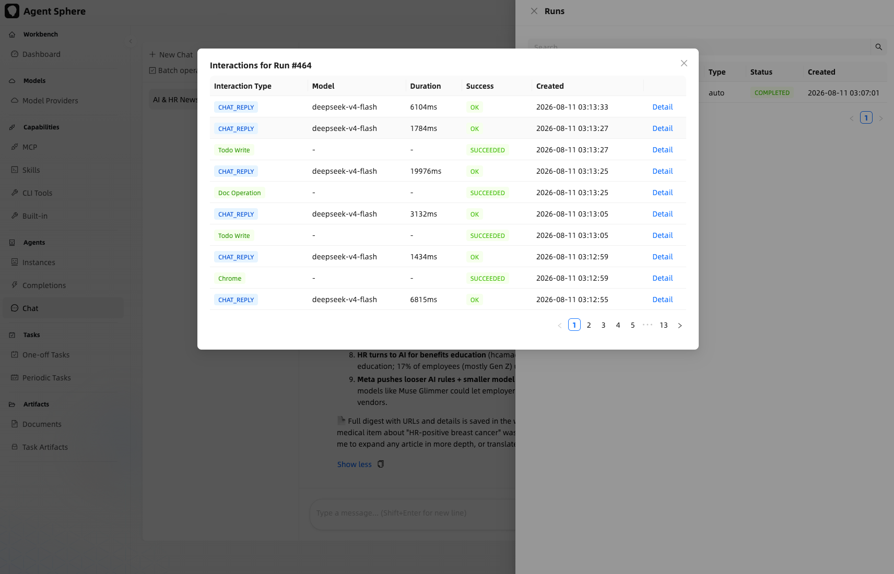

Run interaction detail:

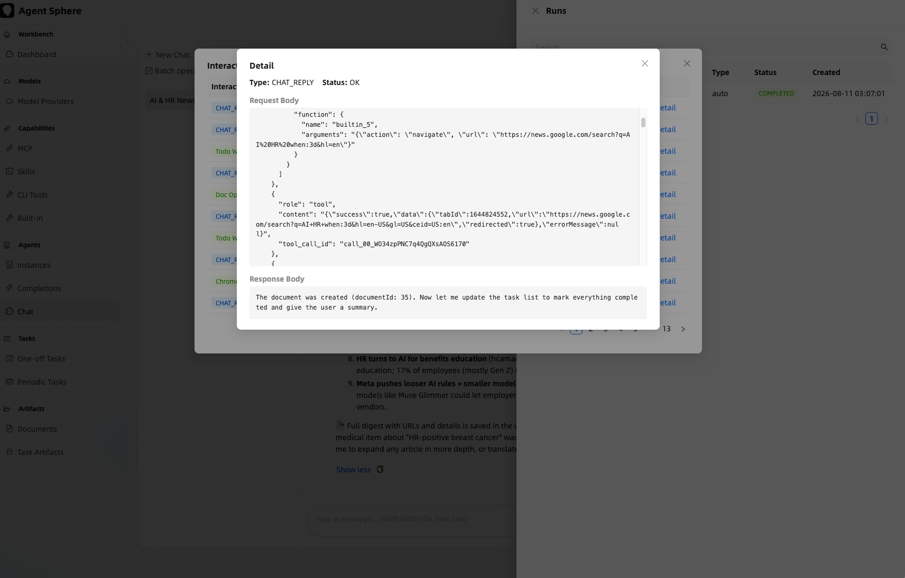

**Why a run failed is persisted** (`agent_run.error_message`, V87). Every terminal `FAILED` publisher already carries a reason in its event — a failed LLM turn, a submit-time validation/context failure, the orphan sweeper, and the stuck-`WAITING` rescuer — so `RuntimeEventListener`'s `FAILED` branch is the single sink that writes it down. Before this, the listener wrote only the status and dropped the event's `errorMessage`, and the table had no column for it, so a failed run left **no reason at all**.

**Troubleshooting heuristics** — the interactions table is the other half of the story, but it is easy to misread:

- A model endpoint returning an **immediate error** shows up as `prompt_tokens IS NULL AND duration_ms < 1000` on a `CHAT_REPLY` row. That signature is how a burst of upstream failures is identified.
- `response_body = '{}'` is **not** an error signal. A turn that returns only tool calls with no prose legitimately has an empty body; that is a normal turn.
- Provider errors arrive as an **event**, not an exception, so `success` used to stay `true` for exactly the failures that kill runs. `KernelLlmService` now records the event error too, which also flips the corresponding assistant timeline row to failed. That is intended — the turn genuinely failed, even if a retry later recovered the run.

#### 4.2.3 Session Panel

| View | Content |
|------|---------|
| **Run List** | View historical runs by session, showing userMessage + assistantReply |
| **Tool Call List** | Latest tool call records for the current session (sorted by creation time descending) |
| **Todo List** | Todo checklist for the current session, with status tracking |
| **Operation Log** | Historical operation records in the Chrome Extension popup |

### 4.3 Logging System

| Logger | Level | Purpose |
|--------|-------|---------|
| `ControllerLogAspect` | INFO | API request/response logging |
| `ChromeCallbackController` | WARN | Browser operation failures |
| `FiberSet` | WARN | Tool timeout/failure |
| `SessionRunner` | INFO | Execution turns and status |
| `LlmInteractionPersistListener` | DEBUG | LLM interaction record persistence |
| `RuntimeEventListener` | DEBUG | Tool call lifecycle events |

### 4.4 Key Deployment Steps

```bash
# 1. Build the backend
cd agent-sphere
mvn compile -pl agent-sphere-bootstrap -am

# 2. Start the backend
mvn spring-boot:run -pl agent-sphere-bootstrap

# 3. Start the frontend
cd agent-sphere-ui
npm run dev

# 4. Load the Chrome Extension
# Chrome → chrome://extensions → Developer mode → Load unpacked
# Select the agent-sphere-chrome-extension directory
# (declares <all_urls>: read & change data on all sites, granted at install)
# Runtime files: manifest.json, background.js (ESM) + lib/*, content.js + content-locator.js,
# page-script.js (MAIN-world auth/session bridge), offscreen.html/js (SSE host), popup.html/js.
# Permissions include `offscreen` and `tabGroups` (plugin tabs auto-group under "AgentSphere").

# 5. Configure URLs
# Click the extension icon → Settings Tab
# Frontend URLs (widget host pages, multiple allowed): https://bole.buukle.top
# Main URL (main site):                             https://as.buukle.top
# Backend URL:                                      https://as.buukle.top
# The popup shows a single "Task" connection badge; the User row shows provider@subject
```

> **Updating the extension.** It is installed via **Load unpacked** and `manifest.json` has no
> `update_url`, so **Chrome does not auto-update it**. To update: download the latest zip from the
> GitHub Release, replace the directory, then `chrome://extensions` → **Reload** (or restart Chrome).
> The popup shows the current version and turns on a banner when the backend's
> `plugin.min-extension-version` is higher than the installed one. Settings saved before the https
> switch are migrated automatically on the next service-worker start — only the two former default
> addresses (`http://bole.buukle.top`, `http://as.buukle.top`) are rewritten; custom URLs are kept.

### 4.5 Architecture Decision Records (ADR)

| Decision | Solution | Reason |
|----------|----------|--------|
| **SSE vs WebSocket** | Server-Sent Events | One-way push requires no client confirmation, natively supported by browsers |
| **fetch+ReadableStream vs EventSource** | fetch + ReadableStream | EventSource cannot carry Authorization headers in MV3 Service Worker |
| **Virtual Threads** | Java 21 Virtual Threads | Simplifies concurrency model, one virtual thread per tool |
| **Chrome Extension standalone deployment** | Independent project | Decoupled from Web UI, permission isolation |
| **Multi-emitter SSE** | `List<SseEmitter>` per session | Web UI and Extension share the same SSE channel |
| **FiberSet cancel(true)** | `CompletableFuture.cancel(true)` | Effectively interrupts blocking virtual threads on timeout |
| **Tool result write-time compression** | `RuntimeEventListener` compresses then writes to `compressed_artifact` | HistoryLoader reads without re-compression, reducing redundant computation |
| **Token budget-based compaction trigger** | `shouldCompact` inside `runTurn`'s execute callback | Uses the actual called model route's maxInputTokens for accuracy |
| **Compaction cursor** | `compactedUptoRunId` marks compacted runs | HistoryLoader skips compacted runs, only loads subsequent ones |
| **Compaction protection loop** | Max 3 retries | Prevents infinite loops when compaction fails due to network fluctuations |
| **Redis event bus** | Redisson `RTopic` topics (`runtime.events` / `runtime.agui` / `runtime.chrome.*`) | Multi-replica SSE / AG-UI / Chrome delivery; SSE event cache in Redis for cross-replica reconnect replay (single-writer, write-before-publish) |
| **Distributed runtime state** | Redis state + owner lease (`SessionRunCoordinator`), Redis queue/steer (`SessionInputManager`), Redis cancel sets, `OrphanRunSweeper` | Run executes on one replica but input/state/cancel survive; stale owner → run FAILED → re-wake. Makes `replicas: 2` safe |
| **Session-level stop** | `POST /api/v1/runtime/{sessionId}/stop` | Cancel by session, no runId; works across replicas (loop checks Redis cancel set, incl. parked `AWAITING_USER` runs) |
| **Task polling DB-ized** | `@Scheduled` sweep + conditional claim (`polled_at`/`poll_phase`) + single-winner terminal update | Task polling survives replica restarts; no in-memory poller |

### 4.6 Performance Optimizations

#### 4.6.1 Virtual Thread Concurrency

The `runtimeAsyncExecutor` was changed from a fixed thread pool (8 core threads) to per-task virtual threads. Previously, the thread pool bottleneck limited concurrent chat sessions to 8 — all pool threads blocked waiting for LLM streaming responses, causing subsequent requests to queue or get rejected. Virtual threads resolve this by being unmounted from the carrier thread during I/O waits, allowing hundreds of concurrent LLM streaming sessions without consuming OS thread resources.

File: `AsyncConfig.java`

#### 4.6.2 LLM Stream Timeout Fix

Restructured `KernelLlmService.stream()` so the `CountDownLatch.await(timeout)` runs independently from the blocking `modelProviderSpi.stream()` call. Previously, if the HTTP stream hung, the timeout could never fire because the latch wait was placed after the blocking call.

The fix: the streaming call runs on a separate virtual thread while the current thread waits for the latch with the configured `stream-timeout`. On timeout, the `CompletableFuture` completes exceptionally immediately, freeing the caller.

File: `KernelLlmService.java`

#### 4.6.3 HTTP Stream Read Timeout

Added a read timeout mechanism in `ModelProviderServiceImpl.streamEvents()`:
- Changed from synchronous `httpClient.send()` to `sendAsync().orTimeout()` for initial response timeout
- Added a scheduled `Thread.interrupt()` for the streaming body read loop
- Both use the `stream-read-timeout` (default 120s) configuration value

File: `ModelProviderServiceImpl.java`

### 4.7 Capability Extension

#### Adding a New Built-in Tool

```java
@Component
public class CapabilityBuiltinToolMyTool implements CapabilityBuiltinToolSpi {
    @Override
    public BuiltinToolEnum getToolType() { return BuiltinToolEnum.MY_TOOL; }

    @Override
    public ToolInfoVO getInfo() {
        ToolInfoVO info = new ToolInfoVO();
        info.setName(BuiltinToolConstants.NAME_PREFIX + "MyTool");
        info.setDescription("Description for LLM");
        info.setParamSchema(ToolSchemaUtil.generateParamSchema(MyToolDTO.class));
        info.setResponseSchema(ToolSchemaUtil.generateParamSchema(MyToolResultVO.class));
        return info;
    }

    @Override
    public ExecuteResult execute(ExecuteContext ctx) {
        MyToolDTO dto = (MyToolDTO) ctx;
        // Implementation logic
        return new MyToolResultVO(/* result */);
    }
}
```

### 4.8 RBAC (Role-Based Access Control)

AgentSphere provides a complete RBAC permission system for multi-user management, supporting fine-grained permission control at the API level.

#### Permission Model

| Component | Description |
|-----------|-------------|
| **User** | System users, each assigned one or more roles |
| **Role** | A named collection of permissions, e.g., "Admin", "Operator", "Viewer" |
| **Permission** | Single API operation, encoded as `domain:action` (e.g., `admin:user:read`, `instance:run:write`) |

The permission check is enforced at the controller layer via `@WithTenant` and `AuthContext` to ensure multi-tenant data isolation.

**Row-level data isolation**: beyond RBAC, non-super-admin reads are rewritten by `DataPermissionInterceptor` to append `AND created_by = <username>` on every SELECT (except `agent_user`). This is what keeps each user's private resource copy (instances, completions, tasks, task artifacts, …) isolated.

#### Administration UI

RBAC, system configuration, and OIDC identity providers are all managed from a single System Admin console (users, roles, permissions, identity providers / SSO, system config):

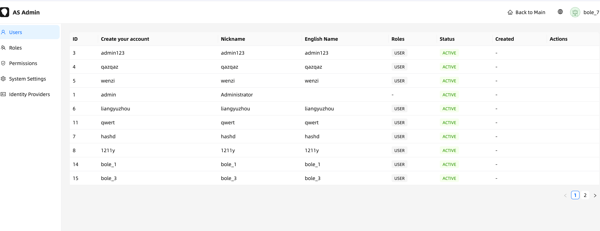

- **User Management** — create/view users and assign roles
- **Role Configuration** — create roles and bundle permissions
- **Permission Assignment** — grant/revoke `domain:action` permissions per role

Skill Hub permissions: `capability:skill:publish` (publish/unpublish a skill to the Hub) and `capability:skill:install` (fork a Hub skill into your own skills) — both seeded to the `USER` role.

### 4.9 Audit Log

AgentSphere records all user operations as audit logs for security review and troubleshooting.

#### Recorded Operations

| Category | Operations |
|----------|------------|
| **User Management** | Login, logout, password change, profile update |
| **Role/Permission** | Role create/update/delete, permission assignment |
| **Instance** | Create/update/delete agent instances |
| **Model Provider** | Provider create/update/delete, API key management |
| **Capability** | MCP/Skill/CLI capability create/update/delete |
| **Session** | Session create/delete, message sending |

#### Audit Log UI

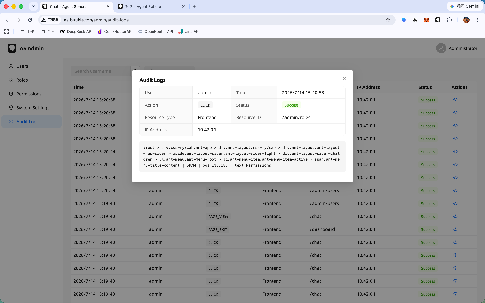

### 4.10 Multi Authentication Sources (OIDC SSO)

AgentSphere supports **multiple OIDC identity providers** so third-party business systems can sign users in without managing passwords locally. Each provider maps to an independent local user (`provider_code + subject`); no cross-provider merging is performed.

#### SSO Login Flow

1. User clicks sign-in → `GET /api/v1/auth/sso/authorize?provider=<code>&redirect_uri=...`
2. Backend validates the provider is enabled, generates PKCE (`S256`) + `state` + `nonce`, and redirects to the IdP.
3. IdP authenticates → redirects back to the backend callback (`/api/v1/auth/sso/callback`).
4. Backend exchanges the code, verifies the id_token (issuer / audience / RS256 signature via JWKS), JIT-provisions the user, and redirects with a one-time `otc`.
5. `POST /api/v1/auth/sso/exchange` swaps `otc` for a local token.

#### Managing Identity Providers

Open **System Admin → Identity Providers** to manage providers from the UI (no SQL) — the same admin console shown in [§4.8](#48-rbac-role-based-access-control):

| Field | Description |
|-------|-------------|
| Code | Unique provider identifier — must match the `provider` passed to `authorize` (e.g. `business`) |
| Name | Display name |
| Issuer | OIDC issuer URL |
| Client ID / Client Secret | Confidential-client credentials; the secret is **encrypted at rest** (AES-GCM) and only a masked value is ever returned |
| Authorization / Token Endpoint | IdP endpoints |
| JWKS URL | Public key set used to verify id_token signatures |
| Scopes | e.g. `openid email profile` |
| Enabled | Toggle login for this source on/off |

Each provider can be **connection-tested** (`POST /api/v1/admin/identity-providers/{id}/test`): it fetches the JWKS and hits the token endpoint with an intentionally-invalid grant — any 4xx means reachable, network errors/5xx fail.

Permissions: `admin:identity-provider:read/create/update/delete` (seeded to ADMIN and USER roles).

#### IdP Requirements

- OIDC **authorization code** flow with a **confidential client** (client secret).
- PKCE (`S256`) and `nonce` support.
- id_token signed with **RS256**, verifiable via the public JWKS URL.
- Redirect URI registered at the IdP: `<backend-origin>/api/v1/auth/sso/callback`.

#### Default Role & Resource Template

| Field | Description |
|-------|-------------|
| `default_role_id` | Role granted to newly provisioned SSO users (replaces the default `USER` role) |
| `resource_template` | JSON array (see [§4.12](#412-resource-template-reference)); empty uses the built-in default |

On a user's **first** login the callback provisions the local user (with the default role) and then **asynchronously** generates the user's **private resource copy** from the provider template — model provider, api key, model route, completions (with schema/prompt), instance (auto-bound with the built-in **browser tool**), MCP, skill, and document — each owned by the user (`created_by = username`). Provisioning never blocks login; a failure is logged and the user keeps their account. Row-level isolation (every SELECT is rewritten with `AND created_by = <username>`) keeps each user's copy private.

#### Display Name (`provider@subject`)

The identity provider's `preferred_username`/`name` is stored as `display_subject` and refreshed on every login. The UI (main site and admin console) shows the user as **`provider@subject`** (e.g. `bole@elvin`); `GET /api/v1/sso/me` returns `{providerCode, subject}`.

### 4.11 Embeddable Chat Widget

`agent-sphere-copilot-widget` is a **standalone embeddable chat widget** that third-party business sites can drop into any page. It bundles React into a single IIFE script, mounts into a **shadow DOM**, and authenticates through the OIDC SSO above — no CopilotKit / AG-UI cloud-runtime (auth and chat are fully self-managed). Chat is a **typed REST + SSE timeline** (same shape as the main UI chat page) driven by a per-session SSE stream.

#### Embed

```html
<script src="https://as-widget.buukle.top/agent-sphere-widget.js"></script>
<script>
  window.AgentSphereWidget.init({
    apiBase: 'https://as.buukle.top/api/v1', // AgentSphere backend
    provider: 'business',                    // identity provider code
    autoLogin: true,                         // silent OIDC probe on load
    title: 'Agent Sphere 助手',
  });
</script>
```

| Option | Default | Description |
|--------|---------|-------------|
| `apiBase` | `/api/v1` | Backend API base (use an absolute URL when cross-origin) |
| `provider` | `business` | OIDC provider code from the Identity Providers page |
| `autoLogin` | `true` | Attempt silent sign-in (`prompt=none`) on load |
| `title` | `Agent Sphere 助手` | Widget header title |
| `mountTo` | `undefined` | Optional DOM element. When set, the widget fills the container (static); otherwise it renders a fixed bottom-right floating bubble |

#### Screenshots

SSO login screen (select an identity provider):


Multiple identity providers configured:


Embedded into a third-party system page (`mountTo`):


#### How It Works

- **OIDC SSO**: consumes `?otc=` → `POST /auth/sso/exchange` → stores the user+token in `sessionStorage` (`agent-sphere-widget:agent-user`); `?otc=`/`?error=` are stripped from the URL after handling. `autoLogin` performs a one-shot silent probe (`prompt=none`) via a hidden same-origin iframe (no page redirect); the login screen lets the user pick an enabled identity provider.
- **Agent & session lists**: instances (enabled) come from `/instance/instances` (paged) and sessions from `/instance/sessions` (offset paged). Sessions support create, inline rename (✓/✕), and archive (two-step inline confirm), all with infinite-scroll pagination.
- **Timeline channel (REST + SSE)**: the widget renders a *typed timeline* — `GET /instance/sessions/{sid}/timeline` (paged by `beforeSeq`/`afterSeq`, limit 5–50) returns rows keyed by `seq` + `kind` (`user` / `assistant` / `tool` / `clarification` / `subagent` / `run_status` / `error`). A live SSE stream `GET /runtime/{sid}/stream` (Bearer) drives the same rows.
- **SSE typewriter & merge**: `content_token` / `reasoning_token` push onto the matching `seq+kind==='assistant'` row's `reply` / `thinking`; sub-agent rows aggregate live steps (LLM reasoning/reply + `tool_call_*`). Terminal / tool / clarification events (`run_completed`/`failed`/`cancelled`/`awaiting_user`, `tool_call_*`, `clarification_*`) trigger an `afterSeq` refresh for an authoritative merge — `mergeTimeline` dedupes by `seq`, and placeholder sub-agent rows carry negative `seq<0` until replaced by real rows.
- **Send / stop / clarify**: sending posts `POST /runtime/{sid}/chat` → `{runId,status}` (the rest arrives via SSE + refresh). A RUNNING dot shows while active and the send button becomes **stop** → `POST /runtime/{sid}/stop` (session-level, no runId). Clarification options are answered inline via `POST /runtime/{sid}/run/{runId}/clarify`.
- **WidgetTimeline rendering**: self-built row renderer — copy buttons on user/assistant rows, collapsible model-reason sections, tool cards (browser screenshots render inline, click-to-zoom lightbox), inline clarification options (confirm/choice/input), collapsible sub-agent cards with live steps (single-open tool detail, auto-scroll), RUNNING wobble dot, and "load older" pagination. Chat image attachments render as thumbnails with a click-to-zoom preview.
- **Hosted mode**: passing `mountTo` renders the widget statically inside your layout (e.g. inside a drawer or a section) instead of a floating bubble.

The widget builds **two** IIFE bundles: `agent-sphere-widget.js` (full chat UI) and `agent-sphere-auth.js` (a lightweight, no-React SSO silent-login entry for host pages that already show chat elsewhere).

#### Development

```bash
cd agent-sphere-copilot-widget
npm install
npm run dev        # vite dev on :5173, proxies /api -> localhost:8080
npm run build      # tsc + vite lib IIFE -> dist/agent-sphere-widget.js + dist/agent-sphere-auth.js
```

> Gotcha: rollup 4 ships platform-specific binaries as optional dependencies. Never copy `node_modules`/`package-lock.json` across machines — if `Cannot find module @rollup/rollup-*` appears, run `rm -rf node_modules package-lock.json && npm i` on the target machine.

### 4.12 Resource Template Reference

Each identity provider carries a `resource_template` JSON array. On a user's first login the coordinator dispatches each entry by its `type` to the matching initializer (new types are zero-code — just add a `ResourceInitializer` bean). Entries are processed in order and may reference earlier ones by name.

| `type` | Fields | Notes |
|--------|--------|-------|
| `model_provider` | `name`, `baseUrl` | idempotent by name |
| `api_key` | `provider` (ref), `alias` | creates a placeholder key and sets it active; replace with a real key afterwards |
| `model_route` | `provider` (ref), `modelName`, `company`, `weight` | |
| `completions` | `name`, `businessType`, `route` (ref), `config`, `promptSystem`, `promptUser`, `inputSchema`, `outputSchema` | creates a prompt v1 and activates it |
| `instance` | `name`, `businessType`, `route` (ref) | auto-binds the built-in **browser tool** |
| `mcp` | `name`, `serverUrl`, `serverType` | |
| `skill` | `name`, `definition` | |
| `document` | `title`, `content` | |

The built-in default template (used when the provider leaves `resource_template` empty) provisions a DeepSeek model + key + `deepseek-v4-flash` route, seven business completions (resume_parse / five_dim_match / outreach / nl_search / org_collect / recommend_reason / interview_questions), a sourcing instance, an MCP, a skill, and a usage document. It can be viewed from the Identity Provider edit form (**查看样例**).

### 4.13 Local OIDC Mock (Development)

`agent-sphere/local-dev/mock-oidc-server.mjs` is a zero-dependency OIDC IdP for local SSO testing. Each start it generates a **random mock user identity** (`subject`, `preferred_username`, `email`, `name`) so every boot provisions a fresh SSO user.

```bash
node agent-sphere/local-dev/mock-oidc-server.mjs      # listens on :9000
# MOCK_IDP_PORT / MOCK_IDP_ISSUER / MOCK_IDP_CLIENT_ID / MOCK_IDP_CLIENT_SECRET
# MOCK_IDP_SUBJECT / MOCK_IDP_PREFERRED_USERNAME / MOCK_IDP_EMAIL / MOCK_IDP_NAME  # pin a fixed identity
```

The RSA key is intentionally fixed across restarts so the backend's cached JWKS keeps verifying id_tokens (avoids `S0006`). Point the `agent_identity_provider` row at it (`code=bole`, `issuer=http://localhost:9000`, endpoints under `/oauth2/...`, `jwks_url=http://localhost:9000/jwks`, scopes `openid email profile`, enabled).

### 4.14 Session Data Cleanup (Disk Reclamation)

`agent_session_cleanup_run` tracks a scheduled job (`SessionCleanupTask`) that **hard-deletes** expired session data so the database stops growing. It is the one sanctioned exception to "never hard-delete": `agent_llm_interaction_record` stores full request/response/reasoning text, so a logical `delete_flag` update would leave every byte on disk. The cleanup SQL therefore bypasses MyBatis-Plus on purpose and deliberately does **not** filter on `delete_flag` — already-logically-deleted rows occupy space too.

**What counts as expired** — `session.created_at < cutoff AND session.updated_at < cutoff`, plus two `NOT EXISTS` guards for `PENDING`/`RUNNING` runs and `QUEUED`/`RUNNING` tasks, so an in-flight execution is never deleted out from under itself. A long-running task only updates the `task`/`run` rows and never the session row, so elapsed time alone is not a sufficient signal. `AWAITING_USER` is intentionally **not** guarded — a clarification nobody ever answers would otherwise block cleanup forever. Parked `WAITING` runs are guarded.

**Delete order is a foreign-key contract.** Only two real FKs exist and neither cascades (`agent_run.session_id → agent_session`, `agent_task_artifact.task_id → agent_task`); the mapper's method order *is* the execution order, and a unit test asserts it with `InOrder`. Reordering it breaks production with `violates foreign key constraint`.

**Every run is recorded.** Both the cron and the manual endpoint write a row to `agent_session_cleanup_run`, and the RUNNING row is inserted **before** the lock is taken — so "lock was busy" and "kill switch off" also leave a trace (`status=SKIPPED` plus a `skip_reason`); otherwise nobody could explain why the disk did not shrink. Terminal states are `SUCCESS` (with per-table `table_stats`), `SKIPPED`, and `FAILED` (with `error_message`, and the exception is still rethrown). Previews are recorded too — an irreversible delete needs its audit trail. The run table prunes itself as the job's final phase.

**Manual trigger is asynchronous**: `POST /api/v1/instance/session-cleanup` only *submits* — it inserts the RUNNING record on the request thread and returns immediately, with the work running on `runtimeAsyncExecutor`, because a round can span 200×50 sessions. Poll `GET /api/v1/instance/session-cleanup/runs` (and `/runs/{id}`) for progress and result; a `stale` flag computed from `finished_at` keeps a crashed process's zombie RUNNING row from being mistaken for an in-flight cleanup. **`dryRun` defaults to `true`** — the request body must explicitly set `"dryRun": false` to actually delete.

Retention days and a kill switch live in `agent_system_config` (`config_group='session'`) so they can change without a redeploy, while the cron, batch size and sleep interval live under `buukle.agent.session` in `application.yml`. Like the skill-sync job, the task takes a Redisson lock (`scheduler:session-cleanup`) because `replicas: 2`. Note that a hard delete only frees space **for reuse inside PostgreSQL**; the data files stay the same size on disk, so the job logs a `VACUUM (FULL, ANALYZE)` hint rather than running it (which would take an ACCESS EXCLUSIVE lock).

---

## 5. Capability Open API (External Integration)

External systems (e.g. a business recruiting platform) can call AgentSphere capabilities directly over `/api/v1/api/*`. Every request authenticates the caller identity as **`code + subject + businessType`**:

- `code` — identity provider code (e.g. `business`); `subject` — the SSO subject of that provider. The backend looks up the provisioned `agent_sphere` user via `/sso/me`-style resolution; unknown identities get `401`.
- `businessType` — the resource's business key. Completions/instances are matched **by owner + `businessType`** (session-layer ownership), so a caller only sees the resources of their own user copy.
- `Authorization` header is **not** required on these routes (the caller identity is the business layer); signing is planned for a later version.

### 5.1 Completions

`POST /api/v1/api/completions` runs a single LLM call against the caller's completions matching `businessType`.

```bash
curl -X POST http://localhost:8080/api/v1/api/completions \
  -H 'Content-Type: application/json' \
  -d '{
    "code": "business",
    "subject": "elvin",
    "businessType": "resume_parse",
    "input": { "resumeText": "张三，6年经验...", "candidateId": 1001 }
  }'
```

```json
{
  "content": "{\"name\":\"张三\",\"summary\":\"...\"}",
  "model": "deepseek-v4-flash",
  "usage": { "prompt_tokens": 42, "completion_tokens": 96, "total_tokens": 138 }
}
```

### 5.2 Tasks

```bash
# Submit a task
curl -X POST http://localhost:8080/api/v1/api/tasks \
  -H 'Content-Type: application/json' \
  -d '{
    "code": "business",
    "subject": "elvin",
    "businessType": "sourcing",
    "goal": "整理候选人张三的公开画像",
    "context": { "company": "某互联网公司", "years": 6 },
    "expectedOutput": { "type": "object", "required": ["summary"] },
    "config": { "pollInterval": "2s" },
    "callbackUrl": "https://bole.example.com/task-callback"
  }'

# Query / stop
curl "http://localhost:8080/api/v1/api/tasks/7?code=business&subject=elvin&businessType=sourcing"
curl -X POST "http://localhost:8080/api/v1/api/tasks/7/stop?code=business&subject=elvin&businessType=sourcing"
```

Response is a `TaskVO` (`id`, `status` `QUEUED/RUNNING/COMPLETED/FAILED/CANCELLED`, `sessionId`, `runId`, `resultJson`, …). When `callbackUrl` is set, the backend POSTs task progress/final results there. Completed tasks persist two-phase structured outputs as **task artifacts** (see below).

**Task phases.** A task advances through `execute` → `extract` → `refine`, tracked in `poll_phase`:

1. **`execute`** — the real work run. When it reaches `COMPLETED`, the poller moves on; when it was **truncated by the loop cap** (`loop_capped`), the task is failed instead and extraction is skipped, because a half-finished run must not masquerade as a complete one. That failure still returns the run's own output (plus a human-readable `remark`) so the caller can see what the run actually produced.
2. **`extract`** — a second run re-formats the conversation into the `expectedOutput` JSON Schema. Its output is validated against the contract; on failure the task moves to `refine`.
3. **`refine`** — one correction round fed the validation errors. If it still fails, the last output is returned as-is rather than retrying forever.

Each artifact is stored in `agent_task_artifact` with the phase that produced it.

**Timeout.** Effective timeout = `max(taskTimeoutSeconds, hri-ai.tasks.min-timeout-seconds)`, falling back to `hri-ai.tasks.max-poll-seconds` (3600s) when the caller omits `taskTimeoutSeconds`; the floor defaults to 0 (disabled). Exceeding it fails the task with `task poll timeout`.

The **floor exists because the default alone does nothing in practice**: every task carries its own `task_timeout_seconds`, and callers overwhelmingly send an explicit 3600 — so raising `max-poll-seconds` would only affect tasks that omit the field. `min-timeout-seconds` is the only place that can raise the real timeout without changing the caller. It defaults to **10800s (3h)**, chosen from the observed distribution (mean 838s, max 9818s, nothing above 3h). The trade-off is that the server overrides an explicit caller value, which is deliberate.

The same resolved value also sets the **task-level MCP credential TTL** (`timeout + 15 min`) — deliberately a single chokepoint, so the credential can never expire before the task it belongs to.

### 5.3 Task Artifacts (任务产物)

Refined outputs from the `extract` / `refine` phases (§5.2) are stored in `agent_task_artifact` — each row records which phase produced it — and exposed on the admin side:

- `GET /api/v1/admin/task-artifacts` — paged list (`keyword`, `taskId`, `page`, `size`), gated by `admin:tasks:read`, row-scoped by `created_by`.
- `GET /api/v1/admin/task-artifacts/{id}` — detail with the full `content` JSON and `schemaRef`.

The frontend **产出 → 任务产物** page lists them (task goal, type, schema ref, run id, status, created time) and shows the detail drawer with a formatted JSON view and one-click copy.

---

## 6. Project Structure

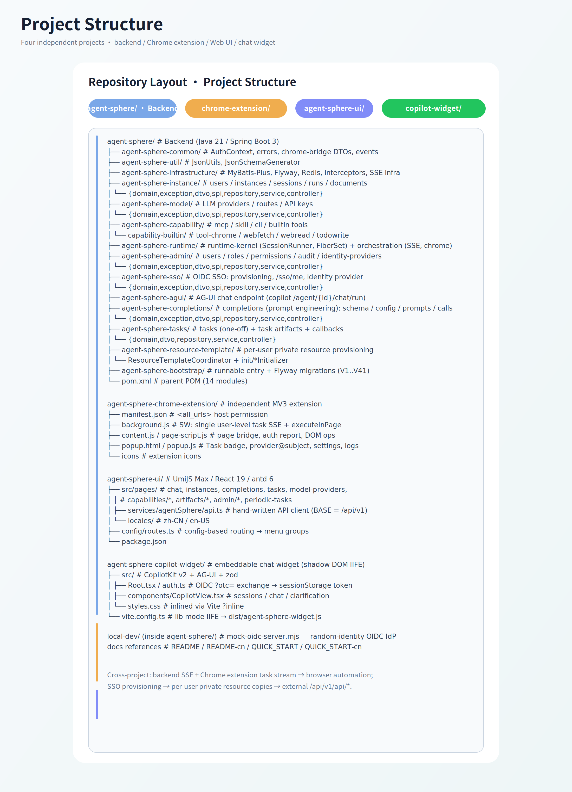

## 7. Tech Stack

| Domain | Technology |
|--------|------------|
| **Backend Runtime** | Java 21, Spring Boot 3.4, Virtual Threads |
| **Database** | PostgreSQL, Flyway migrations |
| **Cache/Distributed Lock** | Redis (Redisson) |
| **Frontend** | React, UmiJS, Ant Design Pro |
| **Chat Widget** | React, shadow DOM, single IIFE script — self-built typed **REST + SSE timeline** chat (no CopilotKit / AG-UI) |
| **Chrome Extension** | Manifest V3, Service Worker, Content Script |
| **Auth** | OIDC multi-provider SSO (PKCE / JWKS), RBAC, audit log |
| **Real-time Communication** | SSE (Server-Sent Events), multi-emitter broadcast |
| **Tool Protocol** | MCP (Model Context Protocol, Streamable HTTP) |
| **API Security** | Bearer Token, @WithTenant multi-tenancy, row-level `created_by` isolation |
| **LLM Integration** | SPI provider abstraction, automatic fallback routing |

## 8. MCP Integration Example

AgentSphere supports connecting to any external service via the MCP protocol. Taking Jira as an example:

```bash
# 1. Deploy the Jira MCP Server
npx @roovet/jira-mcp --port 3100

# 2. Add the MCP capability in the AgentSphere admin console
curl -X POST /api/v1/capability/mcp \
  -d '{"name":"Jira MCP","serverUrl":"http://localhost:3100","serverType":"streamable-http"}'

# 3. Bind it to an Agent instance
curl -X POST /api/v1/instance/instance-capabilities \
  -d '{"instanceId":1,"capabilityType":"mcp","capabilityId":1}'

# 4. Users simply send instructions in the chat
# "Help me check my unfinished tasks on Jira"
# → LLM calls MCP tool → Jira API → returns result
```

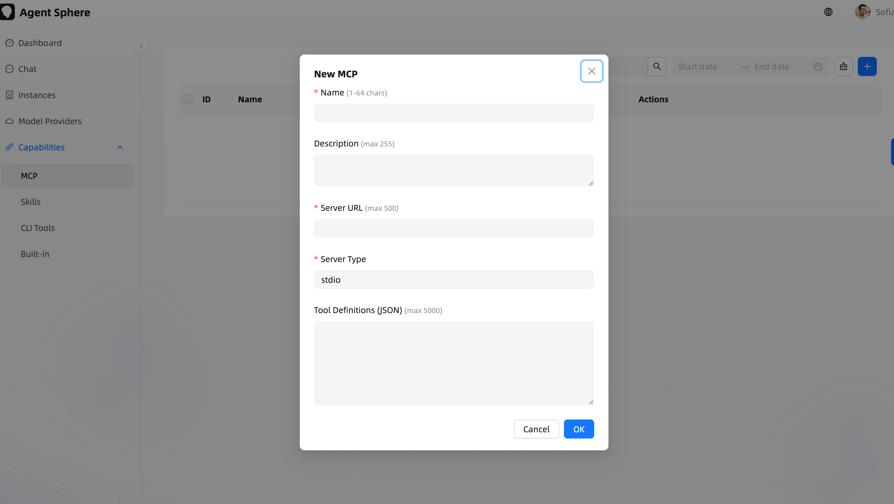

## 9. License

MIT License

Copyright (c) 2026 Buukle
