# AgentSphere

[English](README.md) | **中文**

<p>
  
  
  
  
</p>

<p>
  
  
  
  
  
  
</p>

> 4A = **业务架构（Business Architecture）/ 应用架构（Application Architecture）/ 技术架构（Technology Architecture）/ 数据架构（Data Architecture）**

## 目录

- [0. 一句话定位](#0-一句话定位)
- [产品截图](#产品截图)
- [1. 业务架构](#1-业务架构)
- [2. 应用架构](#2-应用架构)
- [3. 技术架构](#3-技术架构)
- [4. 数据架构](#4-数据架构)
- [5. 4A 对照矩阵](#5-4a-对照矩阵)
- [6. 快速开始](#6-快速开始)
- [7. 仓库地图](#7-仓库地图)
- [8. 开发与验证](#8-开发与验证)

---

## 0. 一句话定位

> 把 **LLM + 工具 + 浏览器 + 记忆 + 模型路由** 封装成一个**可配置的 Agent 实例**，并通过对话式、任务式、能力式三种入口对外提供。

AgentSphere 不是单个 Agent，而是 **Agent 托管平台**。实例是配置单元，能力是供给单元，模型是路由单元，三者互相解耦。

---

## 产品截图

以下为部署环境的实际界面截图。相同页面的英文界面截图见 [README.md](README.md)。

| Agent 运营管理 | 系统管理 | Super Agent 产品 |
|---|---|---|
| 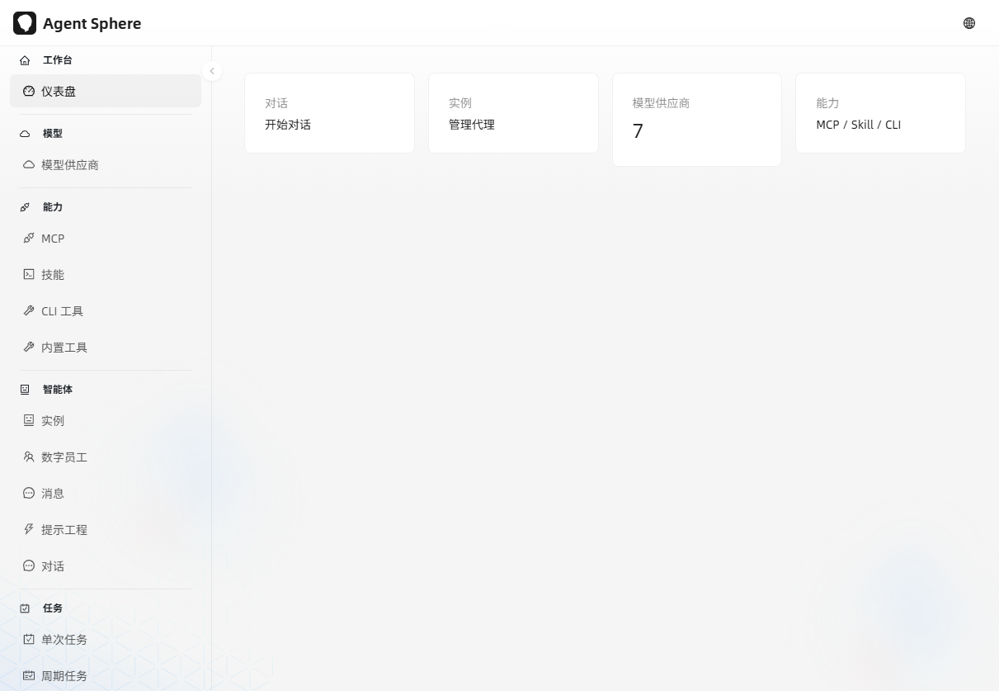 | 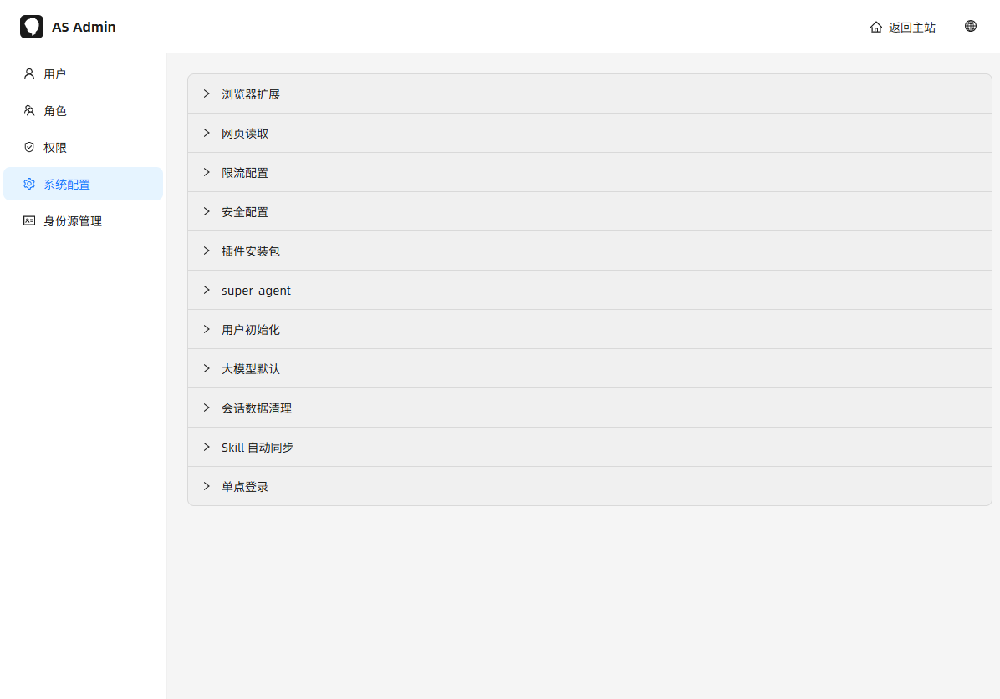 | 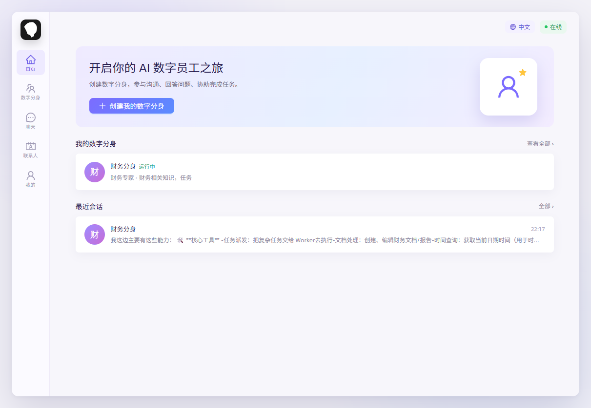 |

### Agent 配置与对话

| 实例 | 对话 | 会话观测 |
|---|---|---|
| 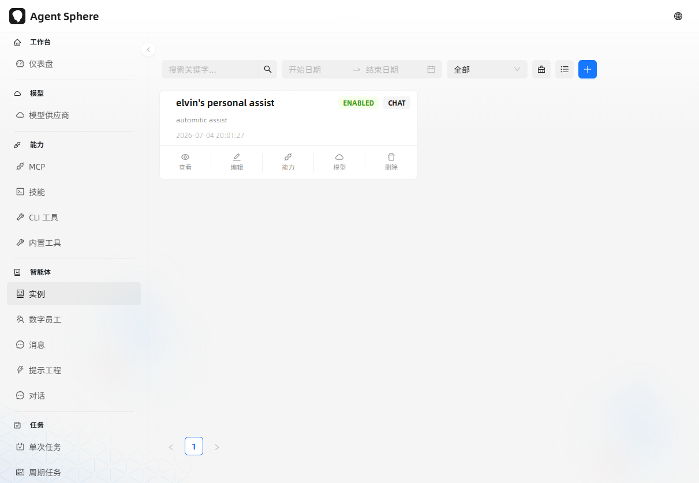 | 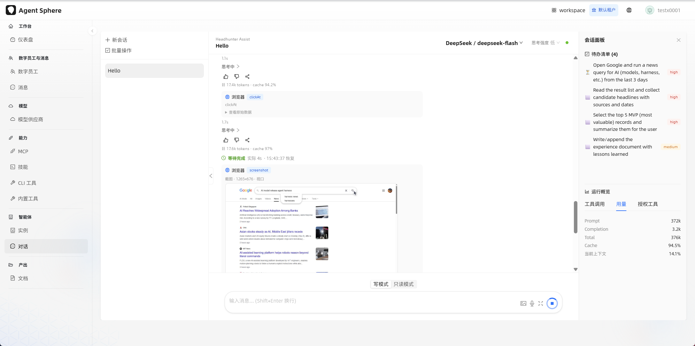 | 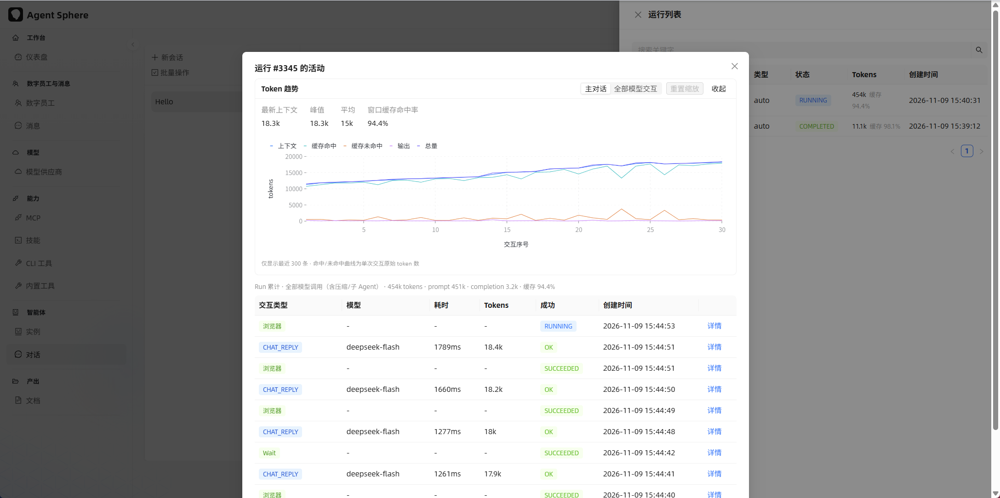 |

### 数字员工与 IM

以下截图来自 `/workspace` 的 Super Agent 产品。

| 数字员工 | 数字员工会话 |
|---|---|
| 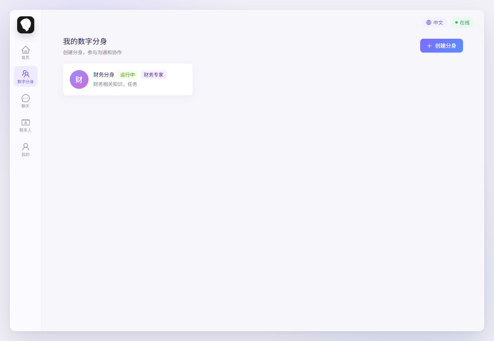 | 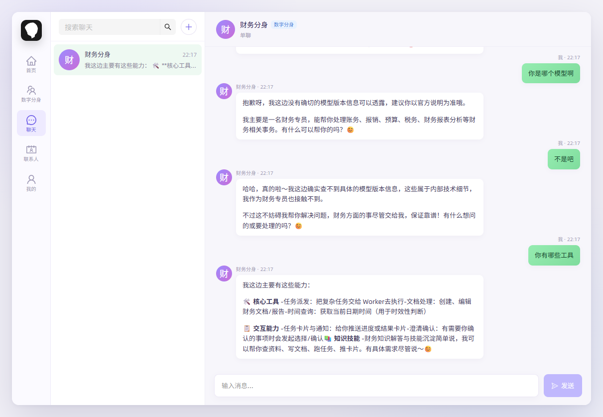 |

---

## 1. 业务架构

### 1.1 定位

| 维度 | 内容 |
|---|---|
| 服务对象 | 平台管理员 / 运营开发者 / 终端用户 / 外部业务系统 / 数字员工使用者 |
| 核心价值 | 业务团队不写代码就能得到一个可用的 Agent：查资料、调 API、操作网页、返回结构化结果 |
| 交付形态 | 对话式（控制台 / widget）· 任务式（提交 + 回调）· 能力式（单次补全）· 数字员工（`/workspace`） |
| 差异化 | 实例级配置、真实浏览器操作、可安装技能、多供应商故障切换、Super Agent 路由与 IM 渠道 |

#### 产品形态

| 入口 | 产品 | 主要能力 |
|---|---|---|
| `http://127.0.0.1:8000/**` | Agent 运营管理平台（不含 `/admin/**` 与 `/workspace`） | Agent 实例、能力中心、模型路由、聊天、任务、产物、IM 运营、Super Agent 配置 |
| `http://127.0.0.1:8000/admin/**` | 系统管理 | 用户、角色、权限、身份源、字典、系统配置、审计日志 |
| `http://127.0.0.1:8000/workspace` | Super Agent 产品 | 数字员工列表、会话、联系人、任务协作、回复 |

- `/**` 是管理员 / 运营者视角。
- `/admin/**` 是平台治理视角。
- `/workspace` 是面向数字员工的终端产品形态。

### 1.2 角色与职责

| 角色 | 主要入口 | 关注点 |
|---|---|---|
| 平台管理员 | `/admin/**` | 用户、角色、权限、身份源、审计、系统配置 |
| 运营 / 开发者 | Web 控制台 | 配置实例、接入 MCP、编写技能、调优模型路由 |
| 终端用户 | `/chat`、嵌入 widget | 提问、回答澄清、观察执行过程 |
| 数字员工使用者 | `/workspace` | 与 Super Agent 对话、跟进工作项、接收回复 |
| 外部业务系统 | `/api/v1/api/*` | 提交任务、获取产物、单次补全 |
| IM / 渠道用户 | IM、webhook、嵌入渠道 | 向数字员工发消息并接收路由后的回复 |
| 无头浏览器 | Chrome 扩展 | 在 Agent 控制下操作真实网页 |

### 1.3 业务能力地图

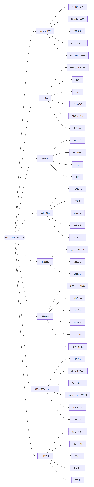

### 1.4 核心业务流程

#### 对话式路径（人在环路中）

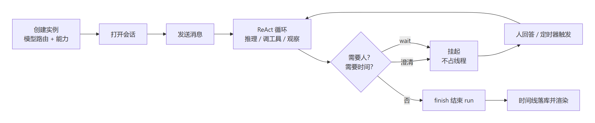

#### 任务式路径（系统到系统，三阶段）

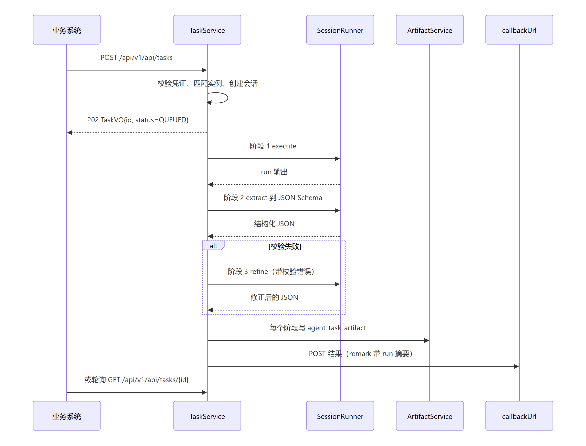

#### 能力式路径（供给 → 消费）

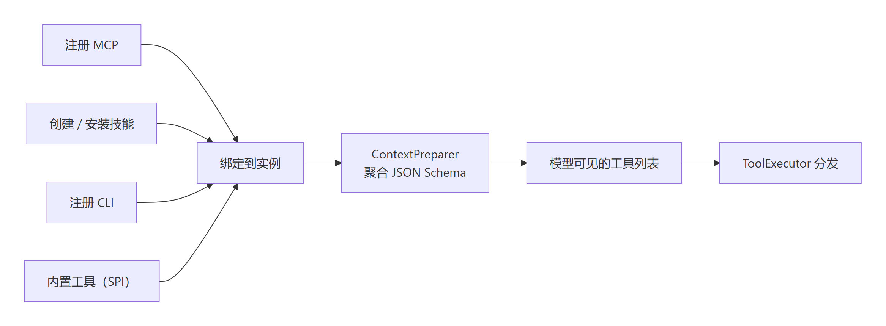

#### Super Agent 路径（数字员工）

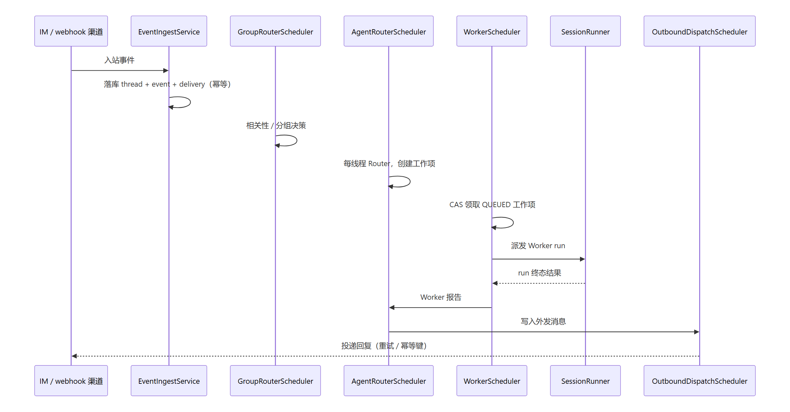

Super Agent 是由 **Router 实例 + Worker 实例 + 渠道绑定** 组成的数字员工。入站事件形成线程与工作项，Worker run 产出报告，外发消息最终回到来源渠道。

#### IM 协作路径

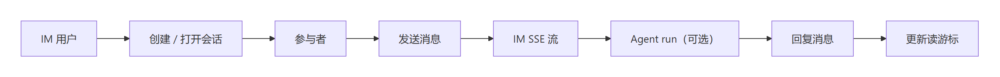

IM 同时支持人与人、人与 Agent 协作。会话、参与者、消息、附件、读游标独立于 Agent 时间线；一条消息可以触发 Agent run，回复再写回 IM 消息。

### 1.5 业务规则

| 规则 | 原因 |
|---|---|
| 会话按入口控制：`allow_console_session` / `allow_widget_session`（widget 默认 false） | 控制台与 widget 共用 API 和 Token，只能靠 `X-Client-Surface` 区分；任务路径的 `INTERNAL` 必须放行 |
| 技能正文必须是 `# H1 + ## stepN + ### stepN.M` | 步骤号是待办回查技能正文的锚点；格式破坏后无法按步检索 |
| 技能市场只展示 `visibility=PUBLIC AND created_by IS NOT NULL` | 行级权限默认按 `created_by` 过滤，市场必须显式放开 |
| 任务超时 = `max(调用方值, 服务端下限)` | 大多数生产任务写死 3600s，只有服务端下限能真正抬高 |
| `finish` 是 Agent 运行唯一合法收口，纯聊天实例不暴露 | 否则模型三句话假装交付，静默失败 |
| “不要再调工具”提示只在接近最后一轮注入 | 过早禁用工具会把未完成工作截成半成品 |
| 一个 Super Agent 固定拥有一个 Router 实例、一个 Worker 实例和渠道绑定 | Router 判断相关性与归属，Worker 执行；角色分离避免一个 Prompt 同时做两件事 |
| 入站渠道事件先落库再路由；delivery 与外发消息必须幂等 | Webhook 重试和重连风暴不能重复创建工作项或重复回复 |
| 工作项通过 CAS 状态迁移领取；终态只由 Worker 报告写入 | 两个副本不能重复派发，调度重试不能覆盖已完成结果 |
| 外发回复采用 persist-then-send + 重试 + 幂等键 | 渠道投递可能失败，outbox 才是事实来源 |
| IM 消息与 Agent 会话通过 conversation/session id 关联，不共用时间线表 | IM 历史与 Agent 执行历史的保留期和读取模式不同 |

### 1.6 范围边界（非目标）

- **不是通用工作流编排器**：编排发生在单个 Agent 的 ReAct 循环内，不是可视化 DAG 设计器。
- **不做模型训练 / 微调**：只做推理侧路由与适配。
- **不做 SaaS 计费 / 配额**：`tenant_id` 已预留，但没有计费模块。
- **定时任务未交付**：`/periodic-tasks` 仍是占位页。

---

## 2. 应用架构

### 2.1 应用全景

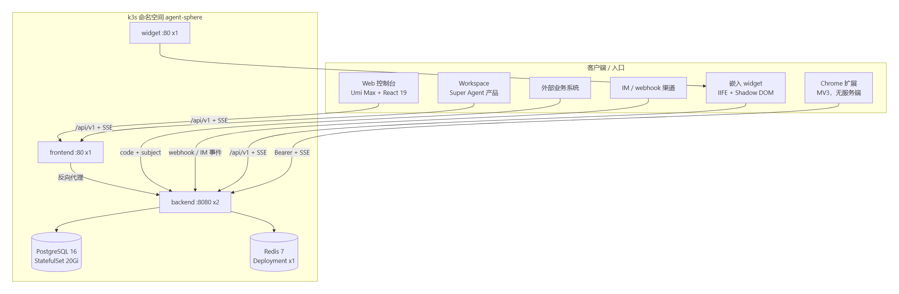

### 2.2 后端模块与依赖

业务域统一按层拆分：

```text
-domain → -exception → -dtvo → -spi → -repository → -service → -controller
```

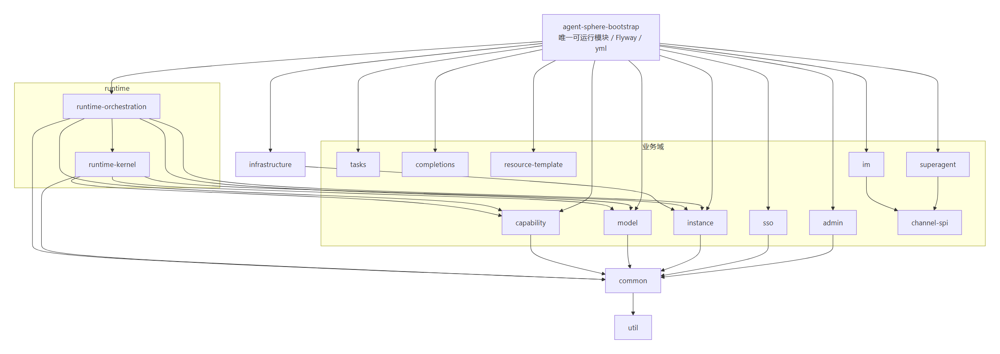

依赖纪律：

- `controller → service → repository → spi → domain`；Controller 只依赖 `*-spi`，不依赖实现。
- kernel 不得反向依赖 orchestration；需要跨层动作时使用 Spring 本地事件。
- `infrastructure` 已依赖 `instance-service`，因此 instance 不得反向依赖 infrastructure。

### 2.3 调用图

#### 静态组件关系

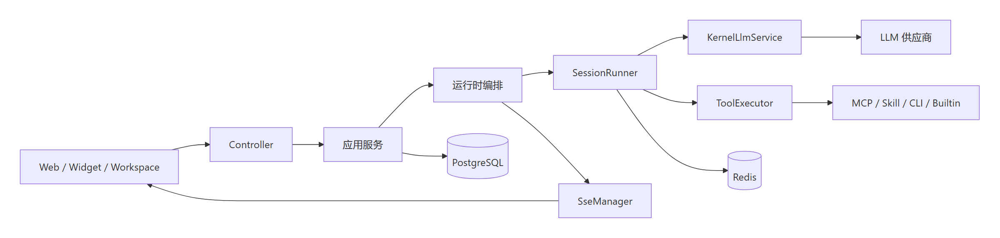

#### 一次 `chat` 调用时序

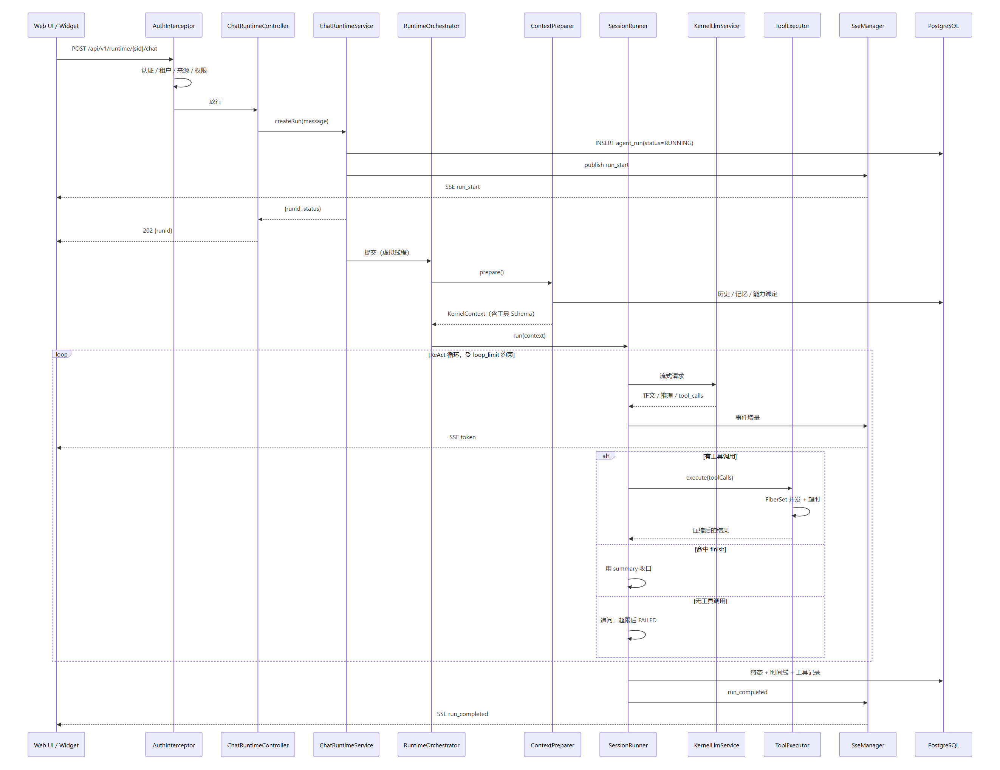

#### Super Agent 数字员工时序

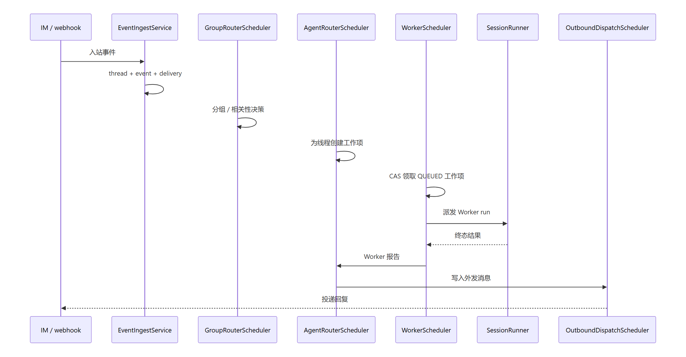

#### IM 消息时序

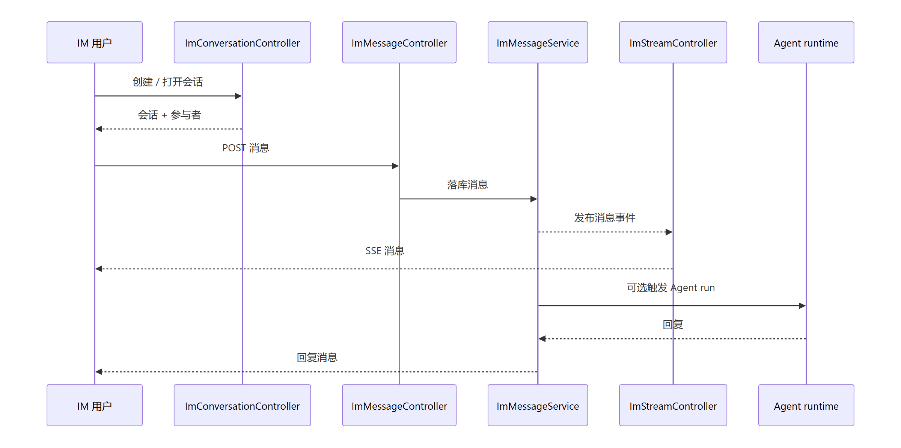

### 2.4 集成矩阵

| 方向 | 对端 | 协议 / 凭证 |
|---|---|---|
| 入站 | Web 控制台 / widget / workspace / 扩展 | REST + SSE（`/stream`），Bearer Token |
| 入站 | 外部业务系统 | `code + subject + businessType`，无 Bearer |
| 入站 | Chrome 扩展 | 长连接 `/runtime/user/task/stream` + `/api/v1/chrome` 回调 |
| 入站 | IM / webhook 渠道 | 通过 `EventIngestPort` 归一化事件；渠道绑定 |
| 出站 | 渠道适配器 | IM / webhook 回复，来自 outbound outbox |
| 出站 | LLM 供应商 | OpenAI 兼容流式 + 厂商策略 |
| 出站 | MCP Server | Model Context Protocol（Streamable HTTP） |
| 出站 | 身份源 | OIDC authorization code + PKCE + nonce + JWKS |
| 出站 | 业务回调 | `callbackUrl` POST |

---

## 3. 技术架构

### 3.1 技术栈

| 层 | 选择 |
|---|---|
| 语言 / 运行时 | Java 21、Spring Boot 3.4.3、虚拟线程 |
| 持久化 | PostgreSQL 16、MyBatis-Plus 3.5.9、Flyway（149 个迁移） |
| 协调 | Redis 7 + Redisson 3.40.2；禁止 Spring Data Redis |
| 韧性 / 缓存 | Resilience4j、Caffeine |
| 工具 / Schema | MCP、victools、swagger-core、Hutool |
| Super Agent / 渠道 | Channel SPI 适配器、事件/outbox 调度器、Redisson 锁 |
| 实时通道 | SSE：按会话 emitter、心跳、事件缓存补发 |
| 前端 | React 19、UmiJS Max、Ant Design 6、Biome |
| Widget | Vite library mode、IIFE、Shadow DOM |
| 扩展 | Manifest V3、原生 ESM、`chrome.debugger` 仅限 `cdp-client.js` |
| 部署 | k3s、Ingress、Fleet GitOps |

### 3.2 部署拓扑

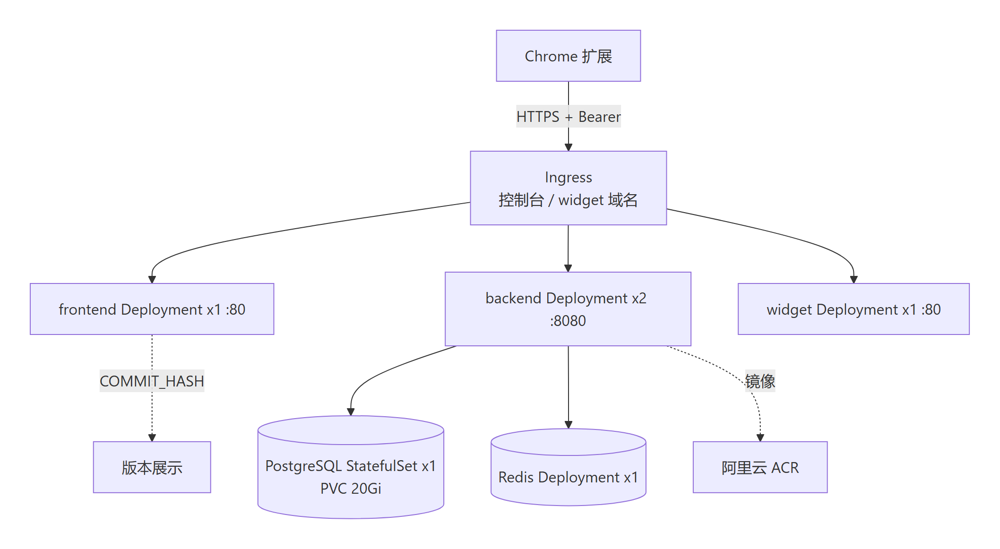

关键点：

- 两个后端副本、无会话亲和：所有运行时状态必须持久化。
- SSE 断线通过 `agent_timeline` 的 `afterSeq` 补齐。
- PG / Redis 单实例；`local-path` 存储不能跨节点漂移。
- 中间件镜像需同步到 ACR。

### 3.3 关键机制

| 机制 | 实现 | 解决的问题 |
|---|---|---|
| 异步 run | 请求线程只创建 run 并返回 `{runId}`；执行在虚拟线程 | 长任务不占 Tomcat 线程 |
| 单写者 | 一个 run 只由执行它的副本写入 | 不需要分布式状态机 |
| 挂起 / 恢复 | pending 记录 + 内存定时器 + cron 补偿 + CAS claim | 不占线程、可跨重启、并发只恢复一次 |
| 多副本协调 | Redisson 锁：清理、技能同步、pending wait、router | 同一任务不会重复执行 |
| 租户上下文 | `InheritableThreadLocal`；后台线程入口清理租户/认证 | 防止租户串线 |
| 事件解耦 | Spring 本地事件 | 打破 kernel → orchestration 循环 |
| 模型容错 | ProviderStrategy + 路由回退 + 退避 | 供应商抖动不拖垮整批任务 |
| 流式一致性 | SSE 增量 + 持久化时间线 + `afterSeq` | 断线与多端一致 |
| 上下文水位 | HistoryLoader + 压缩 + 工具结果压缩 | 防止上下文爆炸 |
| 渠道事件管线 | 先落 thread/event/delivery；Group Router + Agent Router + Worker 调度 | Webhook 重试幂等；路由与执行可分别扩展 |
| 外发 outbox | persist-then-send + 退避重试 + 幂等键 | 渠道失败不丢回复 |
| IM 流 | 独立 IM SSE + 按会话读游标 | 消息投递独立于 Agent 时间线 |

### 3.4 关键技术决策

| 问题 | 决策 | 代价 |
|---|---|---|
| 工具必须快速返回，但等待可能几分钟 | `wait` 挂起而不是 sleep | 两条唤醒路径 + 状态机 |
| “没调工具”语义二义 | 三分支判据 + `finish` + `finish_reason` | 模型必须学会调 `finish` |
| 轮次预算在多次重入间漂移 | 持久化 `loop_count` 与 `loop_limit`，`PINNED` 优先 | 额外字段与幂等写 |
| 上下文爆炸 | 分层压缩 + 历史重建 | 压缩本身消耗 Token |
| 逻辑删除 vs 硬删除 | 会话清理是唯一硬删除，按 FK 顺序 | 删除顺序硬编码 |
| 两副本、无亲和 | 状态全持久化；SSE 补齐 | 实时性略降 |
| 供应商参数差异 | 按 `company` 选策略，不做模型名猜测 | 每个厂商一个实现 |
| 数字员工需要路由 + 执行 | 每个 Super Agent 一个 Router 实例 + 一个 Worker 实例 | 两套 Prompt 与运行时 |
| 渠道事件可能重试 | 先落库 + delivery 幂等 + 工作项 CAS | 更多调度表与状态 |
| IM 与 Agent 历史不同 | IM 表与 Agent 时间线分离，通过 id 关联 | 两套保留策略 |

### 3.5 可观测性

| 层 | 载体 | 用途 |
|---|---|---|
| 请求 | `TraceIdFilter` + `ControllerLogAspect` | 串起一次 HTTP 调用 |
| 用户 | `agent_timeline` | 用户可见执行轨迹；SSE 补齐来源 |
| 模型 | `agent_llm_interaction_record` | 原始请求/响应/推理；`prompt_tokens IS NULL AND duration_ms < 1000` = 供应商秒回错误 |
| 审计 | `sys_audit_log` + `*_run` 表 | 管理动作与后台任务轨迹 |
| Super Agent | `agent_work_item`, `agent_outbound_message`, `agent_watchdog_run` | 路由、派发与投递可见性 |
| IM | `im_message`, `im_read_cursor` | 会话投递与已读状态 |

日志级别：`com.buukle` DEBUG；`*.repository` 与 `com.buukle.agent.capability` WARN。

### 3.6 交付流水线

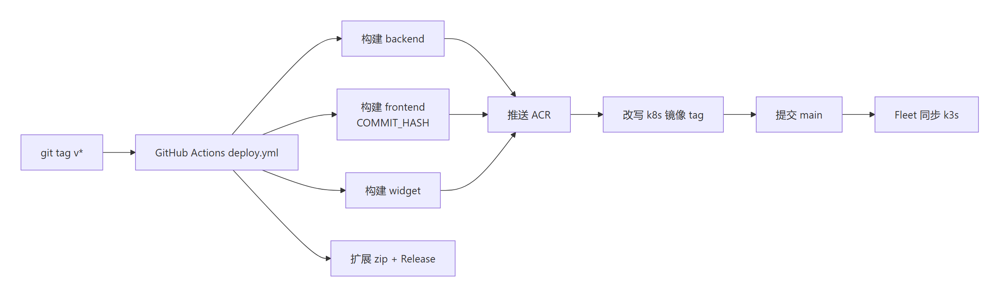

本地等价：`.local-workflow/deploy.sh`（`--dry-run` / `--skip-existing` / `--only`）。

### 3.7 技术债与风险

| 项 | 影响 |
|---|---|
| 无测试 CI | 依赖本地 `mvn test` / `biome` / `jest` 纪律 |
| PG 单实例、20Gi local-path | 无高可用；增长靠清理任务控制 |
| SSE 事件缓存在进程内 | 跨副本补齐只能回源 DB |
| `agent_llm_interaction_record` 很大 | 清理走硬删除；磁盘需 `VACUUM FULL` 才回收 |
| 定时任务未交付 | `/periodic-tasks` 是占位页 |
| 扩展/widget 未与后端版本锁定 | 发布顺序需人工保证 |
| Super Agent 依赖多条调度链 | Group Router / Agent Router / Worker / Outbound / Watchdog 都要健康 |
| 渠道投递是 at-least-once | 消费方必须容忍重复回复；幂等键只能降低概率 |
| IM 与 Agent 时间线分离 | 跨域排查需要按 conversation/session id 关联 |

---

## 4. 数据架构

### 4.1 存储拆分

| 存储 | 内容 | 原因 |
|---|---|---|
| PostgreSQL | 业务表、时间线、原始 LLM 交互、IM 消息 | 强一致、`jsonb`、行级权限 |
| Redis（Redisson） | 缓存、分布式锁、限流、部分运行时状态 | 多副本共享；必须走 Redisson |
| 文件存储 | `agent_file_store`、文档、产物、截图 `fileKey` | 大对象不落库 |
| 浏览器 `sessionStorage` | Widget Token | 跨站嵌入不共享 Cookie |

### 4.2 数据域

| 域 | 核心表 |
|---|---|
| Agent 配置 | `agent_instance`, `agent_instance_capability` |
| 会话运行时 | `agent_session`, `agent_run`, `agent_sub_agent_run`, `agent_timeline`, `agent_tool_call_record`, `agent_session_todo`, `agent_pending_clarification`, `agent_pending_wait`, `agent_user_in_loop_record` |
| 模型与记忆 | `agent_model_provider`, `agent_model_route`, `agent_api_key`, `agent_llm_interaction_record`, `agent_compact_record`, `agent_memory` |
| 能力供给 | `capability_mcp`, `capability_skill`, `capability_skill_sync_run`, `capability_cli` |
| 任务与补全 | `agent_task`, `agent_task_artifact`, `agent_completions`, `agent_completions_call`, `agent_completions_prompt` |
| Super Agent / 渠道 | `agent_super_agent`, `agent_channel_binding`, `agent_thread`, `agent_event`, `agent_event_delivery`, `agent_thread_subscription`, `agent_work_item`, `agent_outbound_message`, `agent_watchdog_run` |
| IM | `im_conversation`, `im_conversation_setting`, `im_message`, `im_participant`, `im_read_cursor` |
| 平台治理 | `agent_user`, `agent_sso_identity`, `agent_identity_provider`, `sys_role`, `sys_permission`, `sys_role_permission`, `sys_user_role`, `sys_audit_log`, `agent_system_config`, `agent_session_cleanup_run` |
| 内容 | `agent_file_store`, `agent_document` |

### 4.3 ER 模型

> Schema 只有 **两个物理外键**：`agent_run.session_id → agent_session`、`agent_task_artifact.task_id → agent_task`。其他关系都是应用层维护的逻辑 `*_id` 关联。

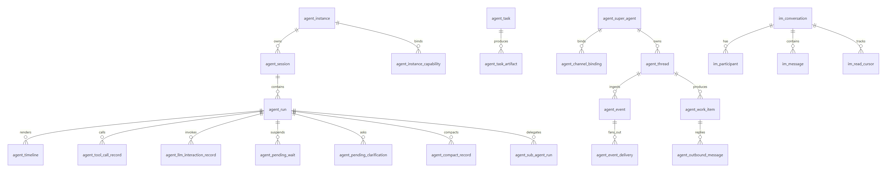

`capability_mcp` / `capability_cli` 通过 `agent_instance_capability(capability_type, capability_id)` 多态绑定，没有外键。

### 4.4 数据流

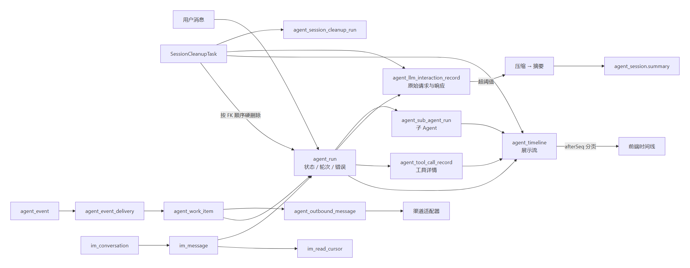

关键特征：

1. 一个 run 写多张表：状态、展示、工具详情、原始 LLM 交互。
2. 时间线合并 SSE 增量与分页查询；前端按 `seq` 去重（子 Agent 行 `seq < 0`）。
3. 压缩链路：历史超阈值 → 压缩记录 → 会话摘要 → 后续 run 重建上下文。
4. 清理任务每轮都记录，包括 dry run。
5. 渠道事件走 delivery → work item → run → outbound；IM 消息独立但可触发 run。

### 4.5 数据治理

| 规则 | 说明 |
|---|---|
| 逻辑删除 | 所有表带 `delete_flag`；会话清理是唯一硬删除 |
| 通用列 | `status`、`remark`、`created_by`、`updated_by`、`created_at`、`updated_at` |
| 多租户 | `tenant_id` + `created_by`；行级拦截器给 SELECT 追加 `created_by` |
| 迁移 | 149 个 Flyway 版本；已应用不可改，只追加 |
| 大表 | `agent_llm_interaction_record` 与 `agent_timeline` 是增长主力 |
| 磁盘回收 | 硬删除只释放 PG 内部空间；文件系统需 `VACUUM FULL` |
| 索引 | 清理依赖 `agent_session(delete_flag, created_at)`、`agent_task(session_id)` |
| 事件幂等 | 入站事件/delivery 按来源键去重；工作项通过 CAS 领取 |
| 外发 outbox | 外发消息先落库后发送；重试复用同一幂等键 |
| 保留策略 | Super Agent 的 thread/event/work item/outbound 行按保留任务清理 |

---

## 5. 4A 对照矩阵

| 业务能力 | 应用落点 | 数据落点 | 技术手段 |
|---|---|---|---|
| 配置 Agent | `InstanceController → InstanceService` | `agent_instance`, `agent_instance_capability` | MyBatis-Plus + 行级权限 |
| 进行一次对话 | `ChatRuntimeController → ChatRuntimeService → SessionRunner` | `session / run / timeline / tool_call_record` | 虚拟线程 + SSE |
| 等待人工回答 | `SessionRunner` 挂起 → `ChatRuntimeService.resume` | `agent_pending_clarification` | CAS claim + 两条唤醒路径 |
| 等待一段时间 | `wait` 工具 → `PendingWaitWakeScheduler` | `agent_pending_wait` | 内存定时器 + cron 补偿 |
| 让 Agent 使用工具 | `ContextPreparer.resolveTools → ToolExecutor → SPI` | `capability_*`, `agent_tool_call_record` | Java SPI + MCP + FiberSet |
| 让 Agent 看/点网页 | 扩展 → `/api/v1/chrome` | `agent_file_store`, `agent_timeline` | CDP + content script |
| 业务需要结构化结果 | `TaskController` → execute/extract/refine | `agent_task`, `agent_task_artifact` | 异步轮询 + JSON Schema |
| 切换模型 / 降级 | `RouteController → ModelProviderService` | `agent_model_provider / route / api_key` | ProviderStrategy + 回退 |
| 谁能用什么 | `@RequirePermission` + `AuthInterceptor` | `sys_user / role / permission` | RBAC + `created_by` |
| 单点登录 | `SsoAuthController` | `agent_identity_provider`, `agent_sso_identity` | OIDC + PKCE + JWKS |
| 事后追责 | `AuditLogController`, `TimelineRecorder` | `sys_audit_log`, `agent_timeline` | AOP + 事件漏斗 |
| 运行数字员工 | `SuperAgentController → SuperAgentService` | `agent_super_agent` + Router/Worker 实例 | Router + Worker 拆分 |
| 接入渠道消息 | `ChannelWebhookController → EventIngestService` | `agent_thread`, `agent_event`, `agent_event_delivery` | 幂等 ingest + Channel SPI |
| 路由并执行工作项 | `GroupRouterScheduler → AgentRouterScheduler` | `agent_work_item` | 相关性路由 + CAS |
| 回复渠道 / IM | `OutboundDispatchScheduler` / `ImMessageService` | `agent_outbound_message`, `im_message` | Outbox + SSE |

---

## 6. 快速开始

前置条件：JDK 21、Maven、Node.js >= 20、PostgreSQL、Redis。

```bash
# 后端
mvn install -DskipTests
mvn -pl agent-sphere-bootstrap spring-boot:run -am

# 管理端（:8000，/api 代理到 :8080）
cd agent-sphere-ui
npm run dev

# Widget（:5173）
cd agent-sphere-copilot-widget
npm run dev
```

产品入口：

- `http://127.0.0.1:8000/**` — Agent 运营管理平台（不含 `/admin/**` 与 `/workspace`）
- `http://127.0.0.1:8000/admin/**` — 系统管理
- `http://127.0.0.1:8000/workspace` — Super Agent 产品

扩展：打开 `chrome://extensions`，开启开发者模式，加载未打包的 `agent-sphere-chrome-extension/` 目录。

后端测试不需要 DB/Redis：

```bash
mvn test
```

---

## 7. 仓库地图

```text
agent-sphere/                  后端（Java/Maven）
agent-sphere-ui/               管理端（React/Umi）
agent-sphere-copilot-widget/   可嵌入 widget
agent-sphere-chrome-extension/ Chrome MV3 扩展
k8s/                           k3s 清单
.github/workflows/             CI/CD
.local-workflow/               本地构建/部署脚本
examples/                      集成示例
```

项目规则：

- `AGENTS.md`
- `agent-sphere/AGENTS.md`
- `agent-sphere-ui/AGENTS.md`
- `agent-sphere-copilot-widget/AGENTS.md`
- `agent-sphere-chrome-extension/AGENTS.md`

---

## 8. 开发与验证

| 项目 | 验证方式 |
|---|---|
| 后端 | `mvn test` |
| 管理端 | `npm run biome` → `npm run lint` → `npm test` |
| Widget | `npm run typecheck` → `npm test` |
| 扩展 | `vm.Script` 语法检查 + 手工 smoke test |

修改任一项目前，先读对应的 `AGENTS.md`。其中包含魔法值、枚举、方法行数、分层、测试与运行时不变量的强制规则。

---

## 许可证

见 [LICENSE](LICENSE)。

---

## 联系方式


微信扫码添加好友。
